# Arquitetura Multiciclo — Filtro Sobel

| Campo | Valor |
|---|---|
| **Versão** | 2.0 (reescrita completa) |
| **Data** | 2026-11-07 |
| **Status** | RTL implementado e verificado em simulação. Síntese caracterizada no Cyclone V, **pendente de re-síntese** (ver §9). Gate formal em `docs/AUDITORIA_01_PRE_MULTICICLO.md` |
| **Evidência de referência** | Suíte Icarus: 79 passed. Cobertura (Verilator 5.054): code 425/426, toggle 3596/3599. Frame 640×480×2: golden OK, `o_status=000` |

> **Convenção de honestidade.** Todo número tem fonte (teste, relatório ou documento do projeto). O que é inferência está marcado como **[inferência]**; o que não foi verificado, como **[não verificado]**.

---

## Sumário

1. [Visão geral](#1-visão-geral)
2. [Arquitetura do sistema](#2-arquitetura-do-sistema)
3. [FSM de controle](#3-fsm-de-controle-mac_control_fsm)
4. [Módulos comuns](#4-módulos-comuns-compartilhados-pelas-3-arquiteturas)
5. [Módulos específicos do multiciclo](#5-módulos-específicos-da-arquitetura-multiciclo)
6. [Timing e latência](#6-timing-e-latência)
7. [Gerenciamento de borda](#7-gerenciamento-de-borda)
8. [Verificação](#8-verificação)
9. [Síntese e constraints](#9-síntese-e-constraints)
10. [Checklist](#10-checklist-de-implementação)
11. [Pendências](#11-estado-e-pendências)
12. [Notas metodológicas (pegadinhas de ferramenta)](#12-notas-metodológicas-pegadinhas-de-ferramenta)
13. [Registro de bugs reais](#13-registro-de-bugs-reais-encontrados-por-execução)
14. [Referências](#14-referências)

---

## 1. Visão geral

A arquitetura **multiciclo** reutiliza **uma única** unidade MAC para calcular, sequencialmente, os gradientes Gx e Gy de cada janela 3×3. É a arquitetura de **menor área**: o `mac_unit` não contém multiplicador, pois os coeficientes do Sobel são apenas `{±1, ±2}` e a multiplicação vira deslocamento mais negação.

### 1.1 Características principais

| Métrica | Valor | Origem |
|---|---|---|
| **Throughput estacionário** | 1 pixel / **16 ciclos** | Modelo medido (§6.2) |
| **Ciclos úteis da FSM** | 15 (`S_LOAD_WIN` a `S_OUTPUT`) | `test_cycle_timing` |
| **Frame 640×480** | ≈ 4,92 M ciclos ≈ 49 ms @ 100 MHz ≈ 20 fps | Calculado do modelo; **não** medido em hardware |
| **ALMs** (Cyclone V 5CSEMA5F31C6) | 4.601 / 32.070 (14%) | `.fit.rpt` |
| **Registradores** | 6.270 | `.fit.rpt` |
| **DSPs** | **0** (por construção, §5.1) | `.fit.rpt` |
| **M10K** | 3 (2 desperdiçados em `skid_fifo2`) | `.fit.rpt` |
| **Fmax** | 98,05 MHz (slow 1100 mV 85 °C); slack −0,199 ns contra 100 MHz | `.sta.rpt` |

> **Ressalvas.**
> - As projeções antigas deste documento (≈200 LUTs, 1 DSP, ≈250 MHz em Artix-7) foram **removidas**: nunca foram medidas e contradiziam o §5.1 (0 DSPs).
> - Os números do Quartus são **anteriores** à correção read-during-write de `mem1` (o relatório mostra `mem1` com 640×9; o RTL atual tem profundidade W+1). **[inferência]** A re-síntese deve alterar levemente os recursos.
> - Os 16 ciclos/pixel equivalem a 1 ciclo em `S_IDLE` mais os 15 úteis. **[inferência]** derivada da FSM e consistente com a medição (delta 0 em 640×480×2).

### 1.2 Fluxo de dados resumido

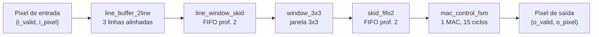

---

## 2. Arquitetura do sistema

### 2.1 Diagrama de blocos

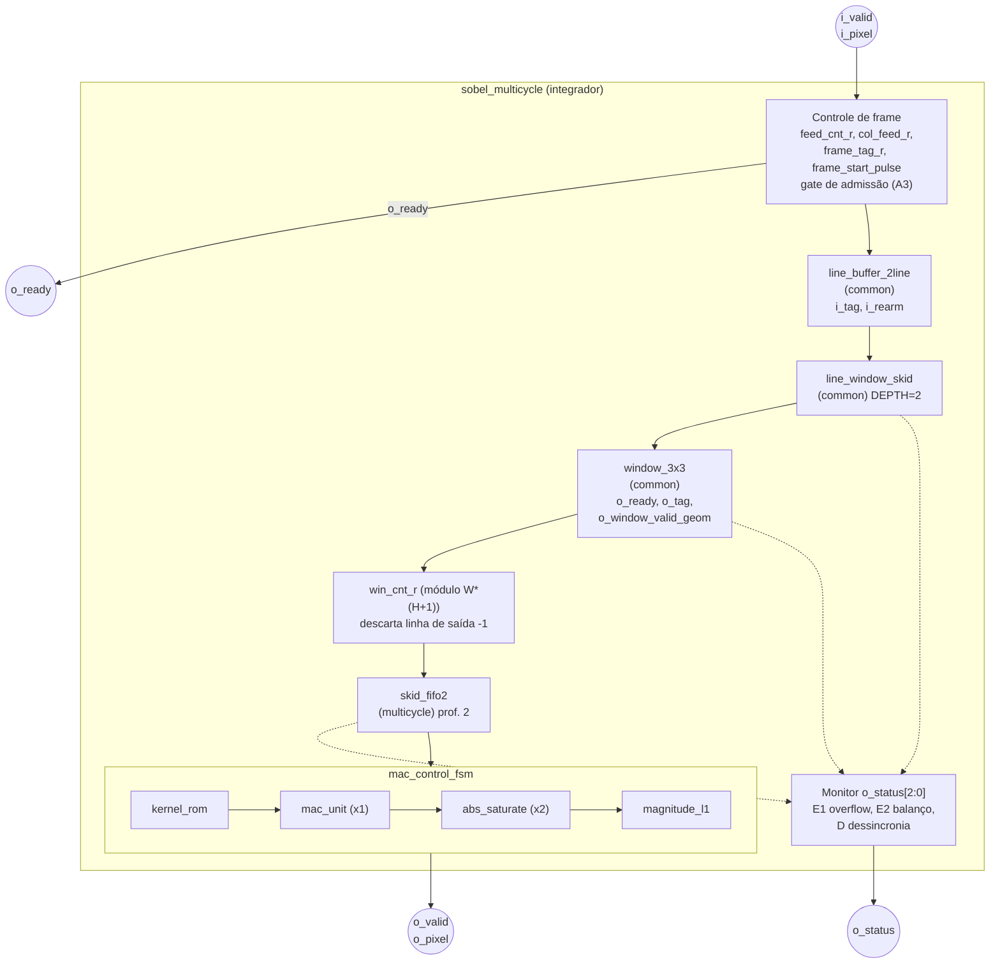

### 2.2 Hierarquia de módulos

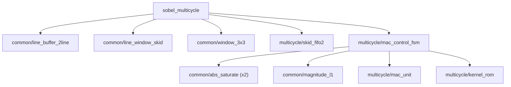

Um módulo só vai para `common/` se seu comportamento for **estritamente idêntico** nas três arquiteturas.

### 2.3 Interface externa de `sobel_multicycle`

| Porta | Sentido | Descrição |
|---|---|---|
| `clk`, `rst_n` | in | Clock e reset **assíncrono ativo-baixo** |
| `i_valid`, `i_pixel` | in | Pixel de entrada (8 bits) |
| `o_ready` | out | `1` = o módulo aceita o pixel neste ciclo |
| `o_valid`, `o_pixel` | out | Pixel de saída (magnitude L1 saturada). **Sem `ready` na saída**: o consumidor deve capturar `o_valid` no mesmo ciclo |
| `o_status[2:0]` | out | Monitor sticky de integridade (§5.5) |

**Contrato A de entrada.** A transferência ocorre quando `i_valid && o_ready` no mesmo ciclo. O produtor pode levantar `i_valid` e **manter** `i_valid`/`i_pixel` estáveis até ver `o_ready=1`. `o_ready` não depende de `i_valid`. Pulsar `i_valid` ignorando `o_ready` **perde o pixel em silêncio** (medido: `o_status=000` mesmo com 80 de 96 pixels perdidos no pior caso). Este requisito deve constar da especificação da interface MMIO.

---

## 3. FSM de controle (`mac_control_fsm`)

### 3.1 Estados (16, enum de 5 bits)

```mermaid
stateDiagram-v2
    direction LR
    [*] --> S_IDLE
    S_IDLE --> S_IDLE : sem i_valid
    S_IDLE --> S_LOAD_WIN : i_valid (captura win_reg)
    S_LOAD_WIN --> S_MAC_GX_0
    S_MAC_GX_0 --> S_MAC_GX_1
    S_MAC_GX_1 --> S_MAC_GX_2
    S_MAC_GX_2 --> S_MAC_GX_3
    S_MAC_GX_3 --> S_MAC_GX_4
    S_MAC_GX_4 --> S_MAC_GX_5
    S_MAC_GX_5 --> S_SAVE_GX
    S_SAVE_GX --> S_MAC_GY_0
    S_MAC_GY_0 --> S_MAC_GY_1
    S_MAC_GY_1 --> S_MAC_GY_2
    S_MAC_GY_2 --> S_MAC_GY_3
    S_MAC_GY_3 --> S_MAC_GY_4
    S_MAC_GY_4 --> S_MAC_GY_5
    S_MAC_GY_5 --> S_OUTPUT
    S_OUTPUT --> S_IDLE
```

| Estado | Código | Função |
|---|---|---|
| `S_IDLE` | 0 | Aguarda `i_valid`. `o_ready = 1` só aqui. Captura `win_reg` na saída |
| `S_LOAD_WIN` | 1 | Folga de 1 ciclo para o `i_clear` do `mac_unit` assentar |
| `S_MAC_GX_0..5` | 2..7 | 6 passos de MAC do Gx |
| `S_SAVE_GX` | 8 | Salva Gx em `gx_result_r` e zera o acumulador |
| `S_MAC_GY_0..5` | 9..14 | 6 passos de MAC do Gy |
| `S_OUTPUT` | 15 | `o_valid = 1`. Resultado combinacional |

**Ciclos úteis por pixel:** LOAD_WIN (1) + MAC_GX (6) + SAVE_GX (1) + MAC_GY (6) + OUTPUT (1) = **15**. Com o ciclo em `S_IDLE`, o período mínimo entre pixels é **16**.

Os estados `S_ABS`, `S_ADD` e `S_SATURATE` de versões anteriores foram **eliminados**: `abs_saturate` e `magnitude_l1` são combinacionais e o valor já está pronto em `S_OUTPUT`.

### 3.2 Taps não nulos (pulando coeficientes zero)

| Kernel | Posições na janela (linha-major, 0..8) | Coeficientes |
|---|---|---|
| **Gx** | 0, 2, 3, 5, 6, 8 | −1, +1, −2, +2, −1, +1 |
| **Gy** | 0, 1, 2, 6, 7, 8 | −1, −2, −1, +1, +2, +1 |

Seis taps por kernel (uma versão antiga deste documento dizia 5 para Gx; era erro). Valores cross-validados por dedução manual e por uma especificação externa independente (`Gx=(c+2f+i)−(a+2d+g)`).

### 3.3 Arcos

17 arcos (IDLE→IDLE, IDLE→LOAD, 14 sequenciais, OUTPUT→IDLE), todos observados por `test_fsm_state_arc_coverage` (16/16 estados, 17/17 arcos, validado por mutação).

---

## 4. Módulos comuns (compartilhados pelas 3 arquiteturas)

### 4.1 `line_buffer_2line.sv`

**Interface**

```systemverilog
module line_buffer_2line #(
    parameter int DATA_WIDTH = 8,
    parameter int IMG_WIDTH  = 8
)(
    input  logic                  clk,
    input  logic                  rst_n,
    input  logic                  i_valid,
    input  logic [DATA_WIDTH-1:0] i_pixel,
    input  logic                  i_tag,        // tag de proveniência (1 bit), passthrough em lockstep
    input  logic                  i_rearm,      // pulso no 1º pixel de cada frame
    output logic                  o_valid,
    output logic [DATA_WIDTH-1:0] o_curr,
    output logic [DATA_WIDTH-1:0] o_line1,      // linha y-1
    output logic [DATA_WIDTH-1:0] o_line2,      // linha y-2
    output logic                  o_curr_tag,
    output logic                  o_line1_tag,
    output logic                  o_line2_tag
);
```

**O que faz.** A partir de um stream 1D (1 pixel por ciclo com `i_valid=1`), entrega alinhadas na mesma coluna 3 amostras de linhas diferentes: a que chega agora (`o_curr`), 1 linha atrás (`o_line1`) e 2 linhas atrás (`o_line2`). Não tem noção de fim de linha ou de frame: apenas atrasa o stream em `IMG_WIDTH` e `2·IMG_WIDTH` pulsos de `i_valid`.

**Estrutura.**

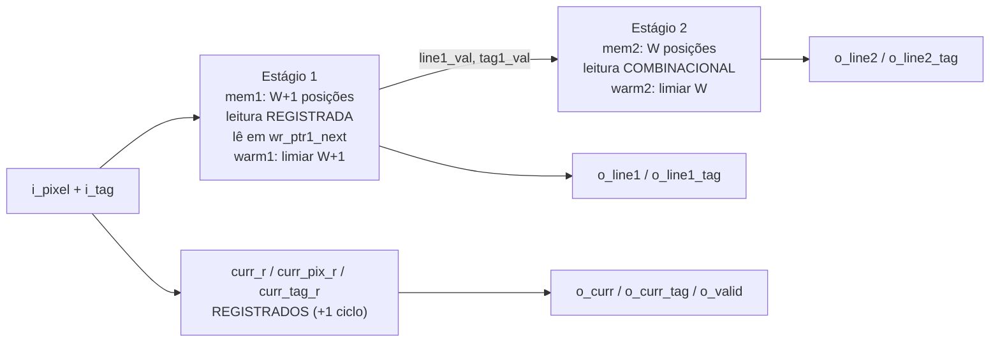

**Decisões e justificativas.**

1. **FIFO circular (memória + ponteiro), não shift-register de W flip-flops.** O shift-register custa O(W) FFs. O padrão "endereço + array" é o que a síntese mapeia para BRAM.
2. **Zero-padding por contador de aquecimento**, não por reset de memória. BRAM real não zera instantaneamente. O contador (`warmup1_cnt_r`, `warmup2_cnt_r`) só libera a saída depois que a posição foi escrita; antes disso a saída é forçada a 0.
3. **Estágios assimétricos.** O estágio 1 usa leitura registrada (limiar `IMG_WIDTH+1`). O estágio 2 usa leitura combinacional (limiar `IMG_WIDTH`): o dado que ele escreve já vem de um registro do estágio 1, e registrar também a leitura do estágio 2 acumularia latência (`2W+1` em vez de `2W`).
4. **Tag empacotada na mesma palavra** do pixel (`mem1`/`mem2` com DATA_WIDTH+1 bits). A tag sofre o mesmo atraso por construção, reaproveitando o endereçamento já validado.

**Evolução posterior (correção do F-16, Alternativa 1 completa) — estado atual do RTL.**

1. **`o_curr`, `o_curr_tag` e `o_valid` são registrados.** `curr_r` acompanha `i_valid` incondicionalmente. `curr_pix_r`/`curr_tag_r` só atualizam sob `if (i_valid)`. Antes, `o_curr` era *wire* puro e `o_line1`/`o_line2` tinham 1 ciclo a mais de latência efetiva em todo ciclo de regime permanente: essa assimetria era a causa raiz do F-16. Confirmado por `test_curr_latency_confirmation` (saída travada durante 4 ciclos de gap). Custo: +1 ciclo de latência e necessidade do `line_window_skid` (§4.2).
2. **`mem1` com profundidade `IMG_WIDTH+1`, lendo em `wr_ptr1_next`.** Elimina a colisão de leitura e escrita no mesmo endereço (aviso 276027 do Quartus: o M10K do Cyclone V não garante "old data"). O atraso continua `IMG_WIDTH` (`test_slot_extra_preserves_delay`; `test_line_buffer_depth` para W ∈ {2, 3, 4, 5, 8, 16, 640}). **W=1 não é suportado** (`$clog2(1)=0`).
3. **`i_rearm`**: carrega `warmup1_cnt_r`/`warmup2_cnt_r` com **1** (conta o próprio pulso, Alternativa A) e `warm1`/`warm2` têm `&& !i_rearm` (B1). O zero-padding da borda superior se repete a cada frame (Alternativa 3-C).
4. **Contrato de `i_tag`:** deve permanecer **estável** em qualquer ciclo, válido ou não (`tag1_val`/`tag2_val` leem `i_tag` ao vivo no ramo não aquecido). `sobel_multicycle` cumpre isso via `frame_tag_r`. Decisão registrada: documentar o contrato em vez de registrar `i_tag` internamente, para não reintroduzir a classe de risco (mais um registrador com latência própria) que o F-16 expôs.

> **Dívida de comentário.** O bloco "CONTRATO DE SÍNTESE — read-before-write" no RTL descreve a versão anterior; o código atual não lê o endereço escrito. A atualização do comentário é tarefa separada, sem alteração de lógica.

| Alternativa considerada | Por que foi descartada |
|---|---|
| Shift-register de `IMG_WIDTH` flip-flops | O(W) FFs; não escala para imagens reais |
| Leitura combinacional nos 2 estágios | Atraso total `2W−2`. Testado e rejeitado |
| Leitura registrada nos 2 estágios | Atraso total `2W+1`. Testado e rejeitado |
| Resetar a memória inteira no reset | Não é como BRAM real se comporta |
| Ler e escrever o mesmo endereço (read-during-write) | M10K não garante "old data"; indefinido em hardware. Substituído por slot extra e leitura em `wr_ptr1_next` |
| `WarmThresh = IMG_WIDTH` para corrigir o F-16 | Testado e revertido: reintroduz leitura de `X` (memória não escrita) |
| Registrar `i_tag` internamente (Opção B) | Reintroduz a categoria de risco que o F-16 eliminou. Preferido documentar o contrato (Opção A) |
| **Estágio 1 registrado + estágio 2 combinacional (escolhida)** | Fecha em exatamente `2W` ciclos, validado |

### 4.2 `line_window_skid.sv`

FIFO síncrona de **profundidade 2** entre `line_buffer_2line` e `window_3x3`. Absorve o descompasso de 1 ciclo introduzido pelo registro de `o_curr`: sem ela, o `o_ready` de `window_3x3` deste ciclo não pode mais liberar o `i_valid` do mesmo ciclo, porque decisão de aceite e chegada do dado deixam de coincidir.

**Interface.** `i_push`, payload `{curr, line1, line2, 3 tags}`, `i_downstream_ready`; saídas `o_room`, `o_valid`, os 6 campos e `o_overflow`.

**Decisões.**

- **Contador de ocupação** (`count_r`) como única fonte de cheio/vazio. A comparação `wr_ptr == rd_ptr` é ambígua para profundidade ≥ 2.
- **`o_room` (fórmula v2):** `(count_r + i_push − pop) < DEPTH`, considerando o `pop` do mesmo ciclo.

  | Fórmula | DEPTH=1 | DEPTH=2 | DEPTH=3 |
  |---|---|---|---|
  | v1: `count_r + i_push < DEPTH` | 146 ciclos | 75 | 57 |
  | **v2: `count_r + i_push − pop < DEPTH`** | 99 | **57 (teto)** | 57 |

  (ciclos no cenário de reprodução isolada; todas as combinações com 0 divergências de conteúdo e sem overflow).
- **Mantido separado de `skid_fifo2`**, apesar da semelhança. As profundidades respondem perguntas diferentes, medidas em pontos diferentes do pipeline; coincidir em 2 é acaso. Reabrir `skid_fifo2` (fechado e em uso) sem necessidade funcional contraria CLAUDE.md §15.10/15.11.
- **Diferença sinalizada em relação a `skid_fifo2`:** este módulo **não protege a escrita** contra overflow. Emite `o_overflow` e `$error`; o contrato é cumprido por quem gateia `i_push` via `o_room`. Endurecer isso é melhoria possível, **não feita**.

**Testes:** `test_line_window_skid.py` (5 corrotinas no executor normal; `test_overflow_contract_violation` no executor dedicado, `expect_errors=1`).

### 4.3 `window_3x3.sv`

**Interface**

```systemverilog
module window_3x3 #(
    parameter int DATA_WIDTH = 8,
    parameter int IMG_WIDTH  = 8
)(
    input  logic                    clk,
    input  logic                    rst_n,
    input  logic                    i_valid,
    input  logic [  DATA_WIDTH-1:0] i_curr,
    input  logic [  DATA_WIDTH-1:0] i_line1,
    input  logic [  DATA_WIDTH-1:0] i_line2,
    input  logic                    i_curr_tag,
    input  logic                    i_line1_tag,
    input  logic                    i_line2_tag,
    output logic                    o_ready,              // = !phantom_pending_r (trava ativa)
    output logic                    o_valid,
    output logic [9*DATA_WIDTH-1:0] o_window,             // vetor achatado, linha-major
    output logic                    o_tag,                // tag da linha central (i_line1)
    output logic                    o_window_valid_geom   // 1 = as 9 tags da janela são iguais
);
```

**O que faz.** Monta a janela deslizante 3×3 com zero-padding nas bordas esquerda e direita. A janela emitida está **centrada na linha de `i_line1`**; `i_curr` é o "olhar à frente" que completa a vizinhança abaixo.

**Layout de `o_window`.** 9 fatias de DATA_WIDTH bits, MSB→LSB, ordem linha-major `k = 3·linha + coluna`: `o_window[(9-k)*DATA_WIDTH-1 -: DATA_WIDTH]`. Um vetor achatado (e não array 2D) porque Icarus+cocotb não indexam portas de array 2D *unpacked* via VPI.

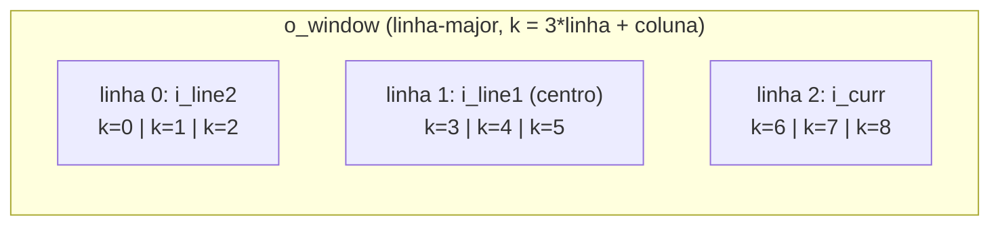

**Borda esquerda — refeita a cada linha.** Cada linha tem seu shift-register de 3 posições. O reset zera apenas uma vez; nas linhas seguintes o último pixel da linha anterior vazaria como vizinho esquerdo. Por isso, quando `col_cnt_r == 0`, as 2 posições mais antigas são **forçadas a 0**.

**Borda direita — ciclo fantasma.** Quando `col_cnt_r == IMG_WIDTH-1`, no ciclo seguinte desliza-se um zero para dentro dos 3 shift-registers, mesmo sem pixel novo. Isso gera a W-ésima janela da linha.

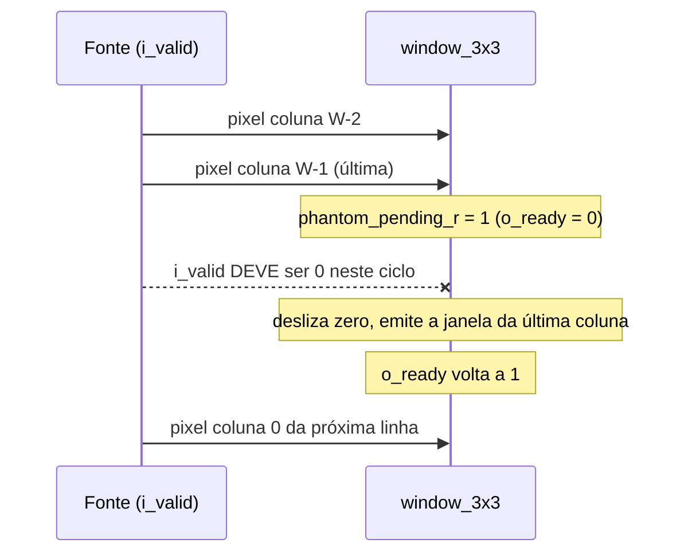

**Contrato de interface.** A fonte deve inserir ≥ 1 ciclo de gap (`i_valid=0`) entre linhas. A forma correta de nunca violar isso é **respeitar `o_ready`** (nunca `i_valid=1` com `o_ready=0`), sem calcular o gap externamente. O `$error` de simulação (em `translate_off/on`) detecta a violação. `o_ready` reaproveita um sinal existente: **nenhum flip-flop novo**.

**Tags (Alternativa 3-B).** 3 shift-registers de tag espelham os de pixel posição a posição. `o_window_valid_geom` vale 1 quando as 9 tags são iguais (truque: AND de todos == OR de todos). O ciclo fantasma e o padding da 1ª coluna **herdam a tag real** da amostra; um `1'b0` fixo foi um **bug real** encontrado por execução (falso `geom=0` nas 2 primeiras colunas de toda linha quando a tag do frame era 1). Como a 3-C elimina a contaminação na fonte, `o_window_valid_geom` é hoje só **rede de segurança** (medido: 0 janelas reais com `geom=0`).

**Fora de escopo.** Não trata a borda inferior do frame (exigiria conhecer `IMG_HEIGHT`). É responsabilidade de `sobel_multicycle` (§5.5).

> **F-18 — testes ausentes.** O arquivo `tb_python/test_window_3x3.py` atual tem 6 corrotinas: `test_reset_state`, `test_geometry_with_zero_padding`, `test_contract_violation_detected`, `test_o_tag_reflects_center_row`, `test_window_valid_geom_detects_vertical_frame_boundary` e `test_phantom_cycle_does_not_spuriously_invalidate_geom`. Os testes `test_multiple_gap_cycles`, `test_sustained_contract_violation_detected` e `test_ready_gating_prevents_manual_gap_calculation`, descritos em versões anteriores deste documento, **não estão no arquivo**. O histórico git mostra que foram removidos no commit `d5aa31a` ("Corrigido line_buffer e window_3x3"), após terem sido adicionados em `6fb6d71`. Restaurá-los (por exemplo, com `git show d5aa31a^:tb_python/test_window_3x3.py`) e adaptá-los às portas de tag é pendência registrada (§11).

| Alternativa considerada | Por que foi descartada |
|---|---|
| Array 2D na porta | Não indexável via VPI (Icarus+cocotb) |
| Resetar os shift-registers só no power-up | Só vale para a 1ª linha; as seguintes vazam o último pixel como vizinho esquerdo |
| Backpressure completo próprio (handshake real) | Adiado como over-engineering; resolvido depois de forma mínima por `o_ready` |
| Tratar a borda inferior aqui | Exigiria conhecer `IMG_HEIGHT`, acoplando o módulo à geometria do frame |
| Tag de 1 bit `0` fixa no padding | Bug real: derruba `o_window_valid_geom` (a tag não tem "valor neutro") |

### 4.4 `abs_saturate.sv`

```systemverilog
module abs_saturate #(
    parameter int IN_WIDTH  = 11,
    parameter int OUT_WIDTH = 8
)(
    input  logic signed [IN_WIDTH-1:0]  i_value,
    output logic        [OUT_WIDTH-1:0] o_value
);
```

Calcula `|i_value|` e satura em `2^OUT_WIDTH − 1`. Puramente combinacional (função pura), instanciada 2× (Gx e Gy).

- **Extensão de 1 bit antes de negar.** O valor mais negativo (ex.: −1024 em 11 bits) não tem positivo na mesma largura. No uso real (±1020) esse extremo nunca ocorre, mas o módulo é genérico e trata o caso. Testado em `IN_WIDTH=4` (−8) e, desde a Fase 4, também na largura real (`test_most_negative_input_at_project_width`, −1024).
- **Bug real #2.** Os sinais internos foram dimensionados só com `IN_WIDTH+1` bits; com `IN_WIDTH=4, OUT_WIDTH=8` o valor 255 era truncado e gerava `X`. Correção: largura interna = `max(IN_WIDTH+1, OUT_WIDTH)`. Lição: parâmetros que funcionam em uma combinação não provam correção genérica.

| Alternativa considerada | Por que foi descartada |
|---|---|
| Não tratar o extremo de complemento de 2 | Quebraria silenciosamente se o módulo fosse reusado com outra faixa |
| Dimensionar a largura interna só com `IN_WIDTH+1` | Truncamento e `X` quando `OUT_WIDTH > IN_WIDTH+1` |

### 4.5 `magnitude_l1.sv`

```systemverilog
module magnitude_l1 #(parameter int DATA_WIDTH = 8)(
    input  logic [DATA_WIDTH-1:0] i_abs_gx,
    input  logic [DATA_WIDTH-1:0] i_abs_gy,
    output logic [DATA_WIDTH-1:0] o_magnitude
);
```

Soma `|Gx|+|Gy|` (já saturados) e satura de novo: a soma de dois valores de 8 bits chega a 510. Saturar duas vezes não gera erro: para parcelas **não negativas**, saturar cedo e saturar tarde dão o mesmo resultado final.

| Alternativa considerada | Por que foi descartada |
|---|---|
| Somar Gx/Gy com sinal (11 bits) e só então abs + saturar | Carrega 11 bits até o somador final sem ganho de precisão |

---

## 5. Módulos específicos da arquitetura multiciclo

### 5.1 `mac_unit.sv`

```systemverilog
module mac_unit #(
    parameter int DATA_WIDTH  = 8,
    parameter int COEFF_WIDTH = 3,
    parameter int ACC_WIDTH   = 11
)(
    input  logic                          clk, rst_n,
    input  logic                          i_clear,
    input  logic                          i_mac_en,
    input  logic [DATA_WIDTH-1:0]         i_pixel,
    input  logic signed [COEFF_WIDTH-1:0] i_coeff,
    output logic signed [ACC_WIDTH-1:0]   o_acc
);
```

`acc ← acc + pixel × coeficiente`, instanciado **uma única vez**.

**Por que não existe multiplicador.** O coeficiente é uma **entrada de runtime** (vem da FSM), e a síntese normalmente só reduz `pixel * coeff` a deslocamento quando o coeficiente é constante. Por isso o RTL usa um `case` explícito, garantindo **0 DSPs por construção**:

| Coeficiente | Operação | Custo |
|---|---|---|
| +1 | `pixel` | fio |
| −1 | `−pixel` | inversor + somador |
| +2 | `pixel <<< 1` | fio deslocado |
| −2 | `−(pixel <<< 1)` | fio deslocado + inversor + somador |

O `default` (coeficiente fora de `{±1, ±2}`, inclusive 0) produz 0 sem propagar `X`. Testado (`test_unexpected_coefficient_handled_safely`).

**Acumulador de 11 bits, o mínimo exato.** O pior caso é ±1020 (`(1+2+1)·255`); `2^10 = 1024 > 1020`. Confirmado por `test_boundary_max_min`.

**Prioridade:** `i_clear` vence `i_mac_en` no mesmo ciclo (o produto é descartado).

| Alternativa considerada | Por que foi descartada |
|---|---|
| Operador `*` genérico | Coeficiente de runtime: provável DSP real |
| Acumulador de 12 bits | Desperdiça 1 FF |
| 2 instâncias (Gx e Gy em paralelo) | É o que a arquitetura **pipeline** faz |
| Acumulador na FSM | Duplicaria a lógica de soma; menos coeso com "MAC" |

### 5.2 `kernel_rom.sv`

```systemverilog
module kernel_rom #(parameter int COEFF_WIDTH = 3)(
    input  logic                          i_gy,         // 0 = Gx, 1 = Gy
    input  logic [2:0]                    i_tap_idx,    // 0..5
    output logic [3:0]                    o_win_pos,    // 0..8, SEMPRE válida
    output logic signed [COEFF_WIDTH-1:0] o_coeff,
    output logic                          o_addr_valid  // 1 = tap real
);
```

Lookup combinacional dos 6 taps de cada kernel (§3.2).

**Trava ativa (não só alarme passivo).** `i_tap_idx` tem 3 bits (0..7), mas só 0..5 têm significado.

1. **Alarme passivo:** `$error` em `translate_off/on`.
2. **Trava ativa:** `o_win_pos` fica **sempre** em 0..8 (nunca causa acesso fora dos limites de um array de 9 posições, mesmo que o consumidor não cheque nada), e `o_addr_valid` (**sintetizável**) separa "seguro de usar" de "correto" (`o_win_pos=0` sozinho é ambíguo entre "inválido" e "tap 0 legítimo").

`mac_control_fsm` deixa `o_addr_valid` **sem conexão** de propósito (`lint_off PINMISSING`): a FSM prova, por construção, que nunca envia `tap_idx>5`. Essa prova depende da faixa de estados em `is_gx_mac`/`is_gy_mac` continuar correta: um refactor da FSM quebraria a garantia sem tocar em `kernel_rom`. É para esse caso que o alarme existe.

**Princípio geral (reaplicar no pipeline e na paralela):** sempre que uma porta tiver mais combinações de bits do que valores com significado, perguntar não só "precisa de alarme?", mas também "a saída, sozinha, já é impossível de usar de forma perigosa?".

| Alternativa considerada | Por que foi descartada |
|---|---|
| Só o `$error` | A proteção fica inteiramente do lado do consumidor |
| Sentinela fora de faixa (`4'hF`) sem `o_addr_valid` | Evita `X`, mas deixa um valor perigoso vazar (indexação fora dos limites) |
| Proteção redundante em `mac_control_fsm` | Redundante: `kernel_rom` já é instanciado dentro dela |

### 5.3 `mac_control_fsm.sv`

```systemverilog
module mac_control_fsm #(DATA_WIDTH = 8, COEFF_WIDTH = 3, ACC_WIDTH = 11)(
    input  logic                    clk, rst_n,
    input  logic                    i_valid,
    input  logic [9*DATA_WIDTH-1:0] i_window,
    output logic                    o_ready,    // 1 só em S_IDLE
    output logic                    o_valid,    // 1 só em S_OUTPUT
    output logic [DATA_WIDTH-1:0]   o_pixel
);
```

Instancia internamente `mac_unit`, `kernel_rom`, 2× `abs_saturate` e `magnitude_l1` (não é uma FSM pura de propósito: a responsabilidade é "dada uma janela, produzir a magnitude reaproveitando hardware mínimo").

**Datapath.**

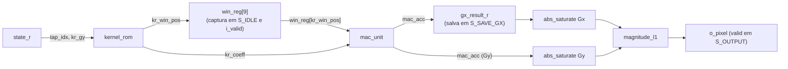

`mac_clear` ocorre em `S_LOAD_WIN` e `S_SAVE_GX`. O resultado de Gx é salvo em registrador separado antes de reaproveitar o acumulador para Gy.

**Contrato.** Apresentar `i_valid=1` com `o_ready=0` faz a janela ser perdida; há `$error` de simulação (`test_mac_control_fsm_contract_violation_runner`, `expect_errors=4`).

**Bugs reais corrigidos** (ver §13): `win_reg` capturando 1 ciclo tarde (#1), violação de contrato entre janelas consecutivas no teste (#3).

| Alternativa considerada | Por que foi descartada |
|---|---|
| Exigir que o chamador segure `i_window` por 2 ciclos | Contradiz o contrato; empurraria um buffer extra para o integrador |
| Eliminar `S_LOAD_WIN` | Reabriria a contagem de 16 estados; risco de `i_clear` e 1º `i_mac_en` no mesmo ciclo |

### 5.4 `skid_fifo2.sv`

```systemverilog
module skid_fifo2 #(parameter int DATA_WIDTH = 9*8)(
    input  logic                  clk, rst_n,
    input  logic                  i_push,
    input  logic [DATA_WIDTH-1:0] i_push_data,
    input  logic                  i_downstream_ready,
    output logic                  o_valid,
    output logic [DATA_WIDTH-1:0] o_data,
    output logic                  o_overflow,
    output logic                  o_room       // 1 = buffer ficará completamente vazio (A3)
);
```

FIFO **síncrona pura** de profundidade 2 entre `window_3x3` e `mac_control_fsm`. Substituiu o skid de profundidade 1 (bypass combinacional).

**Decisões.**

- **Saída sempre registrada** (`o_data = skid_mem_r[rd_ptr]`), sem bypass combinacional. Custo: +1 ciclo por janela (irrelevante frente aos ~16 ciclos/pixel). Benefício: elimina por construção a classe de bug de corrida entre módulos síncronos ligados combinacionalmente (a do F-16).
- **`o_valid = (count != 0) && i_downstream_ready`.** A FSM tem seu próprio contrato (`$error` se `i_valid` com `o_ready=0`).
- **Push+pop com a fila cheia** é aceito sem corromper: a leitura combinacional usa o registrador antes da borda e a escrita só vale no ciclo seguinte (`test_race_push_pop_simultaneous_when_full`). Overflow real (cheio, sem pop) descarta com segurança, sem corromper os itens armazenados (`test_overflow_contract_violation`).
- **`o_room` (Alternativa A3):** `(count_r + i_push − pop) == 0`. A versão só com `count_r` era defasada em 1 ciclo e deixava passar um aceite extra (ver §13, bug A3 #2).
- **Síntese.** `(* ramstyle = "logic" *)` está no RTL. O relatório Quartus anterior mostrou 2 M10K para 144 bits (§9). **[não verificado]** se o atributo já estava presente naquela compilação.

| Alternativa considerada | Por que foi descartada |
|---|---|
| Opção A: bypass combinacional + 2 slots | Mantém caminho combinacional entre módulos síncronos (a classe de bug do F-16) |
| Skid de profundidade 1 | Risco de overflow sob rajada (máximo medido: 2 janelas consecutivas) |
| Alternativa 2: backpressure em `window_3x3` (`i_ready`) | Reabriria um módulo `common/` já reaberto 3 vezes, por risco não confirmado |
| Alternativa 3: predição de ocupação | Exige modelar a latência de todo o pipeline; frágil |
| Comparar `wr_ptr == rd_ptr` para cheio/vazio | Ambíguo para profundidade 2 |

### 5.5 `sobel_multicycle.sv` (integrador)

#### 5.5.1 Responsabilidades

1. Controle de frame (`feed_cnt_r`, `frame_tag_r`, `frame_start_pulse`, padding inferior).
2. Admissão de pixels (handshake com o gate A3).
3. Descarte da "linha de saída −1" (`win_cnt_r`).
4. Monitor de integridade (`o_status`).

#### 5.5.2 Handshake e admissão

```text
gate_fsm_ok    = fsm_ready && !win_valid
accept_sample  = lw_skid_room && gate_fsm_ok
o_ready        = accept_sample && in_real_region
consume_sample = accept_sample && (in_real_region ? i_valid : 1)
```

`line_window_skid.i_downstream_ready` e `window_3x3.i_valid` usam a **mesma expressão** (`win_ready && skid_room`), mantendo pop e consumo em lockstep (§13, A3 #1).

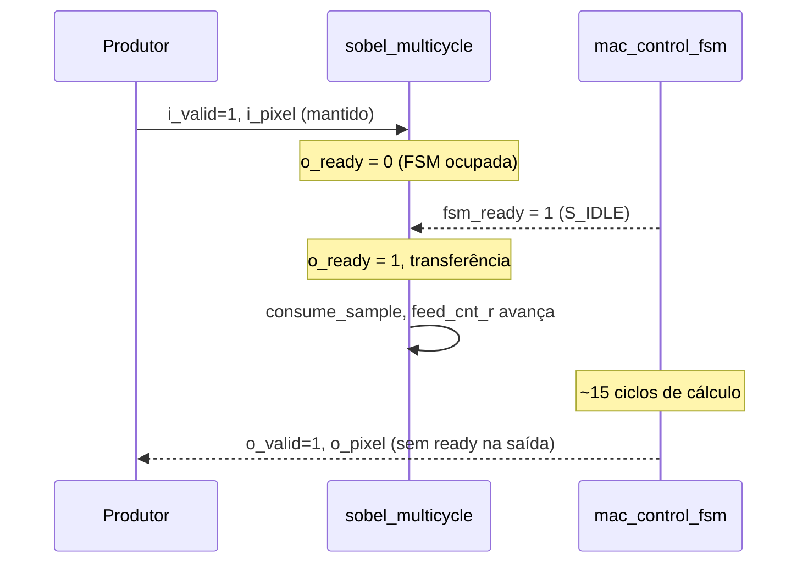

#### 5.5.3 Borda inferior do frame

Após `W·H` pixels reais (`in_real_region = feed_cnt_r < W·H`), o módulo para de aceitar pixels externos e fabrica `W` pixels zero internamente, avançando o mesmo `feed_cnt_r` até `W·(H+1)`. Um único contador cobre o frame; o contador de coluna do `window_3x3` não é duplicado.

#### 5.5.4 Frames consecutivos e F-17

- `frame_tag_r` alterna 1 bit a cada wrap de `feed_cnt_r`; `frame_start_pulse` dispara no 1º ciclo de cada frame e alimenta `i_rearm`.
- **Efeito do `i_rearm` (necessário e correto):** em todo frame, `window_3x3` emite `W` janelas de uma "linha de saída −1" virtual (line1/line2 zero). Elas **não** são pixels reais.
- **F-17 (correção, Opção 2):** `win_cnt_r` cíclico (módulo `W·(H+1)`, conta janelas RAW) marca como espúria toda janela com `win_cnt_r < W`. Depende só da **ordem** das janelas, não de tag nem de temporização de fronteira. Substituiu `discard_cnt_r`/`warmup_done_r` (que só disparavam uma vez na vida do módulo).
- `win_valid_real = win_valid && !win_is_spurious && win_window_valid_geom`.

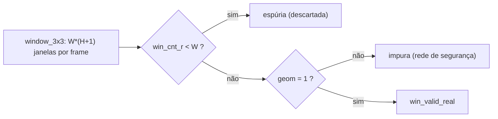

Alternativa A (limiar empírico 3 por tag, proxy não confiável) foi **descartada**: apenas deslocou o sintoma. A Opção 1 (re-armar `discard_cnt_r` com limiar `W`) foi descartada por depender da ordem temporal de `frame_start_pulse` sobre a cauda do frame anterior.

#### 5.5.5 Monitor `o_status[2:0]`

Bits sticky (só o reset limpa), sintetizáveis, que **só sinalizam** (sem autocorreção: esconderia o erro, e o dano de uma perda a montante está em 2 contadores).

| Bit | Nome | Condição |
|---|---|---|
| 0 | **E1** overflow | `u_skid.o_overflow` ou `u_lw_skid.o_overflow` |
| 1 | **E2** balanço | `bal_r` (+`win_valid_real`, −`o_valid`) deve ser 0 com `fsm_ready && !fsm_i_valid`. Pega perda **e** duplicação a jusante |
| 2 | **D** dessincronia | Com o pipeline drenado, `win_cnt_r == feed_cnt_r − (col_feed_r != 0)`. Pega perda a montante de `window_3x3` |

Cada bit aceso gera 1 `$error` de localização (só simulação).

**Modelo de falhas declarado.**

| Detecta | Não detecta |
|---|---|
| Perda, duplicação e dessincronia de janelas | Erro de **valor** de pixel (físico ou de lógica) |
| Overflow de skid (por evento) | Perda + duplicação compensadas no mesmo intervalo (E1 pega a perda por overflow) |
| | Perda de pulso de `o_valid` por consumidor (a saída não tem `ready`) |
| | Localização em hardware (só `$error` em simulação) |
| | Trava sem mudança de contagem (hoje, só timeout de software) |

**Evidência (Fase 2/3).** Perda a montante (I1) é **silenciosa e grave** sem o monitor (saída errada, contadores desalinhados). Com o monitor: controles em silêncio (com verificações não vazias), I1 → `100`, perda a jusante → `010`, duplicação → bit 1, E1 (teste de **fiação**) → `001`, reset limpa. O overflow genuíno de cada FIFO é coberto nos testes unitários (a A3 impede overflow no topo).

**Custo estimado:** ≈ 17 FFs para W=640 (`col_feed_r` 10, `bal_r` 4, `status_r` 3). **[inferência]**, sem síntese. Decisão para a etapa de síntese: tabela com e sem monitor, submódulo próprio ou parâmetro.

#### 5.5.6 Buffer interno maior (item antigo do STATUS)

**Obsoleto.** A A3 serializa as entregas (`u_skid` precisa estar vazio), então uma profundidade maior não admitiria nada a mais e custaria 72 bits por posição. Medido: `max_u_skid = max_u_lw_skid = 2`, overflow 0, em 7 geometrias (W ≤ 64, H ≤ 5, 5 lotes cada). **Limite declarado:** a extrapolação a 640×480 se apoia no argumento estrutural e no teste de frame cheio com `stall=0`, não em simulação com stall nessa escala.

---

## 6. Timing e latência

### 6.1 Latência de preenchimento (primeiro pixel)

| Estágio | Ciclos | Descrição |
|---|---|---|
| `line_buffer_2line` | ≈ `2·W+1` | Atraso de 2 linhas; +1 do registro de `o_curr` |
| `line_window_skid` + `window_3x3` + `skid_fifo2` | poucos ciclos | Registros e FIFOs em série |
| FSM | 15 | Ciclos úteis do 1º pixel |

O termo fixo exato está no modelo abaixo (`(2W−1)·F + 6`, medido).

### 6.2 Modelo de ciclos (medido)

$$\text{ciclos}(W,H,F) = 16\,W\,H\,F + (2W-1)\,F + 6$$

- Ajustado em 6 pontos (W=16 e 640; 3 e 6 linhas; 1 e 4 frames).
- Confirmado em 2 extrapolações: 16×8×2 e **640×480×2 (9.832.964 ciclos medidos, delta 0)**.
- Throughput efetivo: **16 ciclos/pixel**; a 100 MHz, 6,25 Mpixel/s.

### 6.3 Custo de simulação (calibração)

O simulador quase não importa sob cocotb (custo dominado pelo Python): ≈ 12.000 ciclos/s no Icarus, ≈ 13.000 no Verilator (+7%). Frame 640×480×2: 908 s no Icarus, 822 s no Verilator+cov.

---

## 7. Gerenciamento de borda

Estratégia implementada: **zero-padding** (decisão provisória; mudar para replicação ficaria isolada em `line_buffer_2line`/`window_3x3`, sem impacto nas 3 arquiteturas).

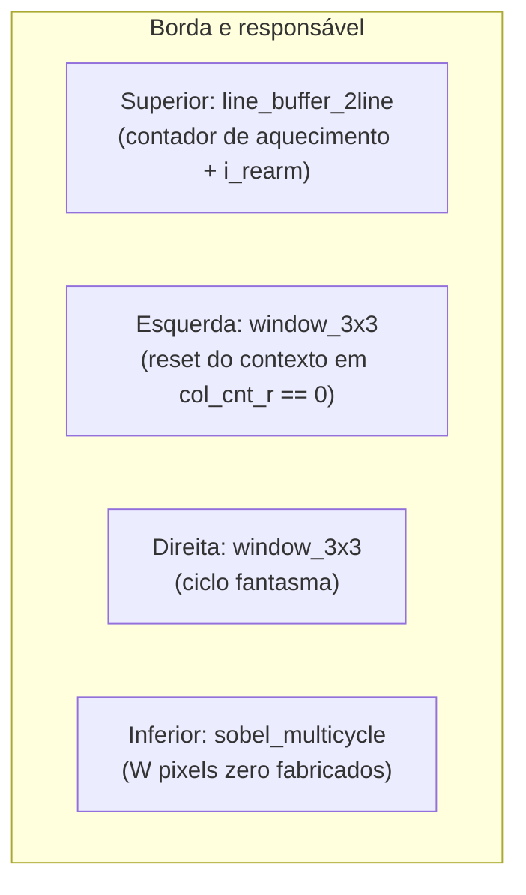

Nenhum sinal `first_pixel/last_pixel/first_line/last_line` existe. O único requisito externo é um **contrato de timing**: respeitar `o_ready` de `window_3x3`.

O OpenCV não usa zero-padding por padrão. Para comparação futura, usar `cv2.Sobel(..., borderType=cv2.BORDER_CONSTANT)`.

---

## 8. Verificação

### 8.1 Suítes existentes

Todos os arquivos estão em `tb_python/` (cocotb + Icarus; padrão de metodologia na §12).

| Arquivo | Cobre |
|---|---|
| `test_line_buffer_2line.py` | Reset, atraso W/2W, gaps, reset no meio, tags (3 fronteiras), rearm, read-before-write, slot extra |
| `test_line_buffer_depth.py` | Atraso em W ∈ {2, 3, 4, 5, 8, 16, 640}, gaps, rearm, reset |
| `test_window_3x3.py` | Reset, geometria, violação de contrato, `o_tag`, `geom` na fronteira vertical, ciclo fantasma. **Faltam 3 testes (F-18)** |
| `test_line_window_skid.py` | Campos, ordem, fórmula de `o_room`, push+pop cheio, overflow |
| `test_abs_saturate.py` | Saturação, faixa ±1020, −8 (4 bits), −1024 (11 bits) |
| `test_magnitude_l1.py` | Soma, saturação, limite 255/256, 4096 combinações |
| `test_mac_unit.py` | Coeficientes, sequências Gx/Gy, ±1020, gating, prioridade do clear, coeficiente inválido |
| `test_kernel_rom.py` | Tabelas, posições únicas, tap inválido (4 `$error`) |
| `test_mac_control_fsm.py` | Reset, 15 ciclos, `o_ready`, janelas variadas, violação de contrato (4 `$error`) |
| `test_fsm_state_arc_coverage.py` | 16/16 estados, 17/17 arcos |
| `test_skid_fifo2.py` | FIFO, corrida push+pop cheio, overflow |
| `test_sobel_multicycle.py` | Reset, golden 4×3, stalls, 2 e 4 frames |
| `test_f17_cyclic_discard.py` | 4 frames, 5 lotes (stall/seed) sem reset, W ∈ {4, 6, 8} × H ∈ {2, 3, 5} e H=1 (12 casos), sem saturação |
| `test_pipeline_status.py` | `o_status`: controles, injeções I1/B/C, E1 por fiação, reset |
| `test_valid_hold_handshake.py` | Contrato A (`blocked > 0` assertado) |
| `test_frame_640x480.py` (`make frame`, `RUN_SLOW=1`) | 2 frames 640×480 contínuos, golden, `o_status=000`, contagem de janelas |
| `test_meta_guard.py`, `test_cov_hook.py`, `test_cov_report.py` | Guarda de `$error`, gancho e agregador de cobertura |
| `test_postsynth_sobel.py` (`NETLIST=`) | Simulação da netlist pós-síntese. **[não verificado]** Não há registro de execução |

`_cocotb_helpers.py` é infraestrutura (não é teste). `run_isolated(testcase, *, expect_errors=0, ...)` captura os `$error` e exige a contagem **exata**; sem isso, um `$error` não derruba o teste cocotb.

### 8.2 Testes obrigatórios (mapeamento)

| Requisito | Onde está |
|---|---|
| Reset assíncrono | `test_reset_state` (vários arquivos) |
| 1 pixel / latência | `test_cycle_timing` (FSM) |
| Imagem pequena golden | `test_small_image_golden` (4×3) |
| Frame completo | `test_frame_640x480` |
| Estados da FSM | `test_fsm_state_arc_coverage` |
| Backpressure | `test_small_image_with_external_stalls`, `test_valid_hold_handshake` |
| Multi-frame (Alternativa 6) | `test_four_consecutive_frames`, `test_f17_cyclic_discard` |
| Casos de borda | **Parcial:** H=1 coberto. **1×1, 2×2 e coluna única não cobertos** (W=1 não é suportado) |

**Alternativa 6 (regra permanente).** Nenhuma arquitetura é declarada concluída sem um teste de 3+ frames consecutivos. O `test_four_consecutive_frames` revelou, sucessivamente, o F-16 e o F-17.

### 8.3 Modelo de referência

```python
# _reference_sobel_l1 (test_sobel_multicycle.py): zero-padding nas 4 bordas, L1 saturado em 255
# _sobel_l1_vectorized (test_frame_640x480.py): versão numpy, validada contra a de laço
#   em 16 casos (416 pixels saturados exercitados)
```

**Massa de teste.** Pixels em [0, 12] ⇒ `|Gx|+|Gy| ≤ 96 < 255` (sem saturação), com guarda `n_sat == 0`. Imagens que saturam em 255 **mascararam** os bugs F-16 e F-17 por muito tempo. Para o frame cheio, massa pseudoaleatória (semente fixa): um padrão periódico mascararia deslocamentos múltiplos do período.

### 8.4 Cobertura (Verilator 5.054, Fase 4 e Frente 2)

| Métrica | Resultado | Limite ligado |
|---|---|---|
| `code` (line+branch+expr) | **425/426** (99,8% efetivo) | ≥ 95% |
| `toggle` | **3596/3599** (99,9% efetivo) | ≥ 90% |
| FSM | 16/16 estados, 17/17 arcos (teste funcional) | 100% |

- Campanha de 40 execuções, 4087 pontos; frame 640×480 agregado (`make cov-frame`).
- **Lacunas visíveis de propósito (4):** `mem2[9][3]` (aguarda teste novo) e a rede de segurança 3-B (`sobel_multicycle`, `win_window_valid_geom:1->0`; evidência empírica, não prova).
- **Limites declarados:**
  - A classe de exclusão `so-icarus` (43 pontos, 1,1%) **não é medida**: só se verifica que o `proof_test` existe.
  - O extrator de FSM do Verilator devolve 0/0; a FSM oficial é o teste funcional.
  - `$error` aborta a simulação sob Verilator, então runners com `expect_errors>0` são pulados em `COV_MODE`.
  - `--coverage-max-width` (padrão 256 bits) deixa `mem1`/`mem2` em W=640 fora da instrumentação de toggle.
  - Métrica = união de configurações (W de 2 a 640).
- O Verilator decide só a cobertura; **quem decide "passou" é o Icarus** (2 estados: não prova ausência de `X`).

### 8.5 Limites da verificação (consolidado)

- Frame cheio rodado com **2 frames, `stall=0`, sem saturação**.
- Stall externo testado só em W ≤ 8.
- Tudo é **simulação RTL**; nenhum teste em hardware.
- Pós-síntese: runner existe, **sem registro de execução**.

---

## 9. Síntese e constraints

O fluxo real é **Quartus Prime Lite 25.1std** no dispositivo Cyclone V `5CSEMA5F31C6`, sem placa física (análise estática). Detalhes em `docs/REGISTRO_FLUXO_QUARTUS.md` e `docs/GUIA_QUARTUS_EXPLICADO.md`.

### 9.1 Constraints

```tcl
# constraints/multicycle.sdc
create_clock -name clk -period 10.000 [get_ports {clk}]
derive_clock_uncertainty
```

O projeto é criado por `constraints/setup_proj.tcl` (`quartus_sh -t`), compilado por `quartus_sh --flow compile sobel_multicycle`. O bloco XDC/SDC de versões anteriores deste documento usava nomes de porta inexistentes (`pixel_in`, `last_pixel_in`...) e foi **removido**.

### 9.2 Resultados (anteriores à correção da slot extra de `mem1`)

| Item | Valor |
|---|---|
| ALMs / FFs / DSPs / M10K | 4.601 (14%) / 6.270 / **0** / 3 |
| Fmax (slow 1100 mV 85 °C) | 98,05 MHz; slack **−0,199 ns** vs 100 MHz |
| Hold / pulso mínimo | +0,234 ns / +3,851 ns |
| Caminho crítico | `col_feed_r[3]` → `line_window_skid:u_lw_skid\|mem~27`; os 10 piores caminhos têm o mesmo From e To |
| ALMs por hierarquia | `line_buffer_2line` 4.345 (94%), `mac_control_fsm` ≈ 90, `skid_fifo2` ≈ 35, `window_3x3` ≈ 30, `line_window_skid` ≈ 27 |

**Leituras e inferências.**

- O gargalo de Fmax está no `line_window_skid`, não em BRAM. Corrigir a inferência de memória **melhora área, não Fmax**.
- `mem2` do `line_buffer_2line` virou MLAB espalhado (leitura assíncrona, aviso 276007), explicando os 94% de ALMs. A leitura combinacional do estágio 2 é uma decisão de projeto (§4.1) que tem custo de área.
- **[inferência]** `col_feed_r` aparece no caminho crítico: o monitor `o_status` foi adicionado antes dessa síntese? **[não verificado]**.

### 9.3 Pendências de síntese

Re-síntese pós-slot-extra; decisão do SDC (100 MHz mantido ou 90 MHz); `ramstyle="logic"` em `skid_fifo2` (comparar M10K); decisão sobre `mem2` em MLAB; execução do `test_postsynth_sobel.py` na netlist; potência (VCD + `quartus_pow`); segundo vendor (Vivado/Artix-7).

---

## 10. Checklist de implementação

### 10.1 RTL

- [x] `line_buffer_2line.sv`, `window_3x3.sv`, `abs_saturate.sv`, `magnitude_l1.sv`, `line_window_skid.sv` (common)
- [x] `mac_unit.sv`, `kernel_rom.sv`, `mac_control_fsm.sv`, `skid_fifo2.sv`, `sobel_multicycle.sv` (multicycle)
- [x] Verible lint: 0 warnings
- [x] Verilator 5.054 `--lint-only -Wall`: 0 warnings (hierarquia e módulos isolados)

### 10.2 Verificação

- [x] Testes unitários de todos os módulos; `test_sobel_multicycle` 5/5
- [x] Multi-frame (F-17), `o_status`, contrato A, frame 640×480
- [x] Cobertura de código ≥ 95% e toggle ≥ 90%; FSM 100%
- [x] Comparação golden (erro = 0) em L1
- [ ] Restaurar os 3 testes removidos de `test_window_3x3.py` (F-18)
- [ ] Casos de borda 1×1, 2×2 e coluna única (exigem W ≥ 2 ou decisão de projeto)

### 10.3 Síntese

- [x] Quartus: síntese e fit sem erros (anterior à slot extra)
- [ ] Re-síntese pós-correção
- [ ] Timing met @ 100 MHz (hoje −0,199 ns)
- [ ] Potência
- [ ] Vivado / Artix-7

---

## 11. Estado e pendências

| # | Pendência | Natureza |
|---|---|---|
| 1 | Restaurar 3 testes de `window_3x3` (F-18) | Verificação |
| 2 | Atualizar o comentário "read-before-write" de `line_buffer_2line.sv` | Documentação do RTL (sem mudar lógica) |
| 3 | Re-síntese e decisão do SDC | Síntese |
| 4 | `ramstyle` de `skid_fifo2`; `mem2` em MLAB | Área |
| 5 | Executar `test_postsynth_sobel.py` na netlist | Verificação |
| 6 | Migrar `COCOTB_TESTCASE` (obsoleto no cocotb 2.1.0) | Infraestrutura |
| 7 | Potência; Vivado | Caracterização |
| 8 | Especificar interface MMIO (contrato A, saída sem `ready`, `o_status`) | Integração |
| 9 | Endurecer escrita de `line_window_skid` (opcional) | Robustez |
| 10 | Reavaliar porta `o_col` (economiza ≈ `$clog2(W)` FFs), contador de posição vs. contagem (Pipeline) | Arquitetura futura |

Todos os pontos acima são **fora do RTL funcional**: o multiciclo está funcionalmente fechado em simulação, com as condições listadas.

---

## 12. Notas metodológicas (pegadinhas de ferramenta)

Versões atuais: **cocotb 2.1.0, cocotb-test 0.3.0, Verilator 5.054, Icarus 12.0, Verible v0.0-4084-gf3e4d98b**. Estas pegadinhas foram descobertas em execução real; ignorá-las já produziu "correções" de bugs que eram artefatos do teste.

| # | Pegadinha | Regra |
|---|---|---|
| 1 | Ler um sinal logo após `await RisingEdge` pode retornar o valor de antes do assentamento | `RisingEdge` → `ReadOnly` → capturar → `NextTimeStep` antes de novo estímulo |
| 2 | `$error` do SystemVerilog **não** passa pelo logger Python da simulação. Sai no stdout do processo do simulador (`vvp`) | Capturar no processo que chama `run()`, via logger `"cocotb"`. `capture_errors()` / `run_isolated` em `_cocotb_helpers.py` |
| 3 | `int(sinal.value)` em porta `signed` devolve o valor **sem sinal** | Usar `sinal.value.signed_integer` |
| 4 | `testcase=` de `cocotb_test.simulator.run()` não restringe a execução no cocotb 2.0+ (define `TESTCASE`; o cocotb espera `COCOTB_TESTCASE`). **`COCOTB_TESTCASE` consta como obsoleto no 2.1.0** (a migração para `COCOTB_TEST_FILTER` **não foi feita nem verificada**) | Usar `run_isolated(testcase, ...)` |
| 5 | **Alarme passivo × trava ativa.** `$error` só existe em simulação; a trava ativa sobrevive em hardware. São complementares | Ver `kernel_rom` (§5.2). Perguntar a cada módulo novo |
| 6 | Ler no mesmo `ReadOnly` um sinal **fio** (latência 0) e um **derivado de registro** (latência ≥ 1) mistura instantes de decisão | Anotar "este sinal reflete a decisão N; aquele, a N−1" antes de combinar. Especialmente ao testar correções que registram um sinal antes combinacional. A suspeita de uma 2ª ocorrência (leitura da saída do skid) foi **resolvida**: era o driver de teste que zerava `i_tag` em folga, não o RTL. As 3 divergências residuais na verificação de memória do skid **não foram provadas** como bug do script (fio solto registrado) |
| 7 | Em módulo com saída **combinacional sobre ponteiro** que a mesma borda observada avança (`skid_fifo2.o_data`), ler depois da borda mostra o item seguinte | Amostrar antes da borda: `Timer(1ns)`, como em `test_skid_fifo2.py` |
| 8 | Em teste com vários lotes na mesma simulação, um `await` ou leitura entre lotes (ex.: `ReadOnly` + `NextTimeStep`) desloca o driver em meio ciclo; o 1º `i_valid` cai na borda e o 1º pixel se perde (só aparece quando o 1º sorteio já apresenta pixel) | Nenhum `await` entre lotes; ler dentro do laço ou do `on_cycle`. Incluir **canário** que reintroduza o defeito suspeito |
| 9 | `Force` em **porta** vaza para a rede externa | Injetar em nets internos |
| 10 | Cache de build (`Skipping compilation`) reaproveita RTL antigo | `rm -rf sim/sim_build_*` após qualquer mudança de RTL |
| 11 | Instrumentação nunca deve ter laço de condução próprio (fonte de bug em 3 rodadas) | Callback `on_cycle` no `_feed_image_and_collect` já validado |
| 12 | Verilator especializa módulos por parâmetro e renomeia a página (`__I4`, `__D48`); `$error` aborta a simulação; `--coverage` não cobre bem FSM | Agregador normaliza o sufixo; runners negativos são pulados em `COV_MODE` |

**Princípio de processo.** Validar casos triviais de resposta conhecida antes de confiar em qualquer script de instrumentação novo; imprimir o número de verificações ao lado de "0 violações" (verificação vazia não prova nada).

---

## 13. Registro de bugs reais encontrados por execução

Nenhum é hipotético: todos foram reproduzidos por teste ou trace.

| # | Módulo | Bug | Correção |
|---|---|---|---|
| 1 | `line_buffer_2line` | Leitura combinacional dava atraso `W−1` | Leitura registrada + limiar `W+1` |
| 2 | `line_buffer_2line` | Cascata de 2 estágios registrados acumulava +1 ciclo | 2º estágio combinacional |
| 3 | `window_3x3` | Array 2D na porta não indexável via VPI | Vetor achatado |
| 4 | `abs_saturate` | Largura interna `IN_WIDTH+1` truncava (`X`) | `max(IN_WIDTH+1, OUT_WIDTH)` |
| 5 | `_cocotb_helpers` | `testcase=` ignorado no cocotb 2.0+ | `COCOTB_TESTCASE` em `run_isolated` |
| 6 | `mac_control_fsm` | #1: `win_reg` capturava 1 ciclo tarde (magnitude sempre 0). #3: teste violava o contrato entre janelas | Capturar em `S_IDLE && i_valid`. `_feed_and_wait` espera `o_ready` |
| 7 | `window_3x3` (3-B) | Padding da 1ª coluna com tag `1'b0` fixa derrubava `o_window_valid_geom` | Herdar a tag atual |
| 8 | `sobel_multicycle` (F-02) | 3-B sozinha detectava a contaminação mas reduzia a contagem de pixels do frame (timeout) | Alternativa 3-C (`i_rearm`) corrige na fonte |
| 9 | `line_buffer_2line` | `i_rearm` descartava o pulso do próprio ciclo (A) e `warm` saturado do frame anterior no ciclo do rearm (B1) | `warmup <= 1` e `warm && !i_rearm` |
| 10 | `line_buffer_2line` + `window_3x3` (**F-16**) | Assimetria de latência `o_curr` × `o_line1/2`: 10 de 12 pixels errados em 1 frame isolado de baixo contraste (mascarado por saturação) | `curr` registrado (com `if (i_valid)`) + `line_window_skid` |
| 11 | `sobel_multicycle` (**A3** #1) | `window_3x3.i_valid` fora de lockstep com o pop durante o ciclo fantasma | `win_ready` na expressão de gating |
| 12 | `skid_fifo2` (**A3** #2) | `o_room` só com `count_r` (defasado 1 ciclo) permitia aceite extra | Fórmula "olhando à frente" |
| 13 | `sobel_multicycle` (**F-17**) | Janelas espúrias da "linha −1" de todo frame entravam como pixels reais (descarte só no frame 0) | `win_cnt_r` cíclico |
| 14 | `line_buffer_2line` | Colisão leitura/escrita no mesmo endereço (aviso 276027) | Profundidade `W+1`, leitura em `wr_ptr1_next` |

**Hipóteses descartadas (registro para defesa).** "`i_rearm` descarta pulso em `warmup1_cnt_r`" como causa única (parcial, mascarava o F-16); "estado residual entre lotes" (era a fase do driver, pegadinha 8); "tag como indicador confiável de conteúdo" (refutado pelo Teste D); Alternativa A do F-17.

---

## 14. Referências

- `docs/ESPECIFICACAO_SOBEL.md` (§3.3.1)
- `docs/MODELO_LATENCIA_PIPELINE.md` — modelo de identidade/ordem das janelas
- `docs/MANIFESTO_SCRIPTS_DIAG_F-16.md` — status dos scripts de diagnóstico
- `docs/AUDITORIA_01_PRE_MULTICICLO.md`
- `docs/REGISTRO_FLUXO_QUARTUS.md`, `docs/GUIA_QUARTUS_EXPLICADO.md`
- `RESUMO_ESTADO_PROJETO.md`, `CLAUDE.md`
- Gonzalez & Woods — *Digital Image Processing* (operador Sobel)
- Intel — Cyclone V Device Handbook (M10K, read-during-write)
- IEEE 1800-2017 — SystemVerilog LRM