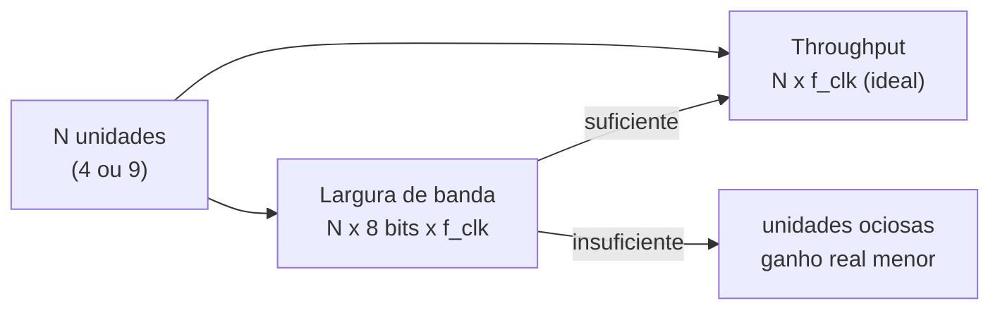
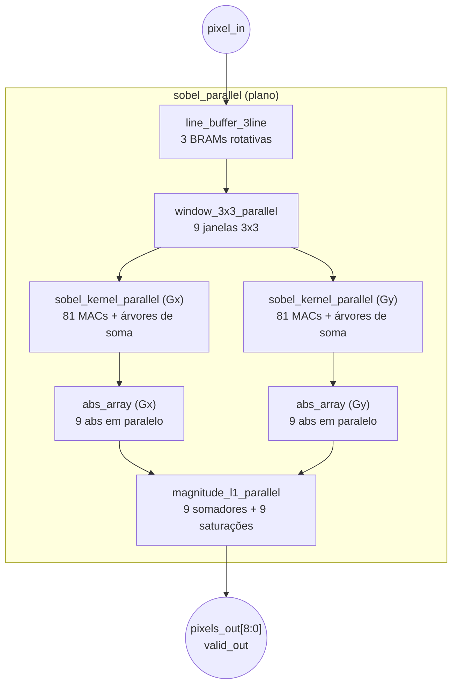
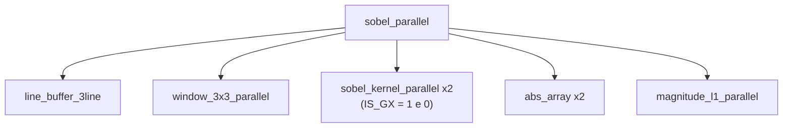
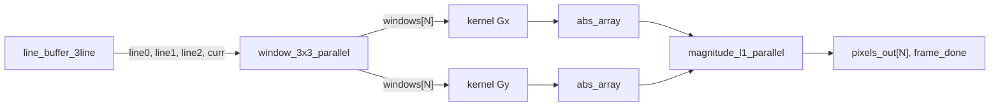
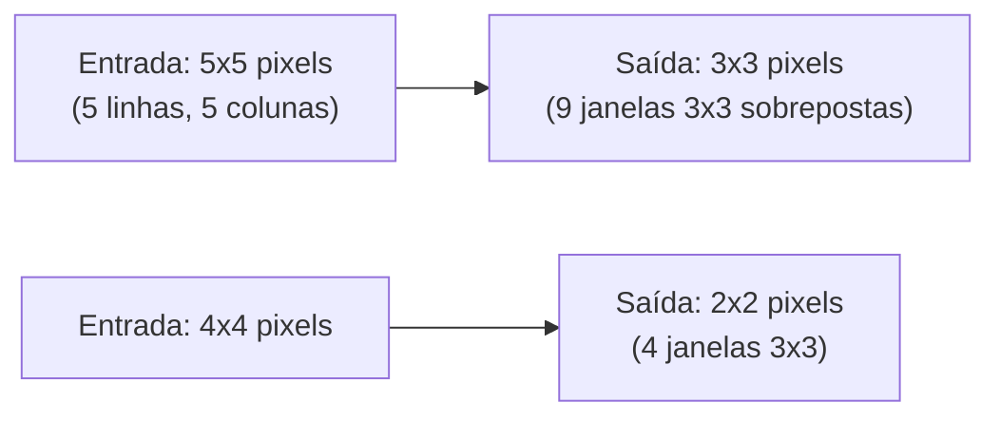

# Arquitetura Paralela — Filtro Sobel

| Campo | Valor |
|---|---|
| **Versão** | 2.0 (reformatada; plano preservado, com revisão técnica) |
| **Data** | 2026-11-08 |
| **Status** | **PLANEJAMENTO.** Nenhum RTL desta arquitetura existe. Será **reescrita** na abertura da implementação |
| **Base** | `ARQUITETURA_MULTICICLO.md` v2.0, `ARQUITETURA_PIPELINE.md` v2.0 e `AUDITORIA_01_PRE_MULTICICLO.md` |

> **Como ler este documento.** As §1 a §8 preservam o **plano original**, reformatado. Os esboços **não compilam e não foram simulados**. A **§9 (Revisão técnica pré-implementação)** lista erros e inconsistências encontrados por leitura, **incluindo erros dentro do próprio plano** (um deles é matemático, §9.1). A **§10** lista os pontos a decidir. **Nenhuma decisão nova foi tomada aqui.**
>
> **Convenção:** **[projeção]** = estimativa nunca sintetizada; **[inferência]** = derivação sem medição; **[não verificado]** = sem evidência.

---

## Sumário

1. [Visão geral](#1-visão-geral)
2. [Diagrama de blocos](#2-diagrama-de-blocos)
3. [Módulos específicos (plano)](#3-módulos-específicos-plano-original)
4. [Top-level (esboço)](#4-top-level-esboço)
5. [Gerenciamento de borda](#5-gerenciamento-de-borda)
6. [Timing e throughput](#6-timing-e-throughput)
7. [Verificação](#7-verificação)
8. [Síntese e constraints](#8-síntese-e-constraints)
9. [Revisão técnica pré-implementação](#9-revisão-técnica-pré-implementação)
10. [Pontos a decidir](#10-pontos-a-decidir-antes-de-qualquer-rtl)
11. [Tabela comparativa](#11-tabela-comparativa)
12. [Checklist](#12-checklist-de-implementação)
13. [Referências](#13-referências)

---

## 1. Visão geral

A arquitetura **paralela** processa **múltiplos pixels por ciclo**, replicando as unidades de cálculo, ao custo de área maior. Duas variantes são planejadas:

| Variante | Pixels/ciclo | MACs Gx | MACs Gy | DSPs (plano) | Latência (plano) |
|---|---|---|---|---|---|
| **Paralela 2×2** | 4 | 36 | 36 | 72 | ~2 ciclos (**ver §9.2**) |
| **Paralela 3×3** | 9 | 81 | 81 | 162 | ~1 ciclo (**ver §9.2**) |

### 1.1 Características (todas **[projeção]**)

| Métrica | Paralela 2×2 | Paralela 3×3 |
|---|---|---|
| Throughput | 4 pix/clk | 9 pix/clk |
| LUTs | ≈ 2.500 | ≈ 5.500 |
| FFs | ≈ 2.000 | ≈ 4.500 |
| DSPs | 72 | 162 |
| BRAM (18 Kb) | 4 | 6 |
| Fmax (Artix-7) | ≈ 150 MHz | ≈ 120 MHz |
| Potência | Alta | Muito alta |

### 1.2 Escalonamento

O projeto de IC prevê `T_par = N · f_clk` (N unidades de processamento), condicionado a `BW ≥ N · B_pixel · f_clk`. Se a memória não alimenta as N unidades, o ganho real cai. **A largura de banda de memória é o gargalo central desta arquitetura** (§9.3).

---

## 2. Diagrama de blocos

### 2.1 Paralela 3×3 (9 pixels/ciclo, plano)

### 2.2 Hierarquia

---

## 3. Módulos específicos (plano original)

### 3.1 `line_buffer_3line`

Armazena **3 linhas completas** em 3 BRAMs com escrita rotativa e fornece 3 linhas simultâneas (`line0`, `line1`, `line2`) mais o pixel corrente. Esboço original: escrita de **1 pixel por ciclo**, leitura combinacional das 3 memórias no mesmo endereço, seleção por `line_sel`. **Ver §9.3** (incompatível com 9 pixels/ciclo).

### 3.2 `window_3x3_parallel`

Gera 9 janelas 3×3 simultâneas (3×3) ou 4 (2×2) a partir de shift registers de 3 posições por linha. **Ver §9.1**: o esboço tem erro de indexação.

### 3.3 `sobel_kernel_parallel`

`PARALLEL_FACTOR × 9` multiplicadores com árvore de soma de 3 níveis; `IS_GX` seleciona o kernel. `ACC_WIDTH = 16` no esboço. **Ver §9.5** (largura e DSPs).

### 3.4 `abs_array` e `magnitude_l1_parallel`

`PARALLEL_FACTOR` instâncias de valor absoluto com tratamento do extremo de complemento de 2, e `PARALLEL_FACTOR` somadores com saturação em 255. São replicações diretas do pipeline, e reaproveitam `abs_saturate` e `magnitude_l1` de `common/` (combinacionais), com registradores se o timing exigir.

---

## 4. Top-level (esboço)

O esboço propaga `last_pixel`/`last_line` até `frame_done`, com sinais (`lp_mag`, `ll_mag`) **que não são produzidos** por nenhum módulo. Ver §9.6.

---

## 5. Gerenciamento de borda

O plano diz que o `line_buffer_3line` "já replica" linhas virtuais e que a coluna 639 "replica a coluna 639". **Isso contradiz o RTL real**, que usa **zero-padding** (`ARQUITETURA_MULTICICLO.md` §7). O golden correto é `BORDER_CONSTANT`, não o padrão do OpenCV.

**Desafio novo desta arquitetura:** várias janelas acessam pixels de borda no mesmo ciclo. O zero-padding deve ser consistente entre elas, e o **último grupo de cada linha** é parcial quando `W` não é múltiplo do fator de paralelismo (§9.1).

---

## 6. Timing e throughput

### 6.1 Planejado

| Variante | Ciclos/frame (plano) | Tempo @ 100 MHz |
|---|---|---|
| 3×3 (9 pix/ciclo) | `(640/9) × 480 ≈ 34.133` | 341 µs ≈ 2.930 fps |
| 2×2 (4 pix/ciclo) | `(640/4) × 480 = 76.800` | 768 µs ≈ 1.300 fps |

### 6.2 Correção aritmética **[inferência]**

`640/9` **não é inteiro** (71,1). Com grupos de 9 pixels, são necessários `⌈640/9⌉ = 72` grupos por linha, ou seja, `72 × 480 = 34.560` ciclos, e não 34.133 (diferença de ≈ 1,2%). Isso vale antes de contar blanking, preenchimento e padding inferior. Para o 2×2, 640/4 = 160 é exato.

---

## 7. Verificação

| Teste do plano | Observação |
|---|---|
| `test_parallel_3x3_throughput`, `test_parallel_2x2_throughput` | Throughput sustentado, **medido** |
| `test_parallel_edge_handling` | Zero-padding consistente entre janelas |
| `test_parallel_3x3_golden`, `test_parallel_2x2_golden` | Golden com `BORDER_CONSTANT`, erro = 0, **massa sem saturação** |
| `test_parallel_corner_cases` | 1×1, 2×2 e linha única; **W=1 não é suportado** pelos módulos comuns |
| (novo) multi-frame 3+ | Requisito de aceite (Alternativa 6) |
| (novo) largura não múltipla do fator | Caso do grupo parcial (§9.1) |

O modelo de referência do plano usa `cv2.Sobel` **sem** `borderType` explícito e é "funcional, não ciclo a ciclo". Deve usar `BORDER_CONSTANT` e ser validado contra `_reference_sobel_l1` do projeto.

---

## 8. Síntese e constraints

O plano trazia XDC (Artix-7) com 120 MHz e `DSP_FOLDING`. O fluxo real é **Quartus** (Cyclone V), com `constraints/*.sdc` e `setup_proj_*.tcl`. Técnicas de área do plano (`ram_style="block"`, LUTRAM, retiming, pblocks) têm equivalentes no Quartus (`ramstyle`, atributos de preservação, LogicLock) e serão **decididas após** o primeiro relatório de recursos. "DSP sharing: não aplicável" permanece válido para o objetivo de throughput máximo.

---

## 9. Revisão técnica pré-implementação

Achados da leitura contra o multiciclo fechado e do plano em si. **Nada altera o plano**: são itens a resolver antes do RTL.

### 9.1 Erros no esboço de `window_3x3_parallel` **[inferência por leitura]**

- **Indexação fora do intervalo.** Os shift registers têm **3 posições** (`line*_sr[0:2]`), mas o gerador acessa `line0_sr[j+2]` com `j` até 2, ou seja, **índice 4**.
- **Cobertura insuficiente.** Um bloco de **3×3 pixels de saída** por ciclo precisa de uma vizinhança de entrada de **5×5** (cada saída usa 3×3 e os blocos se sobrepõem); um bloco **2×2** precisa de **4×4**. O esboço constrói janelas 3×3 a partir de apenas 3 pixels por linha, o que não cobre isso.
- **Grupo parcial.** Com `W` não múltiplo do fator, o último grupo da linha tem janelas incompletas.

### 9.2 Latências do plano são inconsistentes entre si

| Local | 2×2 | 3×3 |
|---|---|---|
| §1 (tabela) | ~2 ciclos | ~1 ciclo |
| §1.1 do plano | 2-3 | 1-2 |
| §6 e §9 do plano | 5-6 | 5 |
| Especificação (v1.0) | 2 | 1 |

Uma latência de 1 ciclo é incompatível com árvores de soma de 3 níveis, abs, soma e saturação registrados. O valor de **5 a 6** é o coerente com os próprios esboços. A latência real será **medida**.

### 9.3 Largura de banda e `line_buffer_3line` **[inferência]**

- O esboço **escreve 1 pixel por ciclo**, o que contradiz "9 pixels/ciclo": para 9 pixels/ciclo, a entrada precisa de **72 bits/ciclo** (ou 36 para 4 pixels), e cada linha precisa de **múltiplos pixels lidos e escritos por ciclo** (bancos de memória, particionamento).
- O projeto de IC já registra a condição `BW ≥ N·B_pixel·f_clk` e prevê particionamento e múltiplos bancos como estudo. Esta é a **decisão arquitetural principal** da Paralela (**P1**).
- O line buffer do multiciclo usa 3 memórias **de 1 pixel por ciclo** e, mesmo assim, precisou de 3 reaberturas. O `line_buffer_3line` não é "um módulo simples".

### 9.4 Interface comum mudou

O plano assume a interface **antiga** de `line_buffer_2line`/`window_3x3` e propõe um módulo novo (`line_buffer_3line`). Hoje os módulos comuns têm tags, `i_rearm`, `o_curr` registrado, `o_ready` e `line_window_skid`. A Paralela **herda o padrão** (elasticidade por FIFO, contrato A, monitor), e as lições do F-16 (corrida combinacional entre módulos síncronos) e do F-17 (janelas espúrias por frame) **se aplicam diretamente**: com N pixels por ciclo, a "linha de saída −1" tem `W/N` grupos espúrios por frame.

### 9.5 DSPs e largura **[inferência]**

Coeficientes constantes ±1/±2 e o multiciclo com **0 DSPs** sugerem que "81 MACs = 81 DSPs" é um teto, não uma previsão. O acumulador de 16 bits do esboço pode ser **11 bits**. A estimativa de 162 DSPs precisa ser refeita com a mesma ferramenta e o mesmo dispositivo.

### 9.6 Sinais de controle e frame

`last_pixel`/`last_line`/`frame_done` do esboço não existem no multiciclo real; o fim de frame é inferido por contador. Com N pixels por ciclo, o contador avança em passos de N e precisa lidar com o grupo parcial.

### 9.7 Documentos

A tabela comparativa do plano usava o multiciclo como "~200 LUTs, 1 DSP, 250 MHz, 6,8 fps". Foi **corrigida** (§11).

---

## 10. Pontos a decidir antes de qualquer RTL

| # | Ponto | Alternativas | Observação |
|---|---|---|---|
| **P1** | Organização de memória e largura de banda | Bancos particionados por coluna módulo N; BRAM multiporta; registradores | Define se 9 pixels/clk é realizável com 3 BRAMs |
| **P2** | Geometria da janela paralela | Vizinhança 5×5 (3×3) e 4×4 (2×2) com sobreposição | Corrige o §9.1 |
| **P3** | Largura não múltipla do fator | Padding da largura, grupo parcial mascarado | 640 não é múltiplo de 9 |
| **P4** | Reutilização dos módulos comuns | Replicar `line_buffer_2line`/`window_3x3`, ou módulos novos (`line_buffer_3line`) | Cada reabertura de `common/` achou bugs |
| **P5** | Contrato de entrada | N pixels por ciclo com blanking, ou contrato A estendido | Afeta MMIO |
| **P6** | Descarte da linha −1 e identidade de janela | Contador por grupo, ID de sequência, marcar posição | Mesma decisão do Pipeline (**P3** de lá) |
| **P7** | Monitor de integridade | Estender `o_status` (E1/E2/D) para N janelas por ciclo | Balanço passa a contar em passos de N |
| **P8** | DSPs e largura do acumulador | 0 DSPs com deslocamento, ou multiplicadores forçados | Afeta a comparação de área |
| **P9** | Variante inicial | Implementar 2×2 primeiro (640/4 exato) ou 3×3 | Sugestão técnica: 2×2 reduz risco |

---

## 11. Tabela comparativa

| Métrica | Multiciclo (**medido**, Cyclone V) | Pipeline **[projeção]** | Paralela 2×2 **[projeção]** | Paralela 3×3 **[projeção]** |
|---|---|---|---|---|
| Throughput | 1 pixel / 16 ciclos | 1 pix/clk | 4 pix/clk | 9 pix/clk |
| Latência | 15 ciclos úteis | ≈ 7 | 5-6 (ver §9.2) | ≈ 5 |
| ALMs / FFs | 4.601 / 6.270 | n/d | n/d | n/d |
| DSPs | **0** | 18 | 72 | 162 (ver §9.5) |
| M10K / BRAM | 3 | 2 | 4 | 6 |
| Fmax | 98 MHz (Cyclone V) | ≈ 200 MHz (Artix-7) | ≈ 150 MHz | ≈ 120 MHz |
| Frames/s @ 100 MHz (640×480) | ≈ 20 | ≈ 325 (limite superior) | ≈ 1.300 | ≈ 2.900 (ver §6.2) |

> Unidades de Cyclone V e de Artix-7 **não são comparáveis**; a comparação final usa a mesma ferramenta e o mesmo dispositivo.

---

## 12. Checklist de implementação

**Pré-requisitos**
- [ ] Decidir P1 a P9 (§10)
- [ ] Restaurar os 3 testes de `window_3x3` (C1/F-18), se o módulo for reutilizado
- [ ] Reescrever este documento sobre a interface atual dos módulos comuns

**RTL**
- [ ] Memória de linhas com a largura de banda decidida (P1)
- [ ] `window_3x3_parallel` com vizinhança correta (P2)
- [ ] `sobel_kernel_parallel`, `abs_array`, `magnitude_l1_parallel`, `sobel_parallel`
- [ ] Verible e Verilator `-Wall` sem warnings

**Verificação**
- [ ] Throughput sustentado **medido**; golden com `BORDER_CONSTANT`
- [ ] Multi-frame (3+), largura não múltipla do fator, massa sem saturação
- [ ] Cobertura code ≥ 95% e toggle ≥ 90%

**Síntese**
- [ ] Quartus (mesmo dispositivo) sem latch; timing documentado
- [ ] Relatório de recursos preenchido

---

## 13. Referências

- `ESPECIFICACAO_SOBEL.md` (§3.3 e §7)
- `ARQUITETURA_MULTICICLO.md` v2.0 e `ARQUITETURA_PIPELINE.md` v2.0
- `AUDITORIA_01_PRE_MULTICICLO.md` (lições e impactos futuros)
- `Projeto_IC_Caio_ESEG.md` (modelo `T_par = N·f_clk` e condição de largura de banda)
- Intel — Cyclone V Device Handbook; Xilinx UG901
- Literatura de processamento paralelo de imagens em FPGA citada no projeto de IC (Ravichandran 2025, Sborz 2020)