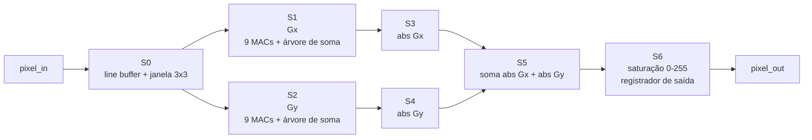
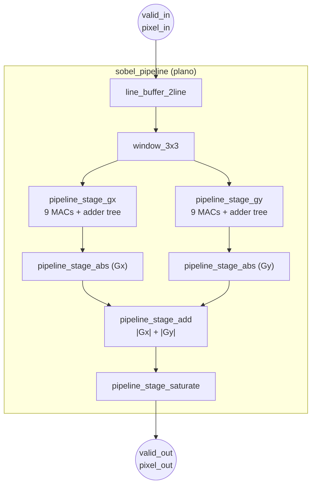
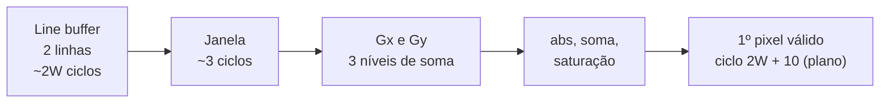
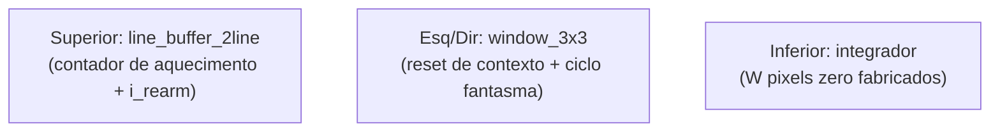

# Arquitetura Pipeline — Filtro Sobel

| Campo | Valor |
|---|---|
| **Versão** | 2.0 (reformatada; plano preservado, com revisão técnica) |
| **Data** | 2026-11-08 |
| **Status** | **PLANEJAMENTO.** Nenhum RTL desta arquitetura existe. Será **reescrita** na abertura da implementação, sobre a interface atual dos módulos comuns |
| **Base** | `ARQUITETURA_MULTICICLO.md` v2.0 (módulos comuns reais) e `AUDITORIA_01_PRE_MULTICICLO.md` (lições) |

> **Como ler este documento.** As §1 a §9 preservam o **plano original** (estágios, esboços de código, projeções), reformatado. Os esboços **não compilam e não foram simulados**: são ilustração. A **§10 (Revisão técnica pré-implementação)** lista o que a leitura contra o multiciclo fechado mostrou estar desatualizado ou errado, e a **§11** lista os pontos que precisam da sua decisão antes de qualquer RTL (CLAUDE.md §15.2). **Nenhuma decisão nova foi tomada aqui.**
>
> **Convenção:** **[projeção]** = estimativa nunca sintetizada; **[inferência]** = derivação sem medição; **[não verificado]** = sem evidência.

---

## Sumário

1. [Visão geral](#1-visão-geral)
2. [Diagrama de blocos](#2-diagrama-de-blocos)
3. [Estágios do pipeline](#3-estágios-do-pipeline-plano-original)
4. [Registrador de pipeline](#4-registrador-de-pipeline-genérico)
5. [Top-level (esboço)](#5-top-level-esboço)
6. [Timing e latência](#6-timing-e-latência)
7. [Gerenciamento de borda](#7-gerenciamento-de-borda)
8. [Verificação](#8-verificação)
9. [Síntese e constraints](#9-síntese-e-constraints)
10. [Revisão técnica pré-implementação](#10-revisão-técnica-pré-implementação)
11. [Pontos a decidir](#11-pontos-a-decidir-antes-de-qualquer-rtl)
12. [Tabela comparativa](#12-tabela-comparativa)
13. [Checklist](#13-checklist-de-implementação)
14. [Referências](#14-referências)

---

## 1. Visão geral

A arquitetura **pipeline** segmenta o cálculo em estágios separados por registradores e processa **1 pixel por ciclo** após o preenchimento inicial. É o ponto intermediário entre área e throughput para visão em tempo real.

### 1.1 Características (todas **[projeção]**)

| Métrica | Valor planejado |
|---|---|
| Latência | 7 ciclos (profundidade do pipeline) |
| Throughput | 1 pixel/ciclo após o preenchimento |
| Área | ≈ 800 LUTs, ≈ 600 FFs (Artix-7) |
| DSPs | 18 (9 para Gx, 9 para Gy) — **ver §10.3** |
| BRAM | 2 (line buffers) |
| Fmax | ≈ 200 MHz (Artix-7) |

### 1.2 Fluxo planejado



---

## 2. Diagrama de blocos



> No plano original, `S1` e `S2` aparecem em sequência numerada, mas **operam em paralelo** sobre a mesma janela (o diagrama acima reflete isso).

---

## 3. Estágios do pipeline (plano original)

### 3.1 Resumo

| Estágio | Nome | Função | Recursos (plano) |
|---|---|---|---|
| **S0** | Line buffer + janela | Forma a janela 3×3 | 2 BRAM + shift registers |
| **S1** | Convolução Gx | 9 MACs + árvore de soma | 9 DSPs **[projeção]** |
| **S2** | Convolução Gy | 9 MACs + árvore de soma | 9 DSPs **[projeção]** |
| **S3** | `\|Gx\|` | Valor absoluto saturante | LUTs |
| **S4** | `\|Gy\|` | Valor absoluto saturante | LUTs |
| **S5** | `\|Gx\| + \|Gy\|` | Soma | 1 somador |
| **S6** | Saturação final | Clip 0–255 e registrador de saída | LUTs + FFs |

### 3.2 S0 — line buffer e janela

Módulos `line_buffer_2line` e `window_3x3` de `common/`. O plano diz que "já existem"; ver §10.1 para a interface **atual**, que mudou.

### 3.3 S1 e S2 — convolução Gx e Gy

Esboço original (mantido para registro; **não é RTL pronto**):

```systemverilog
module pipeline_stage_gx #(
    parameter int DATA_WIDTH   = 8,
    parameter int KERNEL_WIDTH = 4,
    parameter int ACC_WIDTH    = 16
)(
    input  logic                         clk, rst_n, valid_in,
    input  logic [DATA_WIDTH-1:0]        window [0:2][0:2],
    input  logic                         last_pixel_in, last_line_in,
    output logic                         valid_out,
    output logic signed [ACC_WIDTH-1:0]  gx_sum,
    output logic                         last_pixel_out, last_line_out
);
    localparam logic signed [KERNEL_WIDTH-1:0] KERNEL_GX [0:8] = '{-1,0,1, -2,0,2, -1,0,1};
    // 9 produtos combinacionais + árvore de soma de 3 níveis registrados
endmodule
```

Gy é idêntico, com `KERNEL_GY = {-1,-2,-1, 0,0,0, 1,2,1}`.


### 3.3.1 S3 e S4 — valor absoluto

Absoluto com tratamento do caso extremo de complemento de 2 (`−32768` em 16 bits não tem positivo na mesma largura). `S4` é uma segunda instância do mesmo módulo.

### 3.3.2 S5 e S6 — soma e saturação

`magnitude = |Gx| + |Gy|` com 1 bit extra (17 bits), seguida de saturação em `2^DATA_WIDTH − 1 = 255`.

### 3.3.3 Sinais de controle

`valid`, `last_pixel` e `last_line` propagam por todos os estágios. **Ver §10.4**: o multiciclo real **não usa** `last_pixel`/`last_line`.

---

## 4. Registrador de pipeline genérico

```systemverilog
module pipeline_reg #(parameter int WIDTH = 1)(
    input  logic             clk, rst_n, valid_in,
    input  logic [WIDTH-1:0] data_in,
    output logic             valid_out,
    output logic [WIDTH-1:0] data_out
);
    always_ff @(posedge clk or negedge rst_n)
        if (!rst_n) begin valid_out <= 1'b0; data_out <= '0; end
        else        begin valid_out <= valid_in; data_out <= data_in; end
endmodule
```

O plano citava `pipeline_reg.sv` como já existente em `common/`. **Confirmado em 2026-11-08: o arquivo não existe no repositório.** O módulo deve ser criado ou dispensado, conforme o ponto **P4** (§11): um pipeline livre, com `valid` viajando junto do dado, pode usar registradores por estágio em vez de um módulo genérico.

---

## 5. Top-level (esboço)

O esboço original instancia os estágios com as saídas do line buffer **desconectadas** (`/*nc*/`) e conecta `valid` de `window_3x3` ao mesmo sinal que sua entrada. É um **diagrama de intenção**, não um top compilável. A conexão real dependerá da decisão do ponto **P1** (§11).

---

## 6. Timing e latência

### 6.1 Preenchimento



Primeiro pixel válido no plano: ciclo **`2·IMG_WIDTH + 10`** **[projeção]**. Com as mudanças dos módulos comuns (§10.1), esse número precisa ser **recalculado**.

### 6.2 Estado estacionário (plano)

| Métrica | Valor (640×480) |
|---|---|
| Ciclos/frame | 640 × 480 = 307.200 |
| Tempo @ 100 MHz | 3,072 ms (**≈ 325 fps**) |
| Tempo @ 200 MHz | 1,536 ms (≈ 650 fps) |

Este número assume **1 pixel por ciclo ininterrupto**. Ver §10.2: o `window_3x3` exige ao menos 1 ciclo de gap por linha e o frame real tem `W` pixels de padding inferior.

---

## 7. Gerenciamento de borda

O plano original dizia que `line_buffer_2line` e `window_3x3` implementam **replicação de borda** ("primeira coluna: `window[:,0] = window[:,1]`"). **Isso está errado para o RTL real**, que usa **zero-padding** nos quatro lados (`ARQUITETURA_MULTICICLO.md` §7). O modelo de referência do plano usa `BORDER_REPLICATE`: com zero-padding, o golden correto é `BORDER_CONSTANT`.



---

## 8. Verificação

| Teste do plano | Observação |
|---|---|
| `test_pipeline_reset` | Reset assíncrono |
| `test_pipeline_latency` | Latência exata |
| `test_pipeline_throughput` | 1 pixel/ciclo sustentado |
| `test_pipeline_3x3_image` | Imagem 3×3 |
| `test_pipeline_640x480` | Frame completo vs golden |
| `test_pipeline_edge_cases` | **W=1 não é suportado** pelos módulos comuns; 1×1 e coluna única exigem decisão |
| `test_pipeline_backpressure` | Depende do ponto P1 |
| `test_pipeline_frame_boundary` | Substituído por **multi-frame (3+)**, requisito de aceite (Alternativa 6) |

**Requisitos herdados do multiciclo** (ver `AUDITORIA_01`, apêndice de lições): massa **sem saturação** com guarda `n_sat==0`; `run_isolated` com contagem exata de `$error`; instrumentação por `on_cycle`; canário em toda sonda; **recontar testes listando os nomes**.

Cobertura: code ≥ 95%, toggle ≥ 90%. FSM não se aplica.

---

## 9. Síntese e constraints

O plano trazia XDC (Artix-7) e SDC (Quartus) com nomes de porta do esboço (`pixel_in`, `last_pixel_in`...), que não correspondem ao RTL atual. O fluxo real é **Quartus** com `constraints/multicycle.sdc`. Para o pipeline será criado `setup_proj_pipeline.tcl` e um `.sdc` próprio, com clock alvo **[a decidir: 200 MHz exige validação]**. Atributos de síntese do plano (`use_dsp`, `ram_style`) são de Xilinx; o equivalente no Quartus é `ramstyle`/`multstyle`.

---

## 10. Revisão técnica pré-implementação

Resultado da leitura do plano contra o multiciclo fechado. Nada abaixo altera o plano; são **achados** a resolver antes do RTL.

### 10.1 Interface dos módulos comuns mudou

O plano assume `line_buffer_2line` e `window_3x3` **antigos**. Hoje:

| Módulo | Mudança | Impacto no pipeline |
|---|---|---|
| `line_buffer_2line` | `o_curr`/`o_valid` **registrados** (+1 ciclo); `i_tag`, `i_rearm`; `mem1` com profundidade W+1 | Latência e primeiro pixel válido mudam |
| `line_window_skid` | **Novo**: FIFO de profundidade 2 entre line buffer e janela | Obrigatório ou substituível? (**P1**) |
| `window_3x3` | `o_ready`, tags, `o_window_valid_geom`; exige ≥ 1 ciclo de gap por linha | Throughput real < 1 pixel/ciclo (§10.2) |

### 10.2 "1 pixel por ciclo" precisa ser requalificado **[inferência]**

- O ciclo fantasma da borda direita consome **1 ciclo por linha**: o fluxo de entrada precisa de blanking horizontal.
- A borda inferior exige `W` pixels de padding por frame.
- Resultado: o throughput efetivo é ligeiramente menor que 1 pixel/ciclo, e o "325 fps" do plano é um **limite superior**, não uma previsão. O multiciclo mediu um termo fixo `(2W−1)·F + 6` além do termo dominante, o que mostra que esses efeitos existem; o do pipeline precisa ser **medido**, não suposto.

### 10.3 Estimativa de DSPs provavelmente superestimada **[inferência]**

O plano prevê 18 DSPs (`9 + 9`). Os coeficientes são **constantes** ±1/±2 e o `mac_unit` do multiciclo foi sintetizado com **0 DSPs** (`.fit.rpt`). Com kernels `localparam` constantes, a síntese reduz as multiplicações a deslocamento e soma. Além disso, só **6 dos 9 taps** são não nulos. O número real depende de a descrição forçar ou não blocos DSP. Também: o acumulador do plano é de **16 bits**, mas o mínimo exato provado é **11 bits** (±1020), o que reduz área.

### 10.4 Sinais de controle e descarte

O plano propaga `last_pixel`/`last_line` por todos os estágios. O multiciclo **não usa** esses sinais: o fim de frame é inferido por contador (`feed_cnt_r`), e o descarte da "linha de saída −1" é feito por `win_cnt_r` cíclico (F-17). Em pipeline, cada estágio atrasa `valid`; uma janela espúria atravessaria todos os estágios se não fosse descartada antes. **O ponto de descarte deve ser decidido** (**P3**).

### 10.5 Registradores com `if (valid_in)` em cada estágio

No esboço, os registradores internos de `pipeline_stage_gx` só avançam quando `valid_in=1`, e a árvore de soma não carrega o `valid` junto de cada nível. Com **buracos** no fluxo (blanking, stall), isso desalinha dado e `valid`. A escolha entre **pipeline livre** (sempre avança, `valid` viaja junto) e **pipeline com enable** (congela) é uma decisão de projeto (**P4**).

### 10.6 Latência: o "7" do plano

O plano conta 7 estágios (`S0` a `S6`), mas `S1` e `S2` são paralelos, e a árvore de soma de cada um tem **3 níveis**. Contando janela (1), árvore (3), abs (1), soma (1) e saturação (1) também resultam em 7, **por uma composição diferente da documentada**. Isso será rediscutido com o `curr` registrado e as FIFOs.

### 10.7 Documentos e comparação

A tabela comparativa do plano usava o multiciclo como "~200 LUTs, 1 DSP, 250 MHz, 6,8 fps". Foi **corrigida** (§12): 0 DSPs, 16 ciclos/pixel, ≈ 20 fps, números do Cyclone V.

---

## 11. Pontos a decidir antes de qualquer RTL

| # | Ponto | Alternativas | Observação |
|---|---|---|---|
| **P1** | Elasticidade entre line buffer e janela | (a) reutilizar `line_window_skid`; (b) pipeline **livre** sem backpressure, com contrato de blanking; (c) reabrir `common/` | A (b) elimina a FIFO, mas transfere o contrato ao produtor |
| **P2** | Contrato de entrada | Contrato A (multiciclo) ou stream contínuo com blanking | Afeta MMIO e o throughput real |
| **P3** | Descarte da "linha −1" e identidade de janela | Contador de janelas (como F-17), ID de sequência/sideband, marcar posição | Decisão de arquitetura registrada como adiada ao Pipeline |
| **P4** | Pipeline livre ou com enable | Livre (`valid` viaja) ou enable | Define o desalinhamento sob buracos |
| **P5** | Monitor de integridade | Replicar `o_status` (E1/E2/D) ou versão com e sem monitor | Custo estimado ≈ 17 FFs a W=640 **[inferência]** |
| **P6** | Porta `o_col` em `window_3x3` | Reabrir `common/` (aditivo) para economizar ≈ `$clog2(W)` FFs | Toda reabertura anterior de `common/` achou ao menos 1 bug |
| **P7** | Largura do acumulador e inferência de DSP | 11 bits e deslocamento (0 DSPs) ou multiplicador genérico | Afeta a comparação de área |
| **P8** | Clock alvo | 200 MHz (plano) ou valor derivado do primeiro caminho crítico | O multiciclo não fechou 100 MHz (−0,199 ns) |

---

## 12. Tabela comparativa

| Métrica | Multiciclo (**medido**, Cyclone V) | Pipeline **[projeção]** | Paralela 2×2 **[projeção]** | Paralela 3×3 **[projeção]** |
|---|---|---|---|---|
| Ciclos úteis / throughput | 15 úteis; 1 pixel / 16 ciclos | 1 pixel/ciclo | 4 pix/clk | 9 pix/clk |
| ALMs / FFs | 4.601 / 6.270 | n/d | n/d | n/d |
| DSPs | **0** | 18 (ver §10.3) | 72 | 162 |
| M10K / BRAM | 3 | 2 | 4 | 6 |
| Fmax | 98 MHz (Cyclone V) | ≈ 200 MHz (Artix-7) | ≈ 150 MHz | ≈ 120 MHz |
| FPS @ 100 MHz (640×480) | ≈ 20 | ≈ 325 (limite superior) | ≈ 1.300 | ≈ 2.930 |

> Unidades de Cyclone V e de Artix-7 **não são comparáveis**. A comparação final exige a mesma ferramenta e o mesmo dispositivo.

---

## 13. Checklist de implementação

**Pré-requisitos**
- [ ] Decidir P1 a P8 (§11)
- [ ] Restaurar os 3 testes de `window_3x3` (C1/F-18), pois o pipeline reutiliza o módulo
- [ ] Reescrever este documento sobre a interface atual dos módulos comuns

**RTL**
- [ ] `pipeline_stage_gx`, `pipeline_stage_gy`, `pipeline_stage_abs`, `pipeline_stage_add`, `pipeline_stage_saturate`
- [ ] `sobel_pipeline` (integração)
- [ ] Verible e Verilator `-Wall` sem warnings

**Verificação**
- [ ] Testes por estágio e de integração
- [ ] Multi-frame (3+), massa sem saturação, golden com erro = 0
- [ ] Throughput e latência **medidos**
- [ ] Cobertura code ≥ 95% e toggle ≥ 90%

**Síntese**
- [ ] Quartus (mesmo dispositivo do multiciclo) sem latch; timing documentado
- [ ] Relatório de recursos preenchido

---

## 14. Referências

- `ESPECIFICACAO_SOBEL.md` (§3.3 e §7)
- `ARQUITETURA_MULTICICLO.md` v2.0 (módulos comuns, lições, medidas)
- `AUDITORIA_01_PRE_MULTICICLO.md` (apêndice de lições, §10 impactos futuros)
- `MODELO_LATENCIA_PIPELINE.md` (modelo de identidade/ordem das janelas)
- Gonzalez & Woods — *Digital Image Processing*
- Intel — Cyclone V Device Handbook; Xilinx UG901
- IEEE 1800-2017