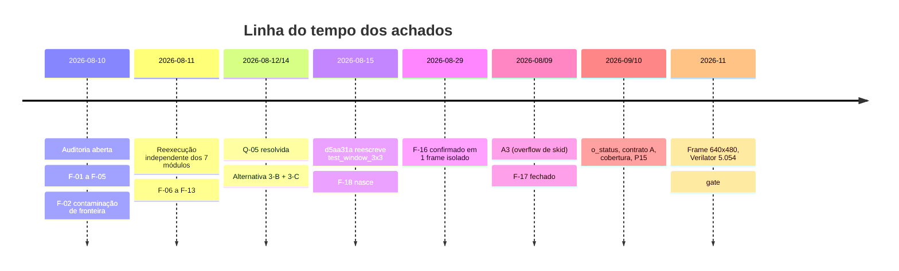
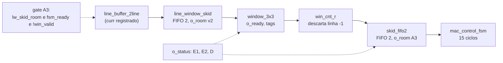

# Auditoria Arquitetural 01 — Fechamento da Arquitetura Multiciclo

> **Relação com o restante do projeto.** Este documento NÃO substitui nem duplica `CLAUDE.md`, `RESUMO_ESTADO_PROJETO.md` ou `docs/ARQUITETURA_MULTICICLO.md`. Regras permanentes e decisões consolidadas vivem lá; aqui entram o processo, as evidências e as conclusões **desta** auditoria, de forma rastreável. É a **única** auditoria do multiciclo: ela abre antes do fechamento (2026-08-10) e fecha com o gate formal da §17 (2026-11-08).
>
> **Legenda do checklist:** `[ ]` não analisado · `[x]` concluído · `[~]` parcial · `[!]` problema · `[?]` depende de informação adicional.
>
> **Nota de continuidade (revisão 2026-11-08).** Esta versão reescreve o documento por inteiro. Nenhum achado com evidência válida foi apagado: foram reorganizados, atualizados de status e, onde havia erro, corrigidos com a correção registrada (§11, F-13 e F-18). O placeholder colado por engano na antiga Decisão D-05 foi removido, e as linhas A-14 a A-16, que estavam soltas fora de tabela, voltaram para a tabela de ações.

---

## 1. Identificação

| Campo | Valor |
|---|---|
| Nome | Auditoria Arquitetural 01 — Fechamento da Arquitetura Multiciclo |
| Código | AUDITORIA-01 (arquivo `docs/AUDITORIA_01_PRE_MULTICICLO.md`) |
| Marco | Declarar a arquitetura Multiciclo fechada e liberar o início da arquitetura Pipeline |
| Objetivo | Determinar se o multiciclo (módulos `common/` + `multicycle/`, integrador, testes, cobertura, síntese) é sólido, coerente e reutilizável para sustentar Pipeline, Paralela, FPGA e o fluxo ASIC opcional |
| Data de início | 2026-08-10 |
| Data desta revisão | 2026-11-08 |
| Status | **CONCLUÍDA** — gate **GO WITH CONDITIONS** (§17) |
| Escopo do "fechado" | **Funcional e verificação** (decisão D-10). Caracterização de síntese entra como condição herdada |

---

## 2. Contexto

A auditoria nasceu em 2026-08-10, durante a depuração de `sobel_multicycle.sv`, quando decisões locais mostraram consequências além do módulo onde foram tomadas (origem de `CLAUDE.md` §15.10). Entre agosto e novembro ela acompanhou o fechamento real do módulo, e nesse intervalo apareceram três defeitos que a versão inicial não podia prever: **F-16** (corrida de latência entre `line_buffer_2line` e `window_3x3`), **F-17** (janelas espúrias de cada frame) e **F-18** (testes de `window_3x3` perdidos). Os dois primeiros foram corrigidos na fonte. O terceiro é condição aberta do gate.

---

## 3. Escopo

**Dentro:**

- `rtl/common/`: `line_buffer_2line`, `window_3x3`, `abs_saturate`, `magnitude_l1`, `line_window_skid`.
- `rtl/multicycle/`: `mac_unit`, `kernel_rom`, `mac_control_fsm`, `skid_fifo2`, `sobel_multicycle`.
- Testbenches cocotb em `tb_python/`, cobertura (Fase 4) e teste de frame completo (Frente 2).
- Coerência entre `ESPECIFICACAO_SOBEL.md`, `ARQUITETURA_MULTICICLO.md`, `STATUS.md`, `RESUMO_ESTADO_PROJETO.md` e o RTL/testes reais.
- Síntese no Quartus (resultados existentes) como evidência de viabilidade.
- Consequências previsíveis do que está em `common/` sobre Pipeline, Paralela, FPGA e ASIC.

**Fora:**

- RTL de Pipeline e Paralela (apenas análise prospectiva).
- Potência, segundo vendor (Vivado), ASIC e integração MMIO com o cv32e40p.

---

## 4. Critérios e fontes de evidência

Esta revisão **não executou nada**. Ela consolida evidência obtida em execuções anteriores e registrada no repositório, mais três conferências feitas pelo usuário em 2026-11-08. A separação abaixo é deliberada: foi ela que permitiu achar o F-06 e o F-18.

| Tipo | Fonte | Observação |
|---|---|---|
| **Execução real no repositório do usuário** | `make cocotb` (79 passed), `cov-triage`/`cov-report`, `make frame`, Verible, Verilator 5.054 `-Wall` | Resultados registrados em `RESUMO_ESTADO_PROJETO.md`. O usuário confirmou em 2026-11-08 que **nenhum número mudou** desde o commit `443a7a5` |
| **Execução real, 2026-11-08 (esta revisão)** | `git log -S`, `git show d5aa31a`, `grep -c "^@cocotb.test"` por arquivo | Saídas coladas pelo usuário |
| **Quartus** | `.fit.rpt`, `.sta.rpt`, `critical_path_summary.rpt` | **Anteriores** à correção de `mem1` (confirmado pelo usuário em 2026-11-08) |
| **Reprodução isolada** | Ambientes reconstruídos em sessões de chat | Distinguida de execução real, conforme `CLAUDE.md` §14.3 |
| **Leitura direta** | RTL, testes, documentos | Comparação cruzada textual |

**Lacunas conhecidas de evidência:** potência, Vivado, simulação da netlist pós-síntese (`test_postsynth_sobel.py` existe, **sem registro de execução**) e qualquer execução em hardware.

---

## 5. Estado do projeto no fechamento

Recontagem por comando real (2026-11-08): `for f in tb_python/test_*.py; do ... grep -c '^@cocotb.test' ...`.

| Módulo | Arquivo de teste | Corrotinas | Observação |
|---|---|---|---|
| `line_buffer_2line` | `test_line_buffer_2line.py` + `test_line_buffer_depth.py` | 10 + 4 | Tags, rearm, W ∈ {2…640} |
| `window_3x3` | `test_window_3x3.py` | **6** | **Nomes diferentes dos de 2026-08-11 (F-18)** |
| `abs_saturate` | `test_abs_saturate.py` | 8 | Inclui −1024 em 11 bits |
| `magnitude_l1` | `test_magnitude_l1.py` | 4 | |
| `line_window_skid` | `test_line_window_skid.py` | 6 | 5 normais + overflow |
| `mac_unit` | `test_mac_unit.py` | 9 | |
| `kernel_rom` | `test_kernel_rom.py` | 4 | 3 normais + tap inválido |
| `mac_control_fsm` | `test_mac_control_fsm.py` + `test_fsm_state_arc_coverage.py` | 5 + 1 | 16/16 estados, 17/17 arcos |
| `skid_fifo2` | `test_skid_fifo2.py` | 6 | 5 normais + overflow |
| `sobel_multicycle` | `test_sobel_multicycle.py` | 5 | 2 e 4 frames |
| F-17 (multi-frame) | `test_f17_cyclic_discard.py` | 1 | 12 elaborações (W × H) |
| Monitor `o_status` | `test_pipeline_status.py` | 1 | 9 modos de sonda |
| Contrato A | `test_valid_hold_handshake.py` | 1 | |
| Frame cheio | `test_frame_640x480.py` | 1 | `RUN_SLOW=1` |
| Netlist | `test_postsynth_sobel.py` | 4 | **Sem registro de execução** |
| Infraestrutura | `test_cov_hook.py`, `test_cov_report.py`, `test_meta_guard.py` | 0 | Python puro, sem simulador |

**Total: 76 corrotinas em 17 arquivos.** Os "**79 passed**" do pytest contam **itens de teste** (parametrizações, runners, testes Python puros) e **não** são comparáveis a corrotinas. Não somar um com o outro.

> **Correção registrada (F-13, preservada).** A versão de 2026-08-10 contava 5 corrotinas para `test_window_3x3.py`; a contagem real era 6. Em 2026-11-08 a contagem é 6 outra vez, mas **com nomes diferentes** (F-18).

---

## 6. Checklist de auditoria

### 6.1 Módulos

- [x] `line_buffer_2line.sv` — §7.1
- [x] `window_3x3.sv` — §7.1 (com ressalva F-18 de testes)
- [x] `abs_saturate.sv`, `magnitude_l1.sv` — §7.1
- [x] `line_window_skid.sv` — §7.1
- [x] `mac_unit.sv`, `kernel_rom.sv`, `mac_control_fsm.sv` — §7.2
- [x] `skid_fifo2.sv` — §7.2
- [x] `sobel_multicycle.sv` — §7.3 (status em conflito F-06 **resolvido**)

### 6.2 Testes

- [x] Testes unitários dos 10 módulos RTL (com 1 exceção parcial: `window_3x3`, F-18)
- [x] Teste de integração e multi-frame (Alternativa 6)
- [x] Teste de frame completo 640×480
- [x] Cobertura de código, toggle e FSM
- [ ] `test_postsynth_sobel.py` executado na netlist **(condição C3)**

### 6.3 Transversais

- [x] Convenções de nomenclatura e reset (`i_*`/`o_*`, `_r`, `rst_n` assíncrono ativo-baixo)
- [x] Handshake ready/valid: contrato A, `o_ready` de `window_3x3`, gating A3
- [x] Zero-padding e composabilidade entre frames (F-02, F-17)
- [x] Reuso de `common/` sob a ótica de Pipeline e Paralela (§10)
- [x] Cobertura de código (F-04, fechado na Fase 4)
- [x] Lint Verible e Verilator
- [~] Documentação coerente com o RTL (§11, F-12 e F-23)
- [~] Síntese (F-22, condição C2)

---

## 7. Auditoria dos módulos

### 7.1 `rtl/common/`

Os 5 módulos foram reauditados ao longo de agosto a novembro. O que mudou desde 2026-08-11:

- **`line_buffer_2line`** foi reaberto 3 vezes (tags 3-B, `i_rearm` 3-C, `curr` registrado do F-16) mais a slot extra de `mem1`. Cada reabertura achou ao menos 1 bug real (§13). Hoje tem 14 corrotinas de teste (incluindo a varredura de largura).
- **`window_3x3`** foi reaberto 3 vezes (`o_ready`, tags 3-B, herança de tag no padding). Hoje tem 6 corrotinas, mas **perdeu a cobertura dedicada** de gap múltiplo, violação sustentada e gating por `o_ready` (F-18).
- **`line_window_skid`** é novo (Metade 2 do F-16). Protege a leitura, mas **não protege a escrita** contra overflow (diferença deliberada em relação a `skid_fifo2`, documentada no cabeçalho do RTL).
- **`abs_saturate`** ganhou o teste do extremo na largura real (−1024) na Fase 4.

**Divergência RTL × `ESPECIFICACAO_SOBEL.md`:** as assinaturas de §3.2 não correspondem ao RTL (F-12). A engenharia usa `ARQUITETURA_MULTICICLO.md`, atualizado.

### 7.2 `rtl/multicycle/`

- `kernel_rom`: coeficientes recalculados e conferidos; trava ativa (`o_addr_valid`) e `$error`.
- `mac_control_fsm`: 16 estados, 15 ciclos úteis (`test_cycle_timing`), 17/17 arcos.
- `skid_fifo2`: substituiu o skid de profundidade 1. `o_room` ganhou a fórmula "olhando à frente" (A3).
- Nenhum defeito funcional aberto nestes módulos.

### 7.3 `sobel_multicycle.sv`

O conflito de status do F-06 foi **resolvido** em 2026-08-12 (o módulo existe e foi validado). Hoje contém:

- Controle de frame (`feed_cnt_r`, `frame_tag_r`, `frame_start_pulse`, padding inferior).
- Gating A3 (`lw_skid_room`, `skid_room`, `win_ready` em lockstep).
- `win_cnt_r` cíclico (F-17).
- Monitor `o_status[2:0]`.

### 7.4 Lint

| Ferramenta | Resultado |
|---|---|
| Verible `v0.0-4084-gf3e4d98b` | **0 warnings** (com `--rules=+line-length=120`) |
| Verilator 5.054 `--lint-only -Wall` | **0 warnings**, hierarquia completa e módulos isolados |

O F-09 (5 warnings do Verilator em 2026-08-11) foi tratado com casts explícitos (A-10) e `lint_off`/`lint_on` pontuais (A-09), e reconfirmado em 0 na Fase 1. O F-14 (line-length) era falso positivo de invocação, fechado.

---

## 8. Auditoria dos testes

A pergunta orientadora é a mesma de 2026-08-10: **os testes sustentam a confiança, ou só confirmam o caminho feliz?**

**Pontos fortes (com evidência):**

- Todo módulo com contrato violável tem teste negativo dedicado, com contagem **exata** de `$error`, protegida desde a Fase 3 pela guarda `run_isolated(expect_errors=...)` (P15). A guarda tem meta-teste estático e 2 canários (`test_meta_guard.py`).
- Os testes de multi-frame (Alternativa 6) cumpriram o propósito: revelaram o F-16 e o F-17.
- Massas de teste sem saturação, com guarda `n_sat == 0` (licão do F-16).
- Cobertura **medida**, não presumida: code 425/426, toggle 3596/3599, FSM 16/16 e 17/17 (§17).

**Pontos fracos (honestos):**

- **F-18:** 3 testes de `window_3x3` foram perdidos.
- **Casos de borda de geometria:** 1×1, 2×2 e coluna única **não** são cobertos. W=1 não é suportado pelo RTL.
- **Frame cheio:** só 2 frames, `stall=0`, sem saturação.
- **Stall externo:** testado só até W ≤ 8.
- **Netlist:** `test_postsynth_sobel.py` sem registro de execução.
- A classe de exclusão `so-icarus` (43 pontos, 1,1%) **não é medida**.

---

## 9. Auditoria arquitetural

1. **Os módulos de `common/` e `multicycle/` são coerentes entre si e passam em 100% dos seus testes**, com a ressalva de F-18.
2. **A superfície de risco de fronteira de frame ficou contida no integrador**, como previsto em 2026-08-11, **mas** a causa raiz do F-16 estava na **interface** entre dois módulos de `common/`, não no integrador. Isso corrige parte da previsão: "o raio de impacto está contido em um único módulo" valia para o F-02, não para o F-16.
3. **Lição arquitetural central (F-16):** módulos síncronos ligados por fios combinacionais, com latências efetivas diferentes entre sinais irmãos, criam corridas que simulação de módulo isolado não revela. A resposta adotada foi **elasticidade por FIFOs síncronas de saída registrada**, e não ajustes de limiar.
4. **O pipeline de 5 estágios** (`line_buffer_2line → line_window_skid → window_3x3 → skid_fifo2 → mac_control_fsm`) agora tem um modelo de identidade (`docs/MODELO_LATENCIA_PIPELINE.md`). A Camada 2 (tempo) **não** foi implementada.
5. **Pontos sensíveis conhecidos** (estado que integra histórico supondo que nada se perde): `win_cnt_r` e `col_cnt_r`/`phantom` (cobertos pelo bit D do monitor); `feed_cnt_r`/`col_feed_r`/`frame_tag_r` (contrato do produtor); `frame_tag_r` de 1 bit (aliasing documentado). Contar versus marcar posição é decisão do Pipeline.

---

## 10. Impactos futuros

| Etapa futura | Impacto identificado | Natureza |
|---|---|---|
| **Pipeline** | `ARQUITETURA_PIPELINE.md` assume `line_buffer_2line`/`window_3x3` **com a interface antiga** (sem tags, sem `i_rearm`, com `o_curr` combinacional). Herda automaticamente `line_window_skid`, os 3 pontos sensíveis (§9.5) e a dívida F-18. A latência de 7 ciclos e a "1 pixel/ciclo" precisam ser recalculadas com o `curr` registrado e as FIFOs | **Confirmado** por leitura |
| **Paralela** | Usa `line_buffer_3line` próprio, mas herda o **padrão** (elasticidade por FIFO, contrato A, monitor) e a lição do F-16 | **Confirmado** por leitura |
| **FPGA** | `line_buffer_2line` consome 94% dos ALMs (`mem2` em MLAB por leitura assíncrona). O gargalo de Fmax é `line_window_skid` | Medido (anterior à slot extra) |
| **MMIO** | Contrato A, saída sem `ready`, `o_status` e a perda silenciosa quando o produtor ignora `o_ready` precisam constar da especificação de interface | **Requisito** |
| **ASIC** | Nenhuma evidência ainda | Aberto |
| **Verificação** | Padrões reaproveitáveis: `run_isolated` com guarda de `$error`, `on_cycle`, canários, massa sem saturação, agregador de cobertura | Pronto |

---

## 11. Achados, riscos e dívida técnica

Numeração **sequencial global**. Achados antigos preservados, com status atualizado.

| ID | Descrição | Severidade | Status |
|---|---|---|---|
| F-01 | `window_3x3` precisou de retrofit (`o_ready`) depois de fechado | Média | Lição arquitetural, sem pendência |
| F-02 | Contaminação de fronteira de frame em `sobel_multicycle` | Alta | **Fechado na fonte** (3-C `i_rearm` + 3-B como rede de segurança) |
| F-03 | Nenhuma métrica de síntese real | Média | **Fechado parcialmente**: há Quartus; ver F-22 |
| F-04 | Cobertura de código nunca medida | Média | **Fechado** (Fase 4: 425/426 e 3596/3599) |
| F-05 | Bug de padrão repetido em `line_buffer_2line`/`window_3x3` mal interpretados por integradores | Média | Motivou `CLAUDE.md` §15.9/15.10 |
| F-06 | Conflito de status sobre `sobel_multicycle.sv` entre documentos | Alta | **Resolvido** em 2026-08-12 |
| F-07 | Reexecução independente da suíte dos 7 módulos (12/12) | Positivo | Confirmado |
| F-08 | Verible 0 warnings | Positivo | Confirmado |
| F-09 | Verilator `-Wall`: 5 warnings (`WIDTHEXPAND`, `WIDTHTRUNC`, `SYNCASYNCNET`, `PINMISSING`) | Baixa–Média | **Fechado** (A-09/A-10; reconfirmado 0 warnings no 5.054) |
| F-10 | "~11 ciclos/pixel" em `ARQUITETURA_MULTICICLO.md` §1.1 | Baixa | **Fechado**; superado por 16 ciclos/pixel (v2.0) |
| F-11 | `CLAUDE.md` citava `plano_ic_submissao.md` inexistente | Baixa | **Fechado** |
| F-12 | `ESPECIFICACAO_SOBEL.md` §3.2 diverge do RTL | Média | **Aberto** — correção na Entrega 4 (condição C5) |
| F-13 | Auditoria contava 5 corrotinas para `test_window_3x3.py`; eram 6 | Baixa | **Corrigido**. Ver F-18 |
| F-14 | Verible line-length default 100 em `sobel_multicycle.sv:272` | Baixa | **Fechado** (falso positivo de invocação, limite do projeto é 120) |
| F-15 | Possível sintaxe incorreta do comando de lint em `ESPECIFICACAO_SOBEL.md` §6.1 (`--indentation_size`) | Baixa | **[não verificado]**. Conferir com `verible-verilog-format --helpfull \| grep -i indent`; corrigir na Entrega 4 |
| F-16 | Corrida de latência `line_buffer_2line` → `window_3x3`: 10/12 pixels errados em 1 frame isolado de baixo contraste, mascarado por saturação | **Alta** | **Corrigido e validado** (Alternativa 1: `curr` registrado + `line_window_skid`) |
| F-17 | Janelas espúrias da "linha de saída −1" de **todo** frame entravam como pixels reais (descarte só no frame 0) | **Alta** | **Corrigido e validado** (`win_cnt_r` cíclico; 12 casos, 5 lotes cada) |
| F-18 | **`test_window_3x3.py` perdeu `test_multiple_gap_cycles`, `test_sustained_contract_violation_detected` e `test_ready_gating_prevents_manual_gap_calculation`** no commit `d5aa31a` (2026-08-15). O docstring do arquivo afirma que esses testes foram repetidos; só a geometria foi. A contagem (6) **não mudou**, mascarando a troca | **Média** | **Aberto — condição C1** |
| F-19 | Ressalva 3: `win_cnt_r` desalinha permanentemente se uma janela se perde a montante de `window_3x3`; perda silenciosa | Média | **Mitigado** por `o_status` (bits E1/E2/D). Limites do modelo de falhas na §17 |
| F-20 | Ressalva 1: `i_valid` com `o_ready=0` perde o pixel em silêncio | Baixa | **Fechado** como contrato A (medido); requisito para o MMIO |
| F-21 | Overflow de `skid_fifo2` após integrar `line_window_skid` | Alta | **Corrigido** (A3, 2 bugs reais: `win_ready` no gating; `o_room` defasado) |
| F-22 | Síntese: Fmax 98,05 MHz, slack −0,199 ns vs 100 MHz; 2 M10K em `skid_fifo2`; `mem2` em MLAB; números **anteriores à slot extra** de `mem1` | Média | **Aberto — condição C2** |
| F-23 | Documentação defasada: `STATUS.md`, `ARQUITETURA_MULTICICLO.md`, menções ao multiciclo em Pipeline/Paralela/`ESPECIFICACAO` | Média | **Em fechamento** (Entregas 1, 2 e 4). `ARQUITETURA_MULTICICLO.md` v2.0 e `STATUS.md` entregues |
| F-24 | Comentário "CONTRATO DE SÍNTESE — read-before-write" em `line_buffer_2line.sv` descreve a versão anterior | Baixa | **Aberto** (só comentário) |
| F-25 | `COCOTB_TESTCASE` obsoleto no cocotb 2.1.0; `run_isolated` ainda o define | Baixa | **Aberto** |
| F-26 | **Perda de registro:** o texto de Q-01 a Q-04 (e possivelmente de outras partes da versão de 2026-08-10) nunca foi commitado; o documento dizia "preservá-las" sem que existissem no repositório. Confirmado por `git log -p`. O arquivo tem **um único commit** (`4f7149c`) até 2026-11-08: as revisões de 08-10 a 08-13 existem só como o snapshot desse commit, e as linhas de histórico da §18 anteriores a ele são registro documental, não recuperável pelo git | Baixa | **Fechado** como lição de processo (apêndice, item 8). As 4 questões foram encerradas por perda de registro (§14) |

---

## 12. Decisões

Decisões D-01 a D-03 (agosto) e D-04 foram preservadas; D-05 a D-10 completam o registro. Formato: alternativas → decisão → justificativa.

**D-01 a D-03 (2026-08-10, histórico).** Skid buffer local, `warmup_done_r` e Alternativa B de re-armamento por fronteira. As duas últimas foram **superadas**: `warmup_done_r`/`discard_cnt_r` foram substituídos por `win_cnt_r` (D-06), e o skid de profundidade 1 por `skid_fifo2` (D-08).

**D-04 (2026-08-11).** Tratar `RESUMO_ESTADO_PROJETO.md` como fonte do estado corrente e o conteúdo de F-02/D-01–D-03 como raciocínio preservado, **não** confirmado como aplicado. Escolhida a opção de registrar o conflito e pedir reconciliação. **Resolvida** em 2026-08-12.

**D-05 (2026-08-12/14) — Prevenção estrutural do bug de fronteira (3-B + 3-C + regra 6).**
- Alternativas: 3-B sozinha (detecção por tag); 3-C (re-armar o aquecimento via `i_rearm`); ambas.
- Decisão: **3-C como correção e 3-B como rede de segurança**, mais a Alternativa 6 como regra de processo.
- Justificativa: a 3-B sozinha detectava a contaminação, mas o dado correto já havia vazado, e `test_two_consecutive_frames` travava por timeout. Detectar não é corrigir (`CLAUDE.md` §15.11.1).

**D-06 (F-17) — Contador cíclico por ordem de janela (Opção 2).**
- Alternativas: (A) limiar empírico 3 por tag, descartada porque só deslocou o sintoma; (1) re-armar `discard_cnt_r` com limiar `W`, descartada por depender da ordem temporal de `frame_start_pulse`; (2) contador cíclico de módulo `W·(H+1)`.
- Decisão: **Opção 2**. Depende só da ordem das janelas, não reabre `common/`.

**D-07 (Ressalva 3) — Monitor `o_status` só sinaliza.**
- Alternativas: sinalizar; autocorrigir; ID de sequência por janela; reabrir `common/`.
- Decisão: **só sinalizar**. A autocorreção esconderia o erro, e o dano de uma perda a montante está em 2 contadores. ID de sequência e reabertura de `common/` ficam para o Pipeline.

**D-08 (skid e A3).**
- Alternativas: skid de profundidade 1; FIFO de profundidade 2 com bypass; FIFO síncrona pura de saída registrada; backpressure em `window_3x3`; predição de ocupação.
- Decisão: **FIFO síncrona pura de profundidade 2** (`skid_fifo2`, `line_window_skid`) e **gating A3** (entrega só com `u_skid` vazio).
- Justificativa: elimina por construção a classe de bug de corrida combinacional do F-16. O A3 serializa as entregas e torna o overflow estruturalmente impossível no topo (medido: ocupação máxima 2, overflow 0).
- Consequência: o item "aumentar o buffer interno" do `STATUS.md` ficou **obsoleto**.

**D-09 (Ressalva 1) — Contrato A em vez do contrato estrito.**
- Alternativas: (A) o produtor mantém `i_valid`/`i_pixel` até ver `o_ready`; (B) estrito, com `$error` e bit de status.
- Decisão: **A**. `valid && !ready` é idêntico para um produtor que espera e para um que perde dado, então B geraria falso positivo e forçaria ready-before-valid.
- Consequência: pulsar ignorando `o_ready` perde o pixel **em silêncio** (medido). Requisito do MMIO.

**D-10 (2026-11-08) — Escopo de "multiciclo fechado".**
- Alternativas: (a) funcional e verificação, com síntese como condição herdada; (b) exigir também re-síntese e decisão do SDC.
- Decisão: **(a)**. Re-síntese é caracterização, não corretude. As condições C2 e C3 ficam explícitas no gate.

---

## 13. Correções e ações

| ID | Ação | Status |
|---|---|---|
| A-01 a A-04 | Skid de profundidade 1; `fsm_i_valid` dependente de `fsm_ready`; `warmup_done_r`; condição do laço do teste | **Superadas** pelo `skid_fifo2`, `win_cnt_r` e A3 |
| A-05 | Re-armar o aquecimento por fronteira de frame | **Concluída** (3-C + A + B1) |
| A-06 | Teste de 3+ frames consecutivos | **Concluída**; virou regra permanente (Alternativa 6) |
| A-07 | Caso degenerado `IMG_HEIGHT=1` | **Concluída** (3 casos em `test_f17_cyclic_discard`) |
| A-08 | Medir cobertura real | **Concluída** (Fase 4) |
| A-09 | `lint_off SYNCASYNCNET` pontual | **Concluída** |
| A-10 | Casts explícitos de largura | **Concluída** |
| A-11 | Atualizar `ESPECIFICACAO_SOBEL.md` §3.2 | **Pendente** (Entrega 4) |
| A-12 | Corrigir `plano_ic_submissao.md` em `CLAUDE.md` | **Concluída** |
| A-13 | "~11 ciclos" em `ARQUITETURA_MULTICICLO.md` | **Concluída**, superada por 16 ciclos/pixel |
| A-14 | `i_tag`/`o_tag` em `line_buffer_2line.sv` | **Concluída** |
| A-15 | `i_tag` + comparação + `o_window_valid_geom` em `window_3x3.sv` | **Concluída** |
| A-16 | Teste multi-frame como requisito permanente | **Concluída** |
| **A-17** | **Restaurar os 3 testes de `window_3x3` (F-18)**, a partir de `git show d5aa31a^:tb_python/test_window_3x3.py`, adaptados às portas de tag (recalcular por **medição** a contagem de `$error` do teste sustentado) | **Pendente — C1** |
| A-18 | Re-síntese no Quartus; decidir SDC (100 ou 90 MHz); testar `ramstyle="logic"` em `skid_fifo2` | **Pendente — C2** |
| A-19 | Executar `test_postsynth_sobel.py` com `NETLIST=` | **Pendente — C3** |
| A-20 | Atualizar o comentário de `line_buffer_2line.sv` (F-24) | Pendente (baixa) |
| A-21 | Migrar `COCOTB_TESTCASE` (F-25) | Pendente (baixa) |
| A-22 | Corrigir `ESPECIFICACAO_SOBEL.md`, e menções ao multiciclo em Pipeline/Paralela (F-12, F-15, F-23) | **Pendente — C5** (Entrega 4) |

---

## 14. Questões em aberto

- **Q-01 a Q-04** (2026-08-10): **texto original irrecuperável.** `git log -p` no arquivo (2026-11-08) mostra uma única ocorrência de "Q-01 a Q-04": a linha "preservadas sem alteração", adicionada em 2026-08-11. A redação original **nunca foi versionada**. Ficam **encerradas por perda de registro (F-26), não por resposta confirmada**. Contexto conhecido: dependiam de `sobel_multicycle.sv` existir e ser testável, o que hoje é verdade. Se o autor lembrar o conteúdo de alguma, reabrir como Q-08 em diante.
- **Q-05** (qual relato sobre `sobel_multicycle.sv` é factual): **resolvida** em 2026-08-12.
- **Q-06 (nova):** a remoção dos 3 testes em `d5aa31a` foi intencional? **[hipótese]** não: o docstring do arquivo afirma que eles foram mantidos. Só o autor pode confirmar.
- **Q-07 (nova):** a síntese de referência já incluía o monitor `o_status`? O caminho crítico passa por `col_feed_r`, que faz parte do monitor. **[não verificado]**.

---

## 15. Decisões preservadas

Reconfirmadas por evidência ao longo da auditoria:

- Reset assíncrono ativo-baixo (`CLAUDE.md` §15.1).
- Convenções de nomenclatura (`i_*`/`o_*`, `_r`, `UPPER_SNAKE_CASE`).
- Magnitude L1 (`|Gx|+|Gy|`).
- `mac_unit` sem multiplicador (0 DSPs, confirmado no `.fit.rpt`).
- Decomposição `abs_saturate` (×2) + `magnitude_l1`.
- `kernel_rom` separado, com trava ativa.
- `line_buffer_2line` com 2 estágios assimétricos (registrado + combinacional).
- Zero-padding de bordas (provisório).

---

## 16. Conclusão

O multiciclo está **funcionalmente fechado e verificado em simulação**, com a evidência mais forte registrada até hoje:

- Suíte Icarus: 79 passed; teste de frame **640×480 × 2** com golden idêntico, `o_status=000` e **delta zero** entre o modelo de ciclos e a medição (9.832.964 ciclos).
- Cobertura medida: code 425/426, toggle 3596/3599, FSM 16/16 e 17/17.
- Lint limpo (Verible e Verilator 5.054).
- Três defeitos estruturais (F-02, F-16, F-17) achados por teste de multi-frame e massa sem saturação, **corrigidos na fonte** e não mascarados.

Dois pontos impedem um "GO" simples, e nenhum deles é um defeito funcional conhecido do RTL:

1. **F-18:** um buraco de verificação. O RTL de `window_3x3` não muda, mas três propriedades (gap múltiplo, violação sustentada, gating por `o_ready`) ficaram sem teste dedicado. A cobertura de código não acusa, porque outros testes exercitam as mesmas linhas.
2. **Síntese defasada (F-22):** os números do Quartus precedem a correção de `mem1`, e o design não fecha timing a 100 MHz.

---

## 17. Gate de avanço

### **Status: GO WITH CONDITIONS**

**Para declarar "multiciclo fechado" (funcional e verificação), nos termos de D-10:** **GO.** O RTL, os testes e a cobertura sustentam o fechamento. O Pipeline pode começar.

**Condições, com critério de fechamento verificável:**

| ID | Condição | Critério de fechamento | Bloqueia o início do Pipeline? |
|---|---|---|---|
| **C1** | Restaurar os 3 testes de `window_3x3` (F-18, A-17) | `grep` mostra os 3 nomes; runner passa; contagem de `$error` do teste sustentado **medida**, não presumida | **Não**, mas deve ser fechada **antes** de o Pipeline reutilizar `window_3x3` |
| **C2** | Re-síntese e decisão do SDC (F-22, A-18) | Relatório novo com `mem1` de profundidade W+1; decisão documentada de 100 ou 90 MHz | Não |
| **C3** | Executar a simulação da netlist (A-19) | `test_postsynth_sobel.py` passa com `NETLIST=` | Não |
| **C4** | Manter explícitos os limites de verificação (abaixo) | Registrados na `ARQUITETURA_MULTICICLO.md` §8.5; citados em qualquer resultado publicado | Não |
| **C5** | Fechar a documentação (F-12, F-15, F-23, A-22) | `ESPECIFICACAO_SOBEL.md` e menções ao multiciclo em Pipeline/Paralela corrigidas | Não |

**Limites declarados do que está "fechado" (C4):**

- Frame cheio: 2 frames, `stall=0`, sem saturação. Stall externo só até W ≤ 8. A extrapolação a 640 de overflow e de ocupação dos skids se apoia em **argumento estrutural**, não em simulação com stall nessa escala.
- Cobertura: a classe de exclusão `so-icarus` (43 pontos, 1,1%) **não é medida**; 4 lacunas ficam visíveis de propósito (`mem2[9][3]`, rede de segurança 3-B).
- `mem1`/`mem2` em W=640 ficam fora da instrumentação de toggle (`--coverage-max-width`, 256 bits).
- **Modelo de falhas do `o_status`:** detecta perda, duplicação e dessincronia de **janelas**. **Não** detecta erro de **valor** de pixel, perda de pulso de `o_valid` por consumidor, nem localização em hardware. Perda e duplicação compensadas no mesmo intervalo se cancelam no bit E2.
- Tudo é **simulação RTL**. Nada foi medido em hardware, e potência e Vivado estão pendentes.

**O que reverteria o gate para NO-GO:** (i) um teste restaurado em C1 falhar contra o RTL atual (indicaria defeito real em `window_3x3`); (ii) a simulação da netlist (C3) divergir do RTL; (iii) a re-síntese revelar que a correção de `mem1` altera o comportamento funcional.

**Critério de reavaliação:** a C1 fechada reavalia o gate para **GO** simples, ao menos para a parte de verificação. C2 e C3 fecham a parte de caracterização.

---

## 18. Histórico

| Data | Alteração | Motivo |
|---|---|---|
| 2026-08-10 | Criação; F-01 a F-05 e D-01 a D-03 registrados | Auditoria formal antes de fechar o multiciclo |
| 2026-08-11 | Revisão completa: reexecução independente dos 7 módulos (12/12), Verible 0, Verilator 5 warnings (F-09), F-06, F-13; gate GO WITH CONDITIONS | Conclusão da primeira fase |
| 2026-08-12 | F-06/Q-05 resolvidos; corrigida a confusão de numeração entre 2 linhagens do documento | Reconciliação de estado |
| 2026-08-13 | A-10 decidido; F-09, F-10, F-11, F-12 e F-14 tratados | Esgotar o escopo de menor severidade |
| **2026-11-08** | **Reescrita completa e fechamento.** Registrados F-15 a F-25 e D-05 a D-10; ações A-17 a A-22; F-02, F-04, F-06, F-09 a F-11, F-14, F-16, F-17, F-20, F-21 fechados; F-18, F-22 e F-12 abertos como condições. Removido o placeholder de D-05; A-14 a A-16 movidas para a tabela. Q-01 a Q-04 encerradas por perda de registro (F-26). Gate **GO WITH CONDITIONS** | Fechamento da arquitetura multiciclo, em uma única auditoria |

---

## Apêndice — Lições de processo desta auditoria (reaproveitáveis)

1. **Contar não é conferir.** Duas contagens iguais com nomes diferentes escondem substituição (F-13 → F-18). Toda recontagem deve **listar os nomes**, não só o total. Comando: `grep "^@cocotb.test" -A1 arquivo | grep "async def"`.
2. **Separar execução real de reprodução** em toda evidência (§4). Foi isso que expôs o F-06.
3. **"0 violações" só vale ao lado do número de verificações** (R5). Controles vazios não provam nada.
4. **Massa de teste sem saturação**, com guarda `n_sat == 0`: imagens que saturam em 255 mascararam F-16 e F-17.
5. **Evidência antes de qualquer correção**, e instrumentação **sem laço de condução próprio** (`CLAUDE.md` §15.11.2).
6. **Canário em toda sonda nova**: reintroduzir o defeito suspeito e exigir que a falha reapareça.
7. **Toda reabertura de módulo `common/` achou ao menos 1 bug real** (4 de 4 casos, mais as reaberturas do `line_buffer_2line`). Reabrir tem custo, mas ignorar a causa raiz tem custo maior.
8. **Registro que não é versionado não existe.** "Preservar" um texto só tem valor se ele estiver em um commit (F-26). Commitar a auditoria a cada revisão, **antes** de reescrevê-la.
9. **A próxima auditoria** (Pipeline) deve abrir com o estado recontado por comando e **reiniciar** do estado real, não do texto desta. Numeração de F-xx, A-xx e Q-xx continua sequencial.