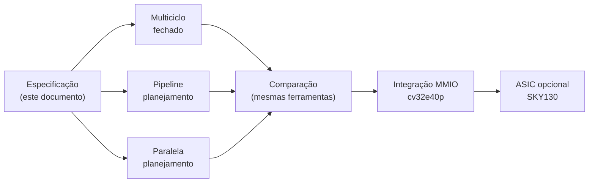
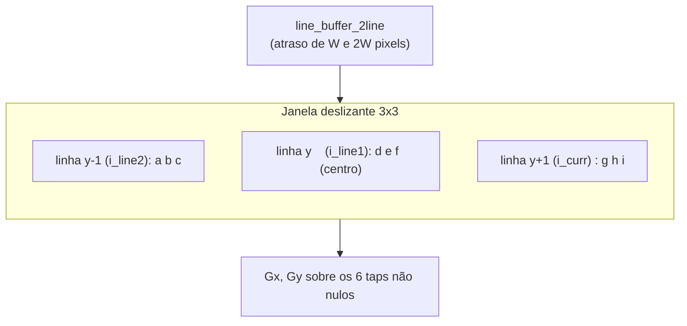
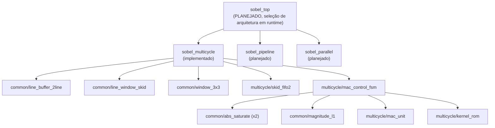

# Especificação Técnica: Filtro Sobel em FPGA (SystemVerilog)

| Campo | Valor |
|---|---|
| **Versão** | 2.0 (reescrita completa) |
| **Data** | 2026-11-08 |
| **Autor** | Iniciação Científica — FPGA Sobel Filter (USP/Poli) |
| **Objetivo** | Implementar, verificar e comparar 3 arquiteturas de filtro Sobel em FPGA |
| **Status** | Multiciclo **fechado** (funcional e verificação). Pipeline e Paralela em **planejamento** |

> **Papel deste documento.** É a especificação de **mais alto nível**: algoritmo, requisitos, métricas de comparação e critérios de aceite. Interfaces e raciocínio de projeto de cada módulo vivem nos documentos de arquitetura (`ARQUITETURA_MULTICICLO.md`, `ARQUITETURA_PIPELINE.md`, `ARQUITETURA_PARALELA.md`), que são a **fonte única** para portas e comportamento. A versão 1.0 duplicava interfaces e divergiu do RTL (achado F-12 da Auditoria 01); esta versão remove a duplicação.
>
> **Convenção:** números têm fonte. **[projeção]** = estimativa nunca sintetizada. **[não verificado]** = sem evidência.

---

## Sumário

1. [Visão geral](#1-visão-geral-do-projeto)
2. [Algoritmo](#2-especificação-do-algoritmo-sobel)
3. [Módulos e hierarquia](#3-módulos-e-hierarquia)
4. [Interface do top-level](#4-interface-do-top-level)
5. [Verificação](#5-verificação-cocotb--icarus--verilator)
6. [Lint e formatação](#6-lint-e-formatação)
7. [Síntese e métricas](#7-síntese-e-implementação-fpga)
8. [Estrutura de diretórios](#8-estrutura-de-diretórios)
9. [Cronograma](#9-cronograma)
10. [Critérios de aceitação](#10-critérios-de-aceitação-definition-of-done)
11. [Referências](#11-referências-técnicas)
12. [Decisões de projeto](#12-decisões-de-projeto-registro-para-defesa)
13. [Histórico](#13-histórico)

---

## 1. Visão geral do projeto

### 1.1 Objetivo

Implementar, verificar e comparar **três arquiteturas** de filtro Sobel em FPGA, em SystemVerilog, com verificação via cocotb (Icarus) e lint via Verible e Verilator. O estudo caracteriza os trade-offs entre desempenho, área e energia sob condições homogêneas de síntese.

### 1.2 Arquiteturas

| Arquitetura | Descrição | Throughput | Área | Estado |
|---|---|---|---|---|
| **Multiciclo** | Reutiliza **1 MAC** ao longo de 15 ciclos úteis (+1 ciclo em `S_IDLE`) | 1 pixel / **16 ciclos** | Menor (0 DSPs) | ✅ **Fechado** |
| **Pipeline** | Pipeline de estágios, 1 pixel por ciclo após o preenchimento | 1 pixel/ciclo **[projeção]** | Média | ⚪ Planejamento |
| **Paralela** | Replica unidades para processar vários pixels por ciclo (2×2 ou 3×3) | 4 a 9 pixels/ciclo **[projeção]** | Maior | ⚪ Planejamento |



---

## 2. Especificação do algoritmo Sobel

### 2.1 Kernels de convolução 3×3

$$
G_x = \begin{bmatrix} -1 & 0 & +1 \\ -2 & 0 & +2 \\ -1 & 0 & +1 \end{bmatrix}
\qquad
G_y = \begin{bmatrix} -1 & -2 & -1 \\ 0 & 0 & 0 \\ +1 & +2 & +1 \end{bmatrix}
$$

Só **6 coeficientes são não nulos** em cada kernel. A forma algébrica equivalente (a mesma validada de forma independente) é `Gx = (c+2f+i) − (a+2d+g)` e `Gy = (g+2h+i) − (a+2b+c)`, com a janela indexada por `a b c / d e f / g h i`.

### 2.2 Magnitude

$$
|G| \approx |G_x| + |G_y| \quad (L1)
\qquad\text{ou}\qquad
|G| = \sqrt{G_x^2 + G_y^2} \quad (L2)
$$

**Decisão de projeto:** usar **L1**, que não exige multiplicador nem raiz quadrada. O custo é uma precisão menor que a de L2.

**Faixas numéricas** (pixels de 8 bits sem sinal): `|Gx|` e `|Gy|` chegam a **1020** (`(1+2+1)·255`), o que cabe em um acumulador de **11 bits com sinal**. A magnitude é **saturada em 255** na saída de 8 bits.

### 2.3 Entrada e saída

| Sinal | Largura | Descrição |
|---|---|---|
| `i_pixel` | 8 bits | Pixel de entrada (grayscale 0–255) |
| `o_pixel` | 8 bits | Magnitude do gradiente (0–255, saturada) |
| `i_valid` / `o_valid` | 1 bit | Validam entrada e saída |
| `clk` | 1 bit | Clock |
| `rst_n` | 1 bit | Reset **assíncrono ativo-baixo** |

### 2.4 Janela 3×3 e bordas

A janela é formada por 2 linhas completas armazenadas mais 3 pixels da linha corrente. As bordas usam **zero-padding** nos quatro lados (decisão provisória: trocar por replicação ficaria isolado nos módulos comuns).



> O OpenCV não usa zero-padding por padrão. Para o modelo de referência de comparação, usar `borderType=cv2.BORDER_CONSTANT` explícito.

---

## 3. Módulos e hierarquia

### 3.1 Hierarquia



`sobel_top` **não está implementado**: o top real do multiciclo é `sobel_multicycle`. A seleção em runtime fica para a integração MMIO.

### 3.2 Módulos e fonte da interface

As portas reais estão nas seções indicadas de `ARQUITETURA_MULTICICLO.md`. Esta tabela registra só o que mudou em relação ao esboço original da v1.0.

| Módulo | Pasta | Fonte | Mudança em relação ao esboço da v1.0 |
|---|---|---|---|
| `line_buffer_2line` | common | §4.1 | `i_tag`, `i_rearm`, 3 tags de saída; `o_curr` registrado; `mem1` com profundidade W+1 |
| `line_window_skid` | common | §4.2 | **Novo**: FIFO de profundidade 2 entre line buffer e janela |
| `window_3x3` | common | §4.3 | `o_ready`, 3 tags de entrada, `o_tag`, `o_window_valid_geom` |
| `abs_saturate` | common | §4.4 | Igual ao esboço |
| `magnitude_l1` | common | §4.5 | Recebe `i_abs_gx`/`i_abs_gy` **já saturados** (não Gx/Gy com sinal) |
| `mac_unit` | multicycle | §5.1 | Sem multiplicador; `COEFF_WIDTH=3`, `ACC_WIDTH=11` |
| `kernel_rom` | multicycle | §5.2 | **Um** módulo parametrizado por `i_gy` (não 2 ROMs); 6 taps por kernel |
| `mac_control_fsm` | multicycle | §5.3 | 16 estados (não 11 nem 25) |
| `skid_fifo2` | multicycle | §5.4 | **Novo** |
| `sobel_multicycle` | multicycle | §5.5 | Integrador real; ver `o_status` |

Convenções de portas: entradas `i_*`, saídas `o_*`, registradores `_r`, reset `rst_n` assíncrono ativo-baixo. Um módulo só vai para `common/` se seu comportamento for **estritamente idêntico** nas três arquiteturas.

### 3.3 Resumo por arquitetura

**Multiciclo (fechada).** FSM de 16 estados: `IDLE → LOAD_WIN → MAC_GX_0..5 → SAVE_GX → MAC_GY_0..5 → OUTPUT → IDLE`. Só os 6 taps não nulos de cada kernel; abs, soma e saturação são combinacionais. **15 ciclos úteis**, **16 ciclos entre pixels**.

**Pipeline (plano).** 7 estágios sugeridos: janela, Gx, Gy, `|Gx|`, `|Gy|`, soma, saturação. Detalhes e revisão técnica em `ARQUITETURA_PIPELINE.md`.

**Paralela (plano).** Replicação de unidades para 4 (2×2) ou 9 (3×3) pixels por ciclo. Detalhes e revisão técnica em `ARQUITETURA_PARALELA.md`.

---

## 4. Interface do top-level

### 4.1 Multiciclo (real)

| Porta | Sentido | Descrição |
|---|---|---|
| `clk`, `rst_n` | in | Clock e reset assíncrono ativo-baixo |
| `i_valid`, `i_pixel` | in | Pixel de entrada |
| `o_ready` | out | Aceita pixel neste ciclo |
| `o_valid`, `o_pixel` | out | Saída; **sem `ready`** (capturar `o_valid` no mesmo ciclo) |
| `o_status[2:0]` | out | Monitor sticky: E1 overflow, E2 balanço, D dessincronia |

**Contrato A de entrada.** A transferência ocorre quando `i_valid && o_ready` no mesmo ciclo; o produtor pode manter `i_valid`/`i_pixel` estáveis até ver `o_ready`. `o_ready` não depende de `i_valid`. Pulsar `i_valid` ignorando `o_ready` **perde o pixel em silêncio**. Este requisito vai para a especificação da interface MMIO.

Os sinais `last_pixel_in`, `last_pixel_out`, `busy` e `frame_done` do esboço da v1.0 **não existem**: o fim de frame é inferido pelo contador `feed_cnt_r`.

### 4.2 Top comum planejado

```systemverilog
// PLANEJADO — não implementado
module sobel_top #(
    parameter int IMG_WIDTH  = 640,
    parameter int IMG_HEIGHT = 480,
    parameter int DATA_WIDTH = 8
    // ARCH selecionável (multiciclo / pipeline / paralela)
)( /* interface conforme §4.1, mais arch_sel */ );
```

A seleção em runtime depende de a interface de cada arquitetura ser compatível (as paralelas emitem vários pixels por ciclo). **Ponto a decidir** na integração MMIO.

---

## 5. Verificação (cocotb + Icarus + Verilator)

### 5.1 Princípios

- **Icarus decide "passou"**; Verilator 5.054 só **mede** cobertura (2 estados: não prova ausência de `X`).
- Todo teste passa por `run_isolated(testcase, expect_errors=...)`, que captura os `$error` e exige a contagem **exata**. Sem isso, um `$error` não derruba o teste cocotb.
- **Massa sem saturação** (pixels em [0, 12] ⇒ `|Gx|+|Gy| ≤ 96`) com guarda `n_sat == 0`: imagens que saturam em 255 mascararam bugs de conteúdo.
- **Multi-frame** (3+ frames consecutivos) é requisito de aceite de **toda** arquitetura.
- Instrumentação nunca escreve laço de condução próprio: usa o callback `on_cycle` do `_feed_image_and_collect`.

### 5.2 Estrutura real

```text
tb_python/                      testes cocotb
├── _cocotb_helpers.py          run_isolated, capture_errors (infraestrutura)
├── test_<modulo>.py            1 arquivo por módulo
├── test_sobel_multicycle.py    integração (golden, stalls, 2 e 4 frames)
├── test_f17_cyclic_discard.py  multi-frame, 12 geometrias, 5 lotes sem reset
├── test_pipeline_status.py     monitor o_status
├── test_valid_hold_handshake.py  contrato A
├── test_frame_640x480.py       frame cheio (RUN_SLOW=1, make frame)
└── models/                     modelo de identidade do pipeline
diagnosticos/                   scripts depreciados (arquivo morto: não rodar)
```

### 5.3 Testes por módulo

| Módulo | Testes (ver `ARQUITETURA_MULTICICLO.md` §8.1) |
|---|---|
| `line_buffer_2line` | Atraso W/2W, zero-padding, gaps, reset, tags, rearm, largura W ∈ {2…640} |
| `window_3x3` | Geometria, violação de contrato, tags. **Faltam 3 testes (F-18, em restauração)** |
| `abs_saturate`, `magnitude_l1` | Saturação, limites 255/256, extremos de complemento de 2 |
| `mac_unit`, `kernel_rom` | Coeficientes, sequências Gx/Gy, ±1020, tap inválido |
| `mac_control_fsm` | 15 ciclos exatos, `o_ready`, janelas variadas, 16/16 estados e 17/17 arcos |
| `skid_fifo2`, `line_window_skid` | Ordem FIFO, corrida push+pop cheio, overflow |
| `sobel_multicycle` | Golden 4×3, stalls, 2 e 4 frames, multi-frame, contrato A, `o_status`, frame 640×480 |

### 5.4 Golden e cobertura

- **Referência:** `_reference_sobel_l1` (laço) e `_sobel_l1_vectorized` (numpy), validados entre si em 16 casos. Comparação pixel a pixel, **erro = 0**.
- **Cobertura medida (multiciclo):** code 425/426, toggle 3596/3599, FSM 16/16 estados e 17/17 arcos.
- Casos de borda de geometria: H=1 coberto. **1×1, 2×2 e coluna única não cobertos** (W=1 não é suportado pelo RTL).
- Métricas de qualidade numérica (PSNR, SSIM, RMSE) estão previstas para a exploração de ponto fixo (8, 12 e 16 bits), ainda não feita.

---

## 6. Lint e formatação

```bash
verible-verilog-lint --rules=+line-length=120,+parameter-name-style=UPPER_SNAKE_CASE <arquivos>
verible-verilog-format --inplace <arquivos>
verilator --lint-only -Wall <arquivos>
```

> **F-15 [não verificado].** A v1.0 citava `--indentation_size=4`. Confirmar com `verible-verilog-format --helpfull | grep -i indent`; se a flag não existir, usar só `--indentation_spaces=4`.

### Estilo (convenções do projeto, `CLAUDE.md` §2–3)

- `parameter`/`localparam` em `UPPER_SNAKE_CASE` ou `PascalCase` conforme o padrão já aplicado nos módulos; sinais em `lower_snake_case`; entradas `i_*`, saídas `o_*`, registradores `_r`.
- `logic` (nunca `reg`/`wire`), `always_ff`/`always_comb` explícitos, indentação de 4 espaços, linhas ≤ 120 colunas.
- RTL sintetizável: sem `initial`, `fork/join` nem atrasos; código de simulação dentro de `// synthesis translate_off/on`.

**Estado atual:** Verible 0 warnings; Verilator 5.054 `-Wall` 0 warnings (hierarquia completa e módulos isolados).

---

## 7. Síntese e implementação (FPGA)

### 7.1 Targets

| Vendor | Dispositivo | Uso |
|---|---|---|
| **Intel** | **Cyclone V 5CSEMA5F31C6** (Quartus Prime Lite 25.1std) | **Fluxo real atual** |
| Xilinx | Artix-7 (Vivado) | Planejado (segundo vendor), **não iniciado** |
| ASIC | SKY130 (Yosys/OpenLane/OpenROAD) | Opcional |

### 7.2 Constraints (fluxo real)

```tcl
# constraints/multicycle.sdc
create_clock -name clk -period 10.000 [get_ports {clk}]
derive_clock_uncertainty
```

O projeto é criado por `constraints/setup_proj.tcl` (`quartus_sh -t`) e compilado por `quartus_sh --flow compile`. Os nomes de porta do esboço antigo (`pixel_in`, `valid_in`) **não existem** no RTL.

### 7.3 Métricas de comparação

**Multiciclo — medido no Cyclone V** (anterior à correção de `mem1`; re-síntese pendente):

| Métrica | Valor |
|---|---|
| Ciclos úteis / pixel | 15 |
| Throughput | 1 pixel / 16 ciclos |
| Frame 640×480 | ≈ 4,92 M ciclos (≈ 20 fps @ 100 MHz, calculado) |
| ALMs / FFs | 4.601 (14%) / 6.270 |
| DSPs | **0** |
| M10K | 3 |
| Fmax | 98,05 MHz (slack −0,199 ns contra 100 MHz) |

**Pipeline e Paralela — projeções originais, não sintetizadas [projeção]:**

| Métrica | Pipeline | Paralela 2×2 | Paralela 3×3 |
|---|---|---|---|
| Throughput (pix/clk) | 1 | 4 | 9 |
| LUTs | ~800 | ~2.500 | ~5.500 |
| FFs | ~600 | ~2.000 | ~4.500 |
| DSPs | 18 | 72 | 162 |
| Fmax (Artix-7) | ~200 MHz | ~150 MHz | ~120 MHz |

> **Avisos de comparação.** (1) ALM/M10K (Cyclone V) e LUT/BRAM18K (Artix-7) **não são comparáveis**: a comparação final exige a **mesma ferramenta e o mesmo dispositivo** para as três arquiteturas. (2) A projeção de DSPs de Pipeline e Paralela está **provavelmente superestimada**: os coeficientes são constantes ±1/±2, e o multiciclo foi sintetizado com **0 DSPs** (§1.1 de `ARQUITETURA_MULTICICLO.md`). **[inferência]** (3) As projeções de latência da Paralela são internamente inconsistentes (ver `ARQUITETURA_PARALELA.md`, §9).

### 7.4 Métricas obrigatórias do estudo

Utilização (LUTs/ALMs, FFs, BRAM/M10K, DSPs), Fmax, throughput efetivo (pixels/s), latência fim a fim, potência (medida ou estimada), RMSE e PSNR. Métricas normalizadas: throughput por unidade de área e energia por pixel.

---

## 8. Estrutura de diretórios

```text
ic-sobel-hw-fpga/
├── CLAUDE.md                     manual permanente de engenharia
├── RESUMO_ESTADO_PROJETO.md      estado, decisões, próximos passos
├── docs/
│   ├── ESPECIFICACAO_SOBEL.md    este arquivo
│   ├── ARQUITETURA_MULTICICLO.md fechado
│   ├── ARQUITETURA_PIPELINE.md   planejamento
│   ├── ARQUITETURA_PARALELA.md   planejamento
│   ├── AUDITORIA_01_PRE_MULTICICLO.md   auditoria única do multiciclo
│   ├── STATUS.md, MODELO_LATENCIA_PIPELINE.md, MANIFESTO_SCRIPTS_DIAG_F-16.md
│   └── REGISTRO_FLUXO_QUARTUS.md, GUIA_QUARTUS_EXPLICADO.md
├── rtl/
│   ├── common/                   line_buffer_2line, window_3x3, line_window_skid,
│   │                             abs_saturate, magnitude_l1
│   └── multicycle/               mac_unit, kernel_rom, mac_control_fsm,
│                                 skid_fifo2, sobel_multicycle
├── include/timescale.svh
├── tb_python/                    testes cocotb (+ models/)
├── diagnosticos/                 arquivo morto: não rodar
├── constraints/                  multicycle.sdc, setup_proj.tcl, setup_lb.tcl
├── scripts/                      cov_report.py, cov_exclusions.toml, utilitários
├── sim/                          artefatos gerados (gitignore)
└── Makefile                      cocotb, frame, cov-triage, cov-report, cov-frame
```

`rtl/pipeline/` e `rtl/parallel/` serão criados na abertura de cada arquitetura.

---

## 9. Cronograma

O plano oficial da IC (`Projeto_IC_Caio_ESEG.md`) prevê 12 meses. O cronograma de 16 semanas da v1.0 é mantido como referência, com o estado real:

| Fase | Atividade | Estado |
|---|---|---|
| 1 | Estudo de SystemVerilog, Verilator, cocotb, Verible | ✅ |
| 2 | Módulos comuns e testes | ✅ |
| 3 | Arquitetura Multiciclo | ✅ **Fechada** (gate GO WITH CONDITIONS) |
| 4 | Arquitetura Pipeline | ⚪ Próxima |
| 5 | Arquitetura Paralela | ⚪ |
| 6 | Top-level e seleção em runtime | ⚪ (depende da MMIO) |
| 7 | Verificação completa e cobertura | 🟡 Feita para o multiciclo |
| 8 | Síntese FPGA e timing | 🟡 Quartus feito para o multiciclo; re-síntese pendente |
| 9 | Coleta de métricas, potência | ⚪ |
| 10 | Redação do artigo e apresentação | ⚪ |

---

## 10. Critérios de aceitação (Definition of Done)

### 10.1 Por módulo

- [ ] SystemVerilog sintetizável (sem `initial`, `fork/join`, atrasos).
- [ ] Verible e Verilator `-Wall` **sem warnings**.
- [ ] Teste unitário dedicado, com caminho feliz, fronteiras e, se houver contrato violável, **caminho errado** com contagem exata de `$error`.
- [ ] Cobertura de código ≥ 95% e toggle ≥ 90%.
- [ ] Documentação do módulo na `ARQUITETURA_*.md`, com **alternativas descartadas**.

### 10.2 Por arquitetura

- [ ] Todos os módulos verificados individualmente e integrados.
- [ ] **Teste de 3+ frames consecutivos** passando (Alternativa 6).
- [ ] Massa de teste **sem saturação**, com guarda `n_sat == 0`.
- [ ] Throughput e latência **medidos** e conferidos com o modelo.
- [ ] Golden com erro = 0.
- [ ] Síntese sem latch e com timing documentado (atendido ou com decisão explícita do SDC).
- [ ] Tabela de recursos preenchida na **mesma ferramenta** das demais.
- [ ] Auditoria da arquitetura com gate formal.

### 10.3 Projeto completo

- [ ] 3 arquiteturas funcionais e verificadas.
- [ ] Integração MMIO com o cv32e40p e medição de speedup.
- [ ] Tabela comparativa completa e normalizada.
- [ ] Artigo e apresentação.
- [ ] Repositório público com CI (Verilator + cocotb + Verible).

---

## 11. Referências técnicas

1. IEEE 1800-2017 — SystemVerilog LRM.
2. Gonzalez & Woods — *Digital Image Processing* (operador Sobel).
3. Intel — Cyclone V Device Handbook; Quartus Prime Lite User Guide.
4. Xilinx UG901 — Vivado Synthesis Guide.
5. Verilator Manual; cocotb Documentation; Verible Style Guide.
6. `Projeto_IC_Caio_ESEG.md` — documento oficial de submissão (cita "Verilog" no texto, mas o projeto usa SystemVerilog; diferença a esclarecer com o orientador, `CLAUDE.md` §15.6).
7. Literatura de aceleração em FPGA citada no projeto de IC (Vasile 2024, Ravichandran 2025, Sborz 2020, entre outras).

---

## 12. Decisões de projeto (registro para defesa)

| Decisão | Justificativa | Trade-off |
|---|---|---|
| Magnitude **L1** | Sem multiplicador nem raiz; 1 somador | Precisão menor que L2 |
| Reset **assíncrono ativo-baixo** | Padrão FPGA/ASIC | Exige sincronização do reset externo |
| **Zero-padding** nas 4 bordas | Simples e totalmente nos módulos comuns | Pode virar replicação sem afetar as arquiteturas |
| `mac_unit` **sem multiplicador** | Coeficientes ±1/±2 ⇒ desloca e inverte; 0 DSPs por construção | Depende de o coeficiente ser restrito |
| `kernel_rom` **único**, combinacional, com `i_gy` | Uma tabela, um teste, sem ciclo extra | — |
| Line buffer de **2 linhas** (não 3) | Economia de memória, streaming natural | Exige `window_3x3` |
| **Elasticidade por FIFOs síncronas** de saída registrada | Elimina a classe de corrida combinacional do F-16 | +1 ciclo por estágio |
| Descarte da linha de saída −1 por **contador de janelas** | Independe de tag e de temporização de fronteira (F-17) | Sensível a perda de janela; mitigado por `o_status` |
| Monitor `o_status` **só sinaliza** | Autocorreção esconderia o erro | Não localiza em hardware |
| **Contrato A** de entrada | `valid && !ready` não distingue espera de perda | Perda silenciosa se o produtor ignorar `o_ready` |
| Pipeline de 7 estágios (plano) | Balanço latência/throughput | Mais registradores; a revisar |
| Paralela 3×3 com 9 pixels/clk (plano) | Throughput teórico máximo | Alto uso de recursos e de largura de banda; a revisar |

---

## 13. Histórico

| Data | Alteração |
|---|---|
| 2025 | v1.0: especificação inicial, com interfaces de módulos e projeções de recursos |
| 2026-11-08 | **v2.0**: reescrita. Interfaces deixam de ser duplicadas (fonte única nas `ARQUITETURA_*`); multiciclo com números medidos; projeções de Pipeline/Paralela marcadas como **[projeção]**; estrutura de testes, diretórios e decisões atualizadas; Quartus/Cyclone V como fluxo real (F-12, F-15, F-23) |