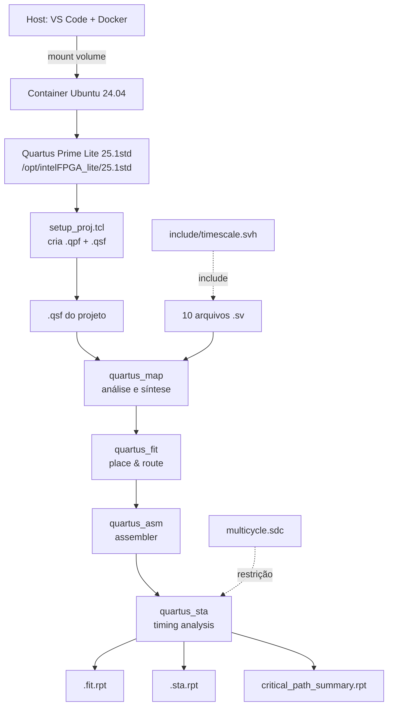

# Guia didático do fluxo de desenvolvimento no Quartus Prime Lite

> **Propósito deste documento.** Servir de material de estudo e de referência operacional para compreender o fluxo de trabalho no Quartus Prime Lite, os arquivos envolvidos, os comandos executados e a lógica que conecta todas essas partes. O documento foi escrito a partir do histórico de execução do projeto `ic-sobel-hw-fpga` no container Docker do VS Code, e não de um fluxo idealizado.
>
> **Convenção de honestidade.** Sempre que uma informação não puder ser confirmada pelo histórico, ela será marcada como **[não verificado]**, **[hipótese]** ou **[pendente]**. Números e resultados são sempre atribuídos à fonte que os produziu.

---

## 1. Visão geral do fluxo

### 1.1 Objetivo técnico

O objetivo desta etapa foi **caracterizar a arquitetura Multiciclo do filtro de Sobel em termos de recursos e timing**, usando o Quartus Prime Lite como ferramenta de síntese e place-and-route para o dispositivo Intel Cyclone V. Não havia placa FPGA física disponível; a caracterização foi feita inteiramente por síntese e análise estática, sem programar dispositivo.

### 1.2 Ferramentas e componentes

| Ferramenta | Versão / identidade | Papel |
|---|---|---|
| Docker | (versão não registrada no histórico) | Containeriza o ambiente |
| VS Code Dev Containers | (versão não registrada) | Interface e execução do container |
| Ubuntu | 24.04 | Sistema operacional dentro do container |
| Quartus Prime Lite | 25.1std | Síntese, fitter, STA |
| Verilator | 5.020 | Lint estrutural (fora do fluxo Quartus) |
| Verible | v0.0-4084-gf3e4d98b | Lint de estilo (fora do fluxo Quartus) |
| Icarus Verilog | 12.0 | Simulação (fora do fluxo Quartus) |
| cocotb | 2.0.1 | Framework de simulação Python |

### 1.3 Etapas realizadas

1. Instalação do Quartus Prime Lite dentro do container, com volume persistente.
2. Criação do projeto Quartus via script Tcl.
3. Validação individual da sintaxe SystemVerilog dos 10 arquivos RTL.
4. Execução do fluxo completo de compilação (`quartus_map` → `quartus_fit` → `quartus_asm` → `quartus_sta`).
5. Leitura dos relatórios de recursos e timing.
6. Extração do caminho crítico via `report_timing`.

### 1.4 Diagrama do fluxo



### 1.5 Modelo mental do Quartus

Antes de qualquer detalhe, é útil fixar três ideias:

1. **O Quartus não compila "arquivos". Compila "projetos".** Um projeto é definido por um arquivo `.qpf` (Quartus Project File) que aponta para uma revisão ativa, e por um arquivo `.qsf` (Quartus Settings File) que contém todas as atribuições — dispositivo, lista de arquivos, restrições SDC, diretórios de busca, etc. Sem projeto, nada acontece.

2. **Configurar ≠ compilar.** Criar o projeto (via `setup_proj.tcl` ou GUI) apenas **grava** as atribuições no `.qsf`. Compilar (via `quartus_map`, `quartus_fit`, etc.) é um passo separado que **lê** o `.qsf` e processa. Se você alterar o `.qsf` e não recompilar, a alteração não tem efeito.

3. **Restringir ≠ medir.** O `.sdc` **impõe** restrições (ex: "o clock tem período 10 ns"). O STA **mede** o comportamento do circuito e reporta o slack contra a restrição. Um Fmax de 98 MHz com restrição de 100 MHz significa que o design **não** fecha, não que ele "roda a 100 MHz".

---

## 2. Explicação detalhada dos arquivos

### 2.1 Arquivos Tcl

#### O que é Tcl

Tcl (Tool Command Language) é uma linguagem de script interpretada, projetada para ser embutida em outras ferramentas. O Quartus usa Tcl como interface de automação: praticamente toda ação que a GUI executa corresponde a um comando Tcl interno. Isso significa que **qualquer operação da GUI pode ser reproduzida por script** — e é essa propriedade que torna o fluxo headless possível.

#### Por que scripts Tcl são preferíveis à GUI neste projeto

- **Reprodutibilidade.** Um script Tcl pode ser versionado, revisado e executado por qualquer pessoa com o mesmo Quartus.
- **Rastreabilidade.** Cada comando do script corresponde a uma ação documentada, em ordem.
- **Automação.** Recompilar com outro dispositivo ou outra restrição é uma linha alterada, não uma sequência de cliques.
- **Integração com CI.** O script pode ser chamado por pipelines automatizados.
- **Limitação.** Algumas ações da GUI não têm equivalente Tcl documentado (por exemplo, exploração interativa de caminhos críticos). Nesse caso, a GUI continua sendo útil.

#### Script efetivamente usado: `constraints/setup_proj.tcl`

Conteúdo reconstruído a partir do histórico (o arquivo real existe no repositório em `constraints/setup_proj.tcl`):

```tcl
project_new sobel_multicycle -overwrite

set_global_assignment -name FAMILY "Cyclone V"
set_global_assignment -name DEVICE 5CSEMA5F31C6
set_global_assignment -name TOP_LEVEL_ENTITY sobel_multicycle

set_global_assignment -name SEARCH_PATH "include"

set_global_assignment -name SYSTEMVERILOG_FILE rtl/common/line_buffer_2line.sv
set_global_assignment -name SYSTEMVERILOG_FILE rtl/common/window_3x3.sv
set_global_assignment -name SYSTEMVERILOG_FILE rtl/common/abs_saturate.sv
set_global_assignment -name SYSTEMVERILOG_FILE rtl/common/magnitude_l1.sv
set_global_assignment -name SYSTEMVERILOG_FILE rtl/common/line_window_skid.sv

set_global_assignment -name SYSTEMVERILOG_FILE rtl/multicycle/mac_unit.sv
set_global_assignment -name SYSTEMVERILOG_FILE rtl/multicycle/kernel_rom.sv
set_global_assignment -name SYSTEMVERILOG_FILE rtl/multicycle/mac_control_fsm.sv
set_global_assignment -name SYSTEMVERILOG_FILE rtl/multicycle/skid_fifo2.sv
set_global_assignment -name SYSTEMVERILOG_FILE rtl/multicycle/sobel_multicycle.sv

set_global_assignment -name SDC_FILE constraints/multicycle.sdc

set_global_assignment -name PROJECT_OUTPUT_DIRECTORY output_files

project_close
```

##### Comando por comando

**`project_new sobel_multicycle -overwrite`**

- **Sintaxe:** `project_new <nome> [-overwrite]`
- **Significado:** cria um novo projeto Quartus chamado `sobel_multicycle` no diretório atual.
- **Efeito:** gera `sobel_multicycle.qpf` e `sobel_multicycle.qsf`. Sem `-overwrite`, falha se já existir.
- **Ponto crítico:** é preciso estar no diretório onde o `.qpf` deve ser criado. No histórico, o comando foi executado a partir de `/workspaces/ic-sobel-hw-fpga`.

**`set_global_assignment -name FAMILY "Cyclone V"`**

- **Efeito:** define a família de dispositivos. Necessário porque diferentes famílias têm arquiteturas internas diferentes (tipos de bloco de memória, número de LUTs, etc.).
- **Sem isso:** o Quartus não sabe qual conjunto de regras aplicar.

**`set_global_assignment -name DEVICE 5CSEMA5F31C6`**

- **Efeito:** define o part number exato. `5CSE` = Cyclone V SE, `MA5` = densidade/velocidade, `F31` = pacote, `C6` = grade de velocidade.
- **Sem isso:** o fitter não pode mapear o design para recursos físicos.

**`set_global_assignment -name TOP_LEVEL_ENTITY sobel_multicycle`**

- **Efeito:** define qual entidade é o topo da hierarquia. Sem isso, o Quartus tenta adivinhar e pode escolher o módulo errado.

**`set_global_assignment -name SEARCH_PATH "include"`**

- **Efeito:** adiciona `include/` à lista de diretórios onde o compilador procura arquivos de `` `include ``.
- **Por que foi necessário:** o `timescale.svh` está em `include/`, fora dos diretórios dos arquivos `.sv` que o incluem. Sem `SEARCH_PATH`, o Quartus emite `Error (10054): can't open Verilog Design File "timescale.svh"`.

**`set_global_assignment -name SYSTEMVERILOG_FILE <caminho>`**

- **Efeito:** registra um arquivo como parte do conjunto de fontes, marcando-o explicitamente como SystemVerilog.
- **Por que `SYSTEMVERILOG_FILE` e não `VERILOG_FILE`:** o Quartus trata `.sv` associados a `VERILOG_FILE` como Verilog-2001, rejeitando construtos como `always_ff` e `typedef enum`.

**`set_global_assignment -name SDC_FILE constraints/multicycle.sdc`**

- **Efeito:** registra o arquivo SDC que será lido pelo `quartus_sta`.
- **Ponto crítico:** o caminho é relativo ao diretório do projeto. Sem isso, o STA roda sem restrições e reporta Fmax irrealisticamente alto.

**`set_global_assignment -name PROJECT_OUTPUT_DIRECTORY output_files`**

- **Efeito:** define onde os relatórios e produtos de compilação serão escritos. Convenção para manter a raiz do projeto limpa.

**`project_close`**

- **Efeito:** encerra o projeto e faz flush no disco.

##### Como executar o script

```bash
quartus_sh -t constraints/setup_proj.tcl
```

- `quartus_sh` é o shell Tcl do Quartus. Sem `-t`, abre sessão interativa.
- `-t <script>` executa o script.
- Deve ser rodado **a partir da raiz do projeto**, porque os caminhos no `.tcl` são relativos.

##### Verificação

```bash
grep -i "SEARCH_PATH\|SDC_FILE\|SYSTEMVERILOG_FILE" sobel_multicycle.qsf
```

Se o comando mostrar as linhas declaradas no script, o projeto foi criado corretamente.

##### O que acontece se o script não for executado

Se você criar os arquivos manualmente mas não rodar `quartus_sh -t setup_proj.tcl`, o `.qsf` não existe e o Quartus não tem o que compilar. Se você editar o `.tcl` mas esquecer de rodar o script, o `.qsf` continua com a versão antiga — **a edição não tem efeito até o script rodar novamente**.

---

### 2.2 Arquivos SDC

#### O que é SDC

**SDC** (*Synopsys Design Constraints*) é um formato padrão da indústria para descrever restrições de temporização. O Quartus adota o mesmo formato que o Synopsys Design Compiler e o PrimeTime. Um arquivo SDC contém comandos Tcl que declaram:

- **Clocks:** período, nome, fonte.
- **Input/output delays:** atrasos externos nas portas.
- **False paths / multicycle paths:** caminhos que não precisam cumprir o período nominal.
- **Clock groups:** relações entre domínios de clock.

O **STA** (*Static Timing Analysis*) lê essas restrições e calcula, para cada caminho entre dois registradores, o slack (margem temporal). Um slack negativo é uma violação.

#### Diferença entre restringir e medir

- **Restringir** é impor ("o clock tem período 10 ns").
- **Medir** é observar o circuito depois que ele é implementado ("o caminho mais lento precisa de 10,199 ns").

O STA combina as duas coisas: aplica a restrição e compara contra o comportamento real do design pós-fit. Por isso o relatório mostra *tanto* o período (da restrição) *quanto* o slack (do circuito).

#### Arquivo efetivamente usado: `constraints/multicycle.sdc`

```tcl
# constraints/multicycle.sdc — restrição básica de clock
create_clock -name clk -period 10.000 [get_ports {clk}]
derive_clock_uncertainty
```

##### Comando por comando

**`create_clock -name clk -period 10.000 [get_ports {clk}]`**

- **Sintaxe:** `create_clock -name <nome> -period <ns> [get_ports {<porta>}]`
- **Efeito:** define um clock chamado `clk` com período de 10 ns (100 MHz), associado à porta física `clk` do top-level.
- **Unidade:** nanossegundos. `10.000` = 10 ns.
- **Como o Quartus interpreta:** todas as análises de setup/hold para esse domínio usam 10 ns como referência. O Fmax reportado é o inverso do tempo de caminho crítico; se ele for menor que 100 MHz, o slack é negativo.

**`derive_clock_uncertainty`**

- **Efeito:** calcula automaticamente incertezas de clock (jitter, skew) e aplica como margem extra nas análises.
- **Por que é boa prática:** sem isso, a análise assume clock ideal, o que subestima os problemas reais.
- **Origem:** convenção Synopsys, adotada pelo Quartus.

##### Como verificar que o SDC foi lido

No `.sta.rpt`, procure a seção **Clocks**:

```bash
grep -B1 -A5 "^; Clock Name" output_files/sobel_multicycle.sta.rpt | head -20
```

Se o SDC foi aplicado, aparece uma linha com `clk`, `Base`, `10.000`, `100.0 MHz`.

##### Consequências práticas

- **Ausente:** o STA roda sem restrição, calcula Fmax "natural" sem comparar a alvo algum. Números reportados nesse estado são apenas informativos.
- **Nome de porta errado:** `create_clock [get_ports {clk}]` falha silenciosamente se `clk` não existe; o SDC não tem efeito.
- **Período incorreto:** o design "passa" com folga artificial (período grande) ou "falha" sem necessidade (período pequeno).

---

### 2.3 Demais arquivos e extensões

| Arquivo ou extensão | Finalidade | Quem utiliza | Criado | Versionar? |
|---|---|---|---|---|
| `rtl/common/*.sv`, `rtl/multicycle/*.sv` | RTL SystemVerilog do projeto | Quartus, Verilator, Icarus | Manual | **Sim** |
| `include/timescale.svh` | Diretivas `` `timescale `` compartilhadas | Quartus, Verilator, Icarus | Manual | **Sim** |
| `constraints/multicycle.sdc` | Restrições de temporização | Quartus STA | Manual | **Sim** |
| `constraints/setup_proj.tcl` | Script de criação do projeto | `quartus_sh -t` | Manual | **Sim** |
| `sobel_multicycle.qpf` | Apontador de projeto | Quartus | Automático | **Não** (regenerável) |
| `sobel_multicycle.qsf` | Atribuições do projeto | Quartus | Automático (do `.tcl`) | **Sim**, mas com ressalva¹ |
| `output_files/sobel_multicycle.fit.rpt` | Relatório de utilização | Leitura humana | Automático | **Não** (regenerável) |
| `output_files/sobel_multicycle.sta.rpt` | Relatório de timing | Leitura humana | Automático | **Não** (regenerável) |
| `critical_path_summary.rpt` | Relatório dos 10 piores caminhos | Leitura humana | Automático | Opcional (evidência) |
| `critical_path.tcl` | Script de extração de caminhos | `quartus_sta -t` | Manual | **Sim** |
| `db/`, `incremental_db/` | Bancos internos do Quartus | Quartus | Automático | **Não** |
| `output_files/*.sof` (se gerado) | Bitstream | `quartus_pgm` (não usado) | Automático | **Não** |
| `Dockerfile` | Definição da imagem | Docker | Manual | **Sim** |
| `devcontainer.json` | Configuração do Dev Container | VS Code | Manual | **Sim** |
| `.gitignore` | Exclusões de versionamento | Git | Manual | **Sim** |

¹ O `.qsf` é regenerado por `setup_proj.tcl`. Versioná-lo é útil como registro do que foi efetivamente aplicado, mas é importante ter em mente que ele é **derivado** do script. Se você versionar o `.qsf` e ele divergir do `.tcl`, vale investigar qual é o estado autoritativo.

---

## 3. Explicação dos comandos executados

### 3.1 Instalação do Quartus no container

Executados **dentro do container**, a partir de `/tmp`:

```bash
# 1. Baixar o instalador SFX (após 403 do wget direto, foi usado o download pelo navegador no host)
# O arquivo real (ELF, ~68 MB) foi movido para dentro do projeto e copiado para /tmp.

# 2. Extrair sem executar
./qinst-lite-linux-25.1std-1129.run --target /tmp/qinst --noexec
cd /tmp/qinst

# 3. Ver componentes disponíveis
./qinst.sh --cli --help

# 4. Instalar apenas Quartus + Cyclone V
./qinst.sh --cli \
  --components quartus,cyclonev \
  --download-dir /tmp/quartus-download \
  --install-dir /opt/intelFPGA_lite/25.1std \
  --delete-downloads \
  --accept-eula
```

**Observações importantes**:

- **O `wget` direto retornou `403 Forbidden`.** O CDN da Altera exige cookie de sessão obtido após aceitar a EULA na página de download. Foi necessário baixar o `.run` pelo navegador no host (Windows) e movê-lo para dentro do container via pasta compartilhada do projeto.
- **Um primeiro download salvou uma página HTML** (331 KB, começando com `<!DOCTYPE html>`) em vez do binário. Rodar `./...run` nesse arquivo gerou `syntax error near unexpected token 'newline'`. A verificação `file <arquivo>` identifica o problema: `ELF 64-bit LSB executable` vs `HTML document`.
- **`--noexec`** apenas extrai o conteúdo do SFX; não instala.
- **`--components`** permite instalação enxuta. Sem isso, o instalador oferece o pacote completo (~22 GB).

### 3.2 Criação e compilação do projeto

Executados **dentro do container**, a partir de `/workspaces/ic-sobel-hw-fpga`:

```bash
# Criar projeto (aplica o .tcl ao .qsf)
quartus_sh -t constraints/setup_proj.tcl

# Compilação completa
quartus_sh --flow compile sobel_multicycle
```

**`--flow compile`** executa `quartus_map`, `quartus_fit`, `quartus_asm`, `quartus_sta` em sequência.

### 3.3 Análise individual (etapa opcional de debug)

```bash
quartus_map sobel_multicycle --analyze_file=rtl/common/line_buffer_2line.sv
# (repetir para cada um dos 10 arquivos)
```

**Nota importante do histórico:** o `--analyze_file` **não lê o `.qsf`** e, portanto, **ignora o `SEARCH_PATH`**. Isso significa que arquivos que dependem de `` `include "timescale.svh" `` falham nesse modo mesmo que o projeto esteja correto. Nesse caso, é preciso ir direto para o `--flow compile`, que tem contexto completo.

### 3.4 Extração do caminho crítico

Executado **dentro do container**:

```bash
quartus_sta sobel_multicycle --do_report_timing
```

**Efeito:** adiciona ao `.sta.rpt` o relatório de timing detalhado.

Depois, extração dos caminhos mais críticos via script Tcl (`critical_path.tcl`) executado com `quartus_sta -t critical_path.tcl` (comando confirmado no histórico, conteúdo exato do script **[não verificado]** — foi sugerido, mas a versão executada não foi colada na conversa).

**Saída real observada:** `critical_path_summary.rpt` com os 10 piores caminhos de setup. Todos com `From: col_feed_r[3]` e `To: line_window_skid:u_lw_skid|mem~27`.

---

## 4. Relação entre as etapas e os artefatos

### 4.1 Configurar vs. compilar

| Configurar | Compilar |
|---|---|
| `setup_proj.tcl` | `quartus_sh --flow compile` |
| Edita `sobel_multicycle.qsf` | Lê `sobel_multicycle.qsf` |
| Não toca em RTL | Processa RTL |
| Rápido (segundos) | Lento (minutos) |
| Não gera relatórios de recursos | Gera `.fit.rpt`, `.sta.rpt` |

**Exemplo concreto do histórico:** alterar `SEARCH_PATH` no `.tcl` não teve efeito até que o `.tcl` foi executado novamente. Foi preciso `rm -rf *.qpf *.qsf db/ output_files/` antes de reexecutar `quartus_sh -t`.

### 4.2 Criar script vs. executar script

Escrever `setup_proj.tcl` no editor não faz nada. Rodar `quartus_sh -t constraints/setup_proj.tcl` é o que produz efeito. A distinção é fundamental porque erros de digitação silenciosos (comandos inexistentes como `SYSTEMVERILOG_INCLUDE`) só aparecem na execução.

**Exemplo concreto:** foi tentado `set_global_assignment -name SYSTEMVERILOG_INCLUDE "include/timescale.svh"`. O Quartus respondeu `ERROR: Illegal assignment: SYSTEMVERILOG_INCLUDE`. A atribuição correta é `SEARCH_PATH`. Essa distinção só ficou clara ao executar.

### 4.3 Definir restrição vs. analisar resultado

- **Definir:** `create_clock -period 10.000` no `.sdc`.
- **Analisar:** `quartus_sta` produz `.sta.rpt` com slack calculado.

Se o design fecha (slack ≥ 0), a restrição foi cumprida. Se não fecha (slack < 0), o design **não** cumpre a restrição, e é preciso ou relaxar o SDC ou otimizar o RTL.

### 4.4 Configurar dispositivo vs. verificar compatibilidade

Registrar `DEVICE 5CSEMA5F31C6` no `.qsf` apenas diz ao Quartus qual dispositivo usar. A verificação de que o design **cabe** nesse dispositivo é feita pelo `quartus_fit`, que reporta utilização (ALMs, M10Ks, DSPs). O `sobel_multicycle` usa 14% dos ALMs e 0 DSPs — cabe confortavelmente.

### 4.5 Gerar relatório vs. interpretar

Gerar `.fit.rpt` é uma operação automática. Interpretar significa:

- Entender que "3 M10Ks" para o `line_buffer_2line`+`skid_fifo2` significa que **uma** FIFO de linha virou M10K, a **outra** virou MLAB (por leitura assíncrona), e a **skid_fifo2** consumiu **2** M10Ks para 144 bits — um desperdício.
- Perceber que "0 DSPs" é **exatamente o que o projeto queria**, e não um resultado acidental.

### 4.6 Compilação bem-sucedida vs. requisitos atendidos

Uma compilação **bem-sucedida** (sem erros) apenas significa que o Quartus conseguiu mapear o design. **Não** significa que o design funciona funcionalmente, nem que atende aos requisitos temporais. O `sobel_multicycle` compilou, mas tem **slack de -0,199 ns** — ou seja, viola o requisito de 100 MHz.

---

## 5. Interpretação dos resultados

### 5.1 Recursos

Fonte: `output_files/sobel_multicycle.fit.rpt`.

| Recurso | Valor | Origem |
|---|---|---|
| ALMs | 4.601 / 32.070 (14%) | `.fit.rpt` (Fitter Resource Usage Summary) |
| Registradores (FFs) | 6.270 | Idem |
| DSPs | 0 / 87 | Idem |
| M10Ks | 3 / 397 | Idem |
| Block Memory Bits | 5.904 | Idem |

**O que isso demonstra:**

- O design **cabe** no dispositivo com folga (14% dos ALMs).
- A decisão arquitetural de **0 DSPs** foi respeitada pelo sintetizador. O `mac_unit` implementa coeficientes `{-2,-1,+1,+2}` por deslocamento e negação, sem `*` no RTL.

**O que isso não demonstra:**

- **Não** demonstra que o design é funcionalmente correto. Isso é responsabilidade da simulação (Icarus + cocotb).
- **Não** demonstra que o uso de recursos é ótimo. Os 3 M10Ks incluem 2 desperdiçados na `skid_fifo2`.

### 5.2 Timing

Fonte: `output_files/sobel_multicycle.sta.rpt` e `critical_path_summary.rpt`.

| Corner | Fmax | Slack |
|---|---|---|
| Slow 1100mV 85°C | 98,05 MHz | **-0,199 ns** |
| Slow 1100mV 0°C | 97,55 MHz | -0,251 ns |
| Fast 1100mV 85°C | (não reportado como Fmax) | +4,025 ns |

**Caminho crítico (do `critical_path_summary.rpt`):**

| Slack | From | To | Data Delay |
|---|---|---|---|
| -0,199 ns | `col_feed_r[3]` | `line_window_skid:u_lw_skid\|mem~27` | 9,934 ns |
| -0,184 ns | `col_feed_r[3]` | `line_window_skid:u_lw_skid\|mem~27` | 9,919 ns |
| ... | (todos idênticos) | (todos idênticos) | ... |

**Interpretação:**

- O design **não fecha** a 100 MHz no corner lento. Fecha naturalmente a ~98 MHz.
- **Existe um único caminho dominante.** Os 10 piores caminhos são todos do mesmo `From` para o mesmo `To`. Isso significa que o resto do design tem folga confortável.
- O gargalo está no **`line_window_skid`**, não em `line_buffer_2line` nem em `skid_fifo2`. Portanto:
  - **Corrigir a inferência de BRAM não melhora o Fmax** (o caminho crítico não passa por BRAM).
  - **Corrigir a inferência de BRAM melhora a área** (elimina 2 M10Ks desperdiçados).

**O que isso não permite concluir:**

- Se o design funcionaria em hardware físico a 98 MHz. STA é uma estimativa de pior caso em condições nominais do modelo.
- Se corrigir o gargalo elevaria o Fmax — depende de onde exatamente o caminho pode ser quebrado, o que é decisão de RTL.

### 5.3 Mensagens relevantes do Quartus

Do `.map.rpt`:

```
Info (276007): RAM logic "line_buffer_2line:u_line_buffer|mem2" is uninferred
               due to asynchronous read logic
```

- `mem2` não virou BRAM porque tem leitura assíncrona. Implementada em MLAB.

```
Warning (276020): Inferred RAM node "skid_fifo2|skid_mem_r_rtl_0".
                  Pass-through logic has been added to match the read-during-write
                  behavior of the original design.
```

- O Quartus adicionou lógica de bypass na `skid_fifo2` para preservar o comportamento read-during-write. Custo: ALMs extras.

```
Warning (276027): Inferred dual-clock RAM node "line_buffer_2line|mem1_rtl_0".
                  The read-during-write behavior of a dual-clock RAM is undefined
                  and may not match the behavior of the original design.
```

- `mem1` virou BRAM dual-clock. Se `wr_ptr` e `rd_ptr` nunca coincidem no mesmo ciclo, o warning é benigno. Caso contrário, o comportamento é indefinido.

---

## 6. Síntese conceitual

### 6.1 Glossário

| Termo | Definição |
|---|---|
| **QPF** | Quartus Project File. Apontador para a revisão ativa de um projeto. |
| **QSF** | Quartus Settings File. Contém todas as atribuições do projeto. |
| **SDC** | Synopsys Design Constraints. Formato padrão de restrições de temporização. |
| **STA** | Static Timing Analysis. Análise de temporização sem estímulo. |
| **ALM** | Adaptive Logic Module. Unidade lógica básica do Cyclone V (contém LUTs e registradores). |
| **FF** | Flip-flop. Elemento de armazenamento síncrono. |
| **M10K** | Bloco de memória embarcada do Cyclone V, com 10.240 bits. |
| **MLAB** | Memory Logic Array Block. Memória pequena distribuída junto aos ALMs. |
| **DSP** | Digital Signal Processing block. Multiplicador-acumulador dedicado. |
| **Fmax** | Frequência máxima à qual o design pode rodar. Calculada como inverso do caminho crítico. |
| **Slack** | Margem temporal. Positivo = folga. Negativo = violação. |
| **Setup** | Verificação de que os dados estão estáveis antes da borda de clock que os captura. |
| **Hold** | Verificação de que os dados permanecem estáveis após a borda de clock. |
| **Corner** | Combinação de tensão e temperatura (ex: 1100mV, 85°C) sob a qual a análise é feita. |
| **P&R** | Place and Route. Etapa de posicionamento físico dos elementos lógicos. |
| **SFX** | Self-extracting archive. Instalador do Quartus. |
| **Tcl** | Tool Command Language. Linguagem de script usada pelo Quartus. |

### 6.2 Fluxo resumido

1. **Preparar ambiente:** container com Ubuntu, Quartus instalado, volume persistente.
2. **Criar projeto:** `quartus_sh -t setup_proj.tcl` grava `.qpf` e `.qsf`.
3. **Compilar:** `quartus_sh --flow compile <top>` roda map, fit, asm, sta em sequência.
4. **Analisar recursos:** ler `.fit.rpt`.
5. **Analisar timing:** ler `.sta.rpt` + `critical_path_summary.rpt`.
6. **Iterar:** se violação, ou relaxar SDC ou otimizar RTL (fora do escopo do fluxo Quartus).

### 6.3 Modelo mental consolidado

- O Quartus trabalha **por projeto**, não por arquivo.
- **Configurar** e **compilar** são etapas separadas.
- **Restringir** e **medir** são etapas separadas.
- O `.qsf` é o ponto de verdade das atribuições; o `.tcl` é o gerador versionável.
- Os relatórios (`.fit.rpt`, `.sta.rpt`) são **saídas** regeneráveis; não precisam ser versionados, mas podem ser guardados como evidência.
- Uma compilação bem-sucedida não atesta correção funcional nem cumprimento de restrições temporais.