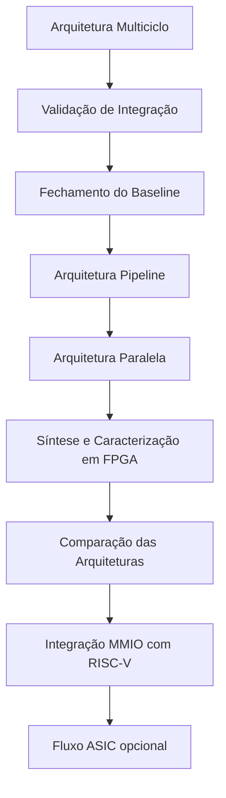

# Status do Projeto

## Resumo

**Última atualização:** 30/08/2026

### Etapa atual

#### Implementação e validação da arquitetura multiciclo.

Os módulos comuns e os módulos específicos da arquitetura multiciclo estão implementados e testados individualmente. Porém, uma investigação recente encontrou um **bug real na integração entre dois módulos comuns** (`line_buffer_2line` e `window_3x3`) que produz pixels de saída incorretos — confirmado mesmo em um único frame, sem depender de múltiplos frames ou fronteiras. O bug estava mascarado até agora porque as imagens de teste usadas saturavam a saída no valor máximo (255), escondendo o erro. A arquitetura multiciclo **não pode ser considerada fechada** enquanto esse bug não for corrigido.

### Próximo marco

#### 🎯 Fechar a arquitetura multiciclo

Para considerar a primeira arquitetura concluída:

1. ~~Consolidar o `sobel_multicycle.sv`~~ — feito, módulo existe e integra as peças;
2. ~~Executar o teste de integração ponta a ponta~~ — feito, suíte de testes existe e cobre a maioria dos casos;
3. **Corrigir o bug de conteúdo incorreto identificado** (linha de dados entre `line_buffer_2line` e `window_3x3`) — bloqueador atual, não resolvido;
4. Validar corretamente múltiplos frames consecutivos — o teste dedicado a isso (`test_four_consecutive_frames`) é justamente o que revelou o bug acima;
5. Mitigar risco de perda de dado sob rajada de pixels (buffer interno pequeno demais em cenários extremos) — solução já decidida (aumentar a capacidade do buffer), aguardando implementação;
6. Atualizar a documentação técnica e a auditoria correspondente.

Após isso:

> **Arquitetura multiciclo → baseline funcional para comparação com as arquiteturas pipeline e paralela.**

---

## Progresso das arquiteturas

| Arquitetura             | Estado                                               |
| ----------------------- | ---------------------------------------------------- |
| Multiciclo / Sequencial | 🔴 Bug de correção conhecido, bloqueando o fechamento |
| Pipeline                | ⚪ Não iniciada                                       |
| Paralela                | ⚪ Não iniciada                                       |

---

## Arquitetura multiciclo

### Concluído

#### Módulos comuns

* [x] `line_buffer_2line.sv` (correto isoladamente — o bug está na combinação com `window_3x3`, não no módulo em si)
* [x] `window_3x3.sv` (idem — correto isoladamente)
* [x] `abs_saturate.sv`
* [x] `magnitude_l1.sv`

#### Módulos específicos

* [x] `mac_unit.sv`
* [x] `kernel_rom.sv`
* [x] `mac_control_fsm.sv`

#### Infraestrutura

* [x] Testbenches individuais com cocotb
* [x] Testes de caminho normal e casos de fronteira
* [x] Makefile
* [x] Documentação de validação
* [x] Lint com Verilator e Verible

### Em andamento

* [ ] **Corrigir bug de conteúdo incorreto na interface `line_buffer_2line` ↔ `window_3x3`** (bloqueador principal)
* [ ] Implementar buffer interno maior em `sobel_multicycle.sv` (mitigação de risco, já decidida)
* [ ] Teste com 3 ou mais frames consecutivos
* [ ] Formalização do fechamento dos achados da Auditoria 01

O problema de contaminação na fronteira entre frames identificado durante a auditoria foi corrigido na fonte, e os testes de dois frames consecutivos passam. Porém, ao ampliar a validação para quatro frames consecutivos, foi descoberto um problema mais profundo e independente: um erro de sincronismo entre dois módulos comuns que corrompe o conteúdo dos pixels de saída — presente mesmo sem nenhuma fronteira de frame, apenas mascarado até agora por imagens de teste que saturavam a saída. A tentativa inicial de correção (ajustar um parâmetro interno) foi testada e descartada por introduzir um problema diferente e pior (leitura de memória não escrita). A correção definitiva ainda está em investigação.

---

# Principais decisões técnicas

Até o momento:

* Reset assíncrono ativo-baixo (`rst_n`);
* Zero-padding para tratamento de bordas;
* Magnitude aproximada utilizando a norma L1: $|G| = |G_x| + |G_y|$
* Arquitetura multiciclo baseada em uma única unidade MAC reutilizada;
* Coeficientes do Sobel implementados sem multiplicador genérico, explorando coeficientes ±1 e ±2;
* `kernel_rom` separado da FSM para facilitar validação isolada;
* Módulos comuns reutilizáveis entre as três arquiteturas;
* Testes com múltiplos frames consecutivos como requisito de validação para todas as arquiteturas.
* Lição registrada: testes de imagem que saturam a saída no valor máximo mascaram bugs de conteúdo — testes de regressão passam a exigir também imagens de baixo contraste.

---

# Próximas etapas

