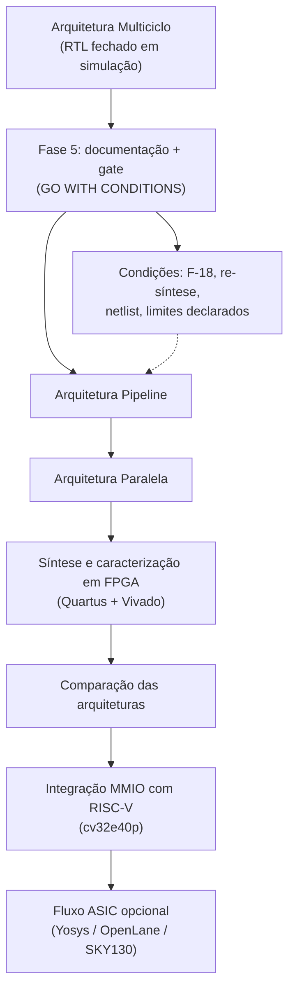

# Status do Projeto

**Última atualização:** 08/11/2026

> Este documento é um painel curto. Decisões, evidências e raciocínio completo ficam em `RESUMO_ESTADO_PROJETO.md`, `docs/ARQUITETURA_*.md` e `docs/AUDITORIA_*.md`.

---

## Resumo

### Etapa atual

**Fechamento formal da arquitetura multiciclo (Fase 5: documentação e gate).**

O RTL do multiciclo está **funcionalmente fechado em simulação**. Os bugs F-16 (corrida de latência entre `line_buffer_2line` e `window_3x3`) e F-17 (janelas espúrias a cada frame) foram corrigidos na fonte e validados. O que resta são **condições** do gate, não bloqueadores funcionais:

| Condição | Natureza |
|---|---|
| Restaurar 3 testes removidos de `test_window_3x3.py` (F-18; removidos no commit `d5aa31a`) | Verificação |
| Re-síntese no Quartus (números atuais são anteriores à correção de `mem1`) e decisão do SDC (100 ou 90 MHz) | Síntese |
| Executar `test_postsynth_sobel.py` na netlist (sem registro de execução) | Verificação |
| Limites de verificação declarados (frame cheio: 2 frames, `stall=0`; stall só em W ≤ 8) | Escopo |

### Próximo marco

#### 🎯 Emitir o gate "multiciclo fechado" e iniciar a arquitetura Pipeline

1. ~~Consolidar `sobel_multicycle.sv`~~ — feito.
2. ~~Teste de integração ponta a ponta~~ — feito (golden, stalls, multi-frame, frame 640×480).
3. ~~Corrigir F-16 e F-17~~ — feito, na fonte.
4. ~~Validar múltiplos frames consecutivos~~ — feito (`test_four_consecutive_frames`, `test_f17_cyclic_discard`).
5. ~~Mitigar perda de dado sob rajada~~ — **obsoleto**: o gating A3 serializa as entregas; medido `max_u_skid = max_u_lw_skid = 2`, overflow 0.
6. ~~Monitor de integridade `o_status`~~ — feito.
7. ~~Cobertura de código~~ — feito (code 425/426, toggle 3596/3599).
8. **Atualizar documentação e auditoria** — em andamento (`ARQUITETURA_MULTICICLO.md` v2.0 entregue; falta este `STATUS.md`, `AUDITORIA_01`, `ESPECIFICACAO_SOBEL.md`).
9. **Gate formal** — "GO WITH CONDITIONS" (ver `docs/AUDITORIA_01_PRE_MULTICICLO.md`).

Após isso:

> **Arquitetura multiciclo → baseline funcional para comparação com as arquiteturas pipeline e paralela.**

---

## Progresso das arquiteturas

| Arquitetura | Estado |
|---|---|
| Multiciclo / Sequencial | 🟢 Funcionalmente fechada em simulação; 🟡 síntese pendente de re-execução |
| Pipeline | ⚪ Não iniciada (planejamento em `docs/ARQUITETURA_PIPELINE.md`, a reescrever) |
| Paralela | ⚪ Não iniciada (planejamento em `docs/ARQUITETURA_PARALELA.md`, a reescrever) |

---

## Arquitetura multiciclo

### Concluído

#### Módulos comuns (`rtl/common/`)

* [x] `line_buffer_2line.sv` (com tags, `i_rearm`, `o_curr` registrado, `mem1` com slot extra)
* [x] `window_3x3.sv` (com `o_ready`, tags e `o_window_valid_geom`)
* [x] `line_window_skid.sv` (FIFO de profundidade 2, fórmula `o_room` v2)
* [x] `abs_saturate.sv`
* [x] `magnitude_l1.sv`

#### Módulos específicos (`rtl/multicycle/`)

* [x] `mac_unit.sv` (0 DSPs por construção)
* [x] `kernel_rom.sv` (com trava ativa `o_addr_valid`)
* [x] `mac_control_fsm.sv` (16 estados, 15 ciclos úteis)
* [x] `skid_fifo2.sv` (profundidade 2, `o_room` A3)
* [x] `sobel_multicycle.sv` (integrador, `win_cnt_r` cíclico, `o_status`)

#### Verificação e infraestrutura

* [x] Testes unitários de todos os módulos (suíte Icarus: **79 passed**)
* [x] Guarda de `$error` em `run_isolated` (contagem exata)
* [x] Multi-frame (F-17), contrato de handshake (contrato A), `o_status`
* [x] Frame 640×480 × 2 (golden OK, `o_status=000`, 9.832.964 ciclos, delta 0 contra o modelo)
* [x] Cobertura: code **425/426**, toggle **3596/3599**, FSM 16/16 estados e 17/17 arcos
* [x] Lint: Verible 0 warnings; Verilator 5.054 `-Wall` 0 warnings
* [x] Síntese no Quartus (Cyclone V): 4.601 ALMs, 6.270 FFs, **0 DSPs**, 3 M10K, Fmax 98,05 MHz

### Em andamento / pendente

* [ ] Documentação: `STATUS.md` (este), `AUDITORIA_01`, `ESPECIFICACAO_SOBEL.md`, menções ao multiciclo em Pipeline/Paralela
* [ ] **F-18:** restaurar `test_multiple_gap_cycles`, `test_sustained_contract_violation_detected` e `test_ready_gating_prevents_manual_gap_calculation` (adaptados às portas de tag)
* [ ] Re-síntese pós-slot-extra; decisão do SDC; `ramstyle` de `skid_fifo2`; `mem2` em MLAB
* [ ] Executar `test_postsynth_sobel.py` na netlist
* [ ] Atualizar o comentário "read-before-write" de `line_buffer_2line.sv` (só comentário)
* [ ] Migrar `COCOTB_TESTCASE` (obsoleto no cocotb 2.1.0)
* [ ] Potência; segundo vendor (Vivado/Artix-7)

---

## Números de referência (multiciclo)

| Métrica | Valor | Observação |
|---|---|---|
| Throughput | 1 pixel / **16 ciclos** | Modelo `16·W·H·F + (2W−1)·F + 6`, medido até 640×480×2 |
| Frame 640×480 | ≈ 4,92 M ciclos (≈ 20 fps @ 100 MHz) | Calculado do modelo, não medido em hardware |
| Fmax | 98,05 MHz, slack −0,199 ns vs 100 MHz | Anterior à correção de `mem1`; caminho crítico em `line_window_skid` |
| DSPs | 0 | Por construção |

---

# Principais decisões técnicas

* Reset assíncrono ativo-baixo (`rst_n`).
* Zero-padding para as 4 bordas (provisório; trocar para replicação ficaria isolado nos módulos comuns).
* Magnitude aproximada pela norma L1: $|G| = |G_x| + |G_y|$.
* Uma única unidade MAC reutilizada; coeficientes ±1/±2 por deslocamento e negação (sem multiplicador).
* `kernel_rom` separado da FSM, com trava ativa além do alarme de simulação.
* **Elasticidade por FIFOs síncronas de saída registrada** (`line_window_skid`, `skid_fifo2`), em vez de handshake combinacional entre módulos síncronos (lição do F-16).
* **Gating A3:** `u_skid` precisa estar vazio para liberar nova entrega. Serializa o fluxo e torna overflow estruturalmente impossível no topo.
* **Descarte da "linha de saída −1" por contador cíclico de janelas** (`win_cnt_r`), e não por tag nem por temporização de fronteira.
* **Tag de 1 bit mantida como rede de segurança**, não como mecanismo de correção.
* **Monitor `o_status` só sinaliza** (sem autocorreção).
* **Contrato A de entrada:** transferência em `i_valid && o_ready`; o produtor mantém `i_valid`/`i_pixel` estáveis até ver `o_ready`.
* Módulos comuns reutilizáveis entre as três arquiteturas.
* Testes de múltiplos frames consecutivos são requisito de validação para todas as arquiteturas.
* **Lições registradas:**
  * Imagens que saturam a saída em 255 mascaram bugs de conteúdo: regressão exige massa de baixo contraste, com guarda `n_sat == 0`.
  * Evidência real antes de qualquer correção (CLAUDE.md §15.11.2); instrumentação sem laço de condução próprio.
  * Em testes com vários lotes, nenhum `await` entre lotes (a fase do driver importa).

---

# Próximas etapas

**Pontos a decidir já no início do Pipeline** (registrados em `RESUMO_ESTADO_PROJETO.md`): contar janelas versus marcar posição (ID de sequência/sideband), reabrir `common/` de forma aditiva (ex.: porta `o_col`), e custo de área do monitor (versão com e sem `o_status`).